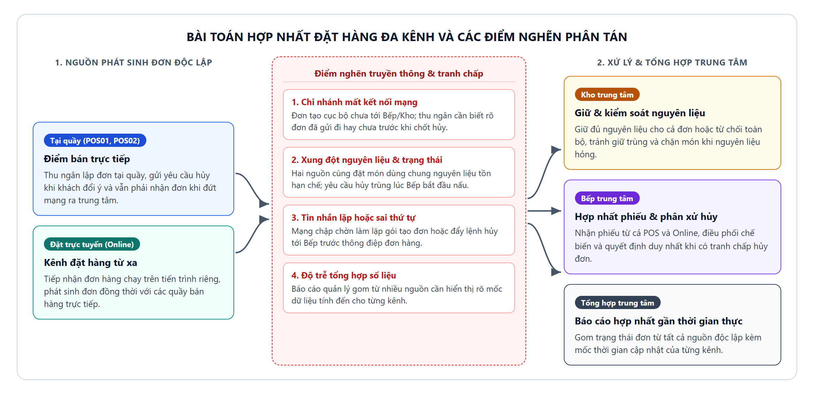

# PHẦN I. NGHIÊN CỨU, KHẢO SÁT YÊU CẦU

## I. HIỆN TRẠNG ĐƠN VỊ

### 1.1. Bối cảnh vận hành đa kênh của chuỗi nhà hàng

Mô hình khảo sát giả định là một chuỗi kinh doanh ẩm thực vận hành đồng thời nhiều điểm bán tại quầy (`POS01`, `POS02`) và một kênh đặt món trực tuyến (`Online`). Khác với mô hình quán ăn đơn lẻ đặt bếp ngay sau quầy thu ngân, chuỗi tổ chức **một Bếp trung tâm** phụ trách chế biến và **một Kho nguyên liệu dùng chung** cấp phát cho toàn hệ thống. Các điểm bán tại quầy và kênh trực tuyến đóng vai trò tiếp nhận đơn đặt hàng, theo dõi tiến độ phục vụ và phản hồi trạng thái cho khách hàng, còn toàn bộ khâu kiểm tra tồn kho và nấu món được gom về cụm xử lý trung tâm.

Cơ chế tách rời điểm nhận đơn khỏi nơi chế biến giúp tối ưu chi phí mặt bằng và chuẩn hóa chất lượng món ăn giữa các kênh. Tuy nhiên, khi cả đơn hàng tại quầy lẫn đơn trực tuyến cùng đổ về một kho và một bếp qua hạ tầng mạng phân tán, quy trình vận hành hằng ngày phát sinh nhiều điểm nghẽn liên quan đến tính đồng bộ và tranh chấp tài nguyên.

### 1.2. Quy trình nghiệp vụ và các vấn đề phân tán phát sinh

Trong chu trình xử lý tiêu chuẩn, đơn hàng phát sinh từ thu ngân tại quầy hoặc từ khách đặt trực tuyến được chuyển tới Kho để kiểm tra và giữ đủ nguyên liệu cho toàn bộ các món trong đơn, hoặc từ chối nếu thiếu hàng. Đơn đã giữ nguyên liệu thành công mới chuyển tiếp thành phiếu chế biến tại Bếp trung tâm để nhân viên bếp bắt đầu nấu và hoàn tất, hoặc từ chối khi gặp sự cố thiết bị hay nguyên liệu hỏng. Kết quả từ Kho và Bếp được trả ngược về đúng kênh đã tạo đơn để thông báo cho thu ngân hoặc khách hàng, đồng thời được tổng hợp phục vụ công tác điều hành của quản lý.

Phân tách các kênh bán hàng, Kho và Bếp thành những tiến trình và nút mạng độc lập làm phát sinh bốn nhóm vấn đề kỹ thuật chính như minh họa trên Hình 1.1.

Trước hết là tình huống mất kết nối tạm thời tại điểm bán. Khi quầy thu ngân mất mạng ra cụm trung tâm, thu ngân vẫn phải tiếp nhận đơn mới cho khách tại chỗ thay vì ngừng bán, nhưng chưa thể biết Bếp đã nhận đơn hay chưa để trả lời khi khách yêu cầu hủy. Thứ hai là xung đột tài nguyên đồng thời: hai đơn phát sinh cùng lúc từ `POS` và `Online` có thể cùng yêu cầu một nguyên liệu chỉ còn đủ cho một phần, hoặc thao tác hủy đơn từ điểm bán xảy ra song song với thời điểm nhân viên Bếp bấm bắt đầu nấu.

Bên cạnh đó, truyền thông qua mạng không ổn định dễ làm gói tin bị gửi lặp hoặc đến sai thứ tự, chẳng hạn yêu cầu hủy tới Bếp trước cả thông điệp tạo đơn từ Kho. Cuối cùng, số liệu tổng hợp phục vụ quản lý gom từ nhiều nguồn độc lập luôn có độ trễ nhất định, đòi hỏi báo cáo phải chỉ rõ thời điểm dữ liệu mới nhất được cập nhật từ từng kênh bán hàng.

## II. HIỆN TRẠNG THỊ TRƯỜNG VỀ GIẢI PHÁP TRONG VÀ NGOÀI NƯỚC

### 2.1. Các giải pháp quản lý bán hàng và nhà hàng phổ biến

Nhóm phần mềm F&B phổ biến tại Việt Nam gồm `KiotViet`, `Sapo FnB`, `MISA CukCuk` và `iPOS` đều hỗ trợ quy trình bán hàng tại quầy, quản lý định lượng kho và kết nối đặt món đa kênh. Để ứng phó với sự cố đường truyền internet, `KiotViet` [1], `Sapo FnB` [2] và `MISA CukCuk` [3] cung cấp chế độ hoạt động ngoại tuyến cho phép thu ngân tiếp tục tạo hóa đơn cục bộ và tự động đồng bộ dữ liệu lên máy chủ đám mây khi mạng phục hồi; riêng `MISA CukCuk` cho phép triển khai máy chủ nội bộ cố định để các thiết bị trong cùng mạng LAN trao đổi đơn với quầy bếp [4]. Sản phẩm `iPOS` tập trung vào quản trị chuỗi thương hiệu và kho trung tâm [5], song tài liệu công khai không trình bày rõ cam kết xử lý khi từng điểm bán mất kết nối độc lập.

Ở thị trường quốc tế, `Toast` [6], [7], `Square for Restaurants` [8] và `Lightspeed Restaurant` [9] cũng giải quyết bài toán mất kết nối internet theo hướng duy trì bán hàng tại chỗ. `Toast` chỉ định một thiết bị cố định trong mạng nội bộ làm trạm trung chuyển cục bộ để quầy thu ngân tiếp tục gửi phiếu xuống màn hình bếp trong quán khi mất internet, trong khi kênh đặt món trực tuyến tạm dừng [6], [7]. `Square` lưu tạm giao dịch thẻ ngoại tuyến tối đa 24 giờ để tải lên sau [8], còn `Lightspeed` duy trì liên lạc giữa máy tính tiền và màn hình bếp thông qua bộ định tuyến nội bộ tại từng cửa hàng [9].

### 2.2. Đối chiếu theo bài toán chuỗi bếp và kho trung tâm

Mối tương quan giữa các giải pháp thương mại hiện có với yêu cầu đặc thù của chuỗi đặt hàng đa kênh dùng chung Bếp và Kho trung tâm được tổng hợp trong Bảng 1.1.

*Bảng 1.1. Đối chiếu các giải pháp thị trường theo yêu cầu chuỗi đặt hàng đa kênh hợp nhất*

| Giải pháp | Nguồn tham chiếu | Bán khi mất internet | Điều phối Bếp/Kho chung qua mạng | Cam kết hủy đơn khi lệch mạng | Mốc độ mới dữ liệu báo cáo |
|---|---|---|---|---|---|
| `KiotViet` | [1] | Có (lưu cục bộ, đồng bộ sau) | Thiết kế theo cửa hàng đơn lẻ hoặc đồng bộ đám mây | Không công bố | Không công bố |
| `Sapo FnB` | [2] | Có (Auto Offline tại quầy) | Đồng bộ dữ liệu khi mạng khôi phục | Không công bố | Không công bố |
| `MISA CukCuk` | [3], [4] | Có (qua máy chủ LAN tại quán) | Phụ thuộc mạng nội bộ cùng lớp IP tại quán | Không công bố | Không công bố |
| `iPOS` | [5] | Không có trong tài liệu công khai | Có phân hệ kho và quản lý chuỗi | Không công bố | Không công bố |
| `Toast` | [6], [7] | Có (trạm chuyển tiếp trong mạng nội bộ quán) | Dừng đơn trực tuyến khi mất internet ra ngoài | Không công bố | Không công bố |
| `Square` | [8] | Có (giao dịch ngoại tuyến 24h) | Màn hình bếp phụ thuộc đồng bộ đám mây | Không công bố | Không công bố |
| `Lightspeed` | [9] | Có (chỉ trong LAN cửa hàng) | Dừng trao đổi nếu mất kết nối từ xa | Không công bố | Không công bố |

## III. KẾT LUẬN

Các giải pháp thương mại trong và ngoài nước thể hiện ưu thế rõ rệt về độ hoàn thiện nghiệp vụ thu ngân, thanh toán và khả năng bán hàng liên tục tại một điểm bán nhờ cơ chế lưu đệm cục bộ hoặc trạm trung chuyển nội bộ. Dù vậy, phần lớn các nền tảng này được thiết kế xoay quanh giả định quầy thu ngân và khu vực bếp nằm chung trong một mạng cục bộ tại từng cửa hàng. Khi áp dụng cho bài toán chuỗi có nhiều điểm bán tại quầy và kênh đặt món trực tuyến cùng chia sẻ một Kho nguyên liệu và một Bếp trung tâm qua mạng diện rộng, các công cụ sẵn có chưa nêu rõ cơ chế xử lý ba yêu cầu kỹ thuật cốt lõi: giữ toàn vẹn thao tác nhận và hủy đơn khi từng chi nhánh mất kết nối, giải quyết xung đột nguyên liệu hoặc tranh chấp trạng thái chế biến theo một thứ tự tất định, và hiển thị độ trễ dữ liệu từng kênh trên báo cáo tổng hợp.

Từ khoảng trống thực tế đó, nhóm thực hiện lựa chọn xây dựng **Hệ thống đặt hàng tại quầy và online hợp nhất** theo kiến trúc hướng sự kiện phân tán. Hệ thống tách các nguồn phát sinh đơn (`POS01`, `POS02`, `Online`) thành các dịch vụ độc lập có cơ sở dữ liệu riêng, giao tiếp bất đồng bộ với dịch vụ Kho và Bếp trung tâm qua hàng đợi thông điệp kết hợp mẫu Outbox và kiểm soát chống trùng, đồng thời nhân bản dữ liệu phục vụ tổng hợp gần thời gian thực. Cấu trúc thiết kế chi tiết và mô hình kiểm soát xung đột được trình bày tiếp trong Phần II.

## Tài liệu tham khảo Phần I

1. KiotViet, *Phần mềm quản lý bán hàng cho nhà hàng, quán ăn*. Truy cập tại: https://www.kiotviet.vn/
2. Sapo, *Tính năng Auto Offline – Vận hành nhà hàng, quán ăn ổn định khi internet gặp sự cố*. Truy cập tại: https://www.sapo.vn/cap-nhat-tinh-nang/tinh-nang-auto-offline
3. MISA CukCuk, *Trang chủ phần mềm quản lý nhà hàng MISA CukCuk*. Truy cập tại: https://www.cukcuk.vn/
4. MISA CukCuk, *Tài liệu hướng dẫn chế độ làm việc ngoại tuyến*. Truy cập tại: https://helpv2.cukcuk.com/en/?p=22858
5. iPOS.vn, *Giới thiệu hệ sinh thái sản phẩm quản lý F&B*. Truy cập tại: https://ipos.vn/en/san-pham/
6. Toast, *Use Toast in Offline Mode*. Truy cập tại: https://support.toasttab.com/en/article/Using-Toast-in-Offline-Mode
7. Toast, *KDS devices in Offline Mode*. Truy cập tại: https://doc.toasttab.com/doc/platformguide/platformOfflineKDSDevices.html
8. Square, *Offline payments time limits*. Truy cập tại: https://squareup.com/help/us/en/article/8106-offline-payments-time-limits
9. Lightspeed, *Offline POS functionality (K-Series)*. Truy cập tại: https://k-series-support.lightspeedhq.com/hc/en-us/articles/53028167251867-Offline-POS-functionality
