# PHẦN II. NGHIÊN CỨU, PHÂN TÍCH THIẾT KẾ HỆ THỐNG

## MÔ HÌNH HLD CỦA HỆ THỐNG

Hệ thống gồm các chi nhánh nhận đơn (POS tại quầy, kênh Online), một Kho dùng chung và một Bếp trung tâm. Các bên chỉ trao đổi với nhau qua Kafka; mỗi dịch vụ có CSDL riêng. Báo cáo quản lý đọc một bản sao tập trung của các CSDL đơn hàng ở chi nhánh.

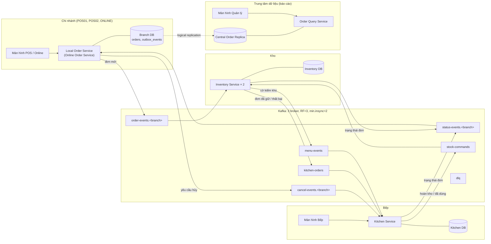

| Thành phần | Vai trò |
|---|---|
| Local Order Service (mỗi chi nhánh POS một instance), Online Order Service | Nhận đơn và yêu cầu hủy, kể cả khi mất mạng; ghi đơn và tin cần gửi trong cùng một giao dịch vào Branch DB (outbox), gửi lên Kafka khi có mạng; áp dụng trạng thái nhận về theo thứ hạng |
| Kafka (3 broker) | Truyền mọi tin giữa các bên, at-least-once. Mỗi chi nhánh có topic riêng (`order-events`, `cancel-events`, `status-events`), cộng các topic nội bộ `kitchen-orders`, `stock-commands`, `menu-events`, `dlq` |
| Inventory Service (2 instance) và Inventory DB | Giữ nguyên liệu cho đơn hoặc trả Thất bại; hoàn kho, ghi hao hụt, ghi nhận đã dùng; cờ kiểm kho |
| Kitchen Service và Kitchen DB | Phiếu bếp; nút Bắt đầu nấu, Từ chối, Hoàn tất; bên duy nhất quyết định hủy đơn đã gửi đi |
| Central Order Replica, Order Query Service | Bản sao tập trung các bảng `orders` của chi nhánh (logical replication), phục vụ báo cáo có mốc "dữ liệu tính đến" |
| Các màn hình (`frontend`) | Chỉ gọi API của các dịch vụ, không tự suy ra trạng thái |

Các nguyên tắc chung: mỗi tin có `event_id` để chống trùng (`processed_events`); tin gửi đi được ghi vào `outbox_events` trong cùng giao dịch với thay đổi trạng thái; consumer tắt auto-commit và chỉ commit offset sau khi commit DB; tin hỏng chuyển vào `dlq` mà không chặn các đơn khác.

## I. DANH SÁCH CHỨC NĂNG PHẦN MỀM

| TT | Tên module | Tên usecase | Giao dịch (Transaction) | Tên tác nhân chính |
|---|---|---|---|---|
| | **Đặt món tại chi nhánh** (Local Order Service, Online Order Service) | | | |
| 1 | | Đặt đơn | Xem danh mục món (`GET /dishes`) | Thu ngân, khách hàng online |
| | | | Tạo đơn (`POST /orders`) | |
| 2 | | Hủy đơn | Yêu cầu hủy đơn (`POST /orders/{id}/cancel`) | Thu ngân, khách hàng online |
| 3 | | Theo dõi đơn | Xem danh sách đơn và trạng thái (`GET /orders`, `GET /orders/{id}`) | Thu ngân, khách hàng online |
| 4 | | Giám sát chi nhánh | Xem kết nối, số tin chờ gửi, cảnh báo (`GET /monitor`) | Thu ngân |
| 5 | | Đồng bộ đơn với Kho và Bếp | Gửi hàng chờ (outbox) lên Kafka | Local Order Service (tự động) |
| | | | Áp dụng trạng thái đơn nhận về theo thứ hạng | |
| 6 | | Nhân bản đơn về trung tâm | Ghi nhịp `replication_heartbeat` mỗi 5 giây | Local Order Service (tự động) |
| 7 | | Xem tình trạng món (đợt 2) | Xem menu kèm trạng thái Còn, Hết, Ẩn (`GET /menu`) | Thu ngân, khách hàng online |
| | **Kho** (Inventory Service) | | | |
| 8 | | Giữ nguyên liệu cho đơn | Nhận đơn mới, giữ nguyên liệu hoặc trả Thất bại (`OrderCreated`) | Inventory Service (tự động) |
| 9 | | Xử lý lệnh của Bếp | Hoàn kho hoặc ghi hao hụt (`ReleaseRequested`) | Inventory Service (tự động) |
| | | | Ghi nhận nguyên liệu đã dùng (`StockConsumed`) | |
| 10 | | Quản lý tồn kho | Xem tồn kho (`GET /stock`) | Nhân viên kho |
| | | | Nhập kho (`POST /stock/receipts`) | |
| | | | Xác nhận kiểm kho xong (`POST /ingredients/{id}/clear-check`) | |
| 11 | | Theo dõi cảnh báo kho | Xem cảnh báo (`GET /alerts`), xem độ trễ consumer (`GET /monitor`) | Nhân viên kho |
| 12 | | Công bố tình trạng món (đợt 2) | Gửi `DishStatusChanged`, heartbeat; cung cấp snapshot (`GET /menu/snapshot`) | Inventory Service (tự động) |
| | **Bếp** (Kitchen Service) | | | |
| 13 | | Xử lý phiếu bếp | Xem danh sách phiếu và cảnh báo (`GET /tickets`) | Nhân viên bếp |
| | | | Bắt đầu nấu (`POST /tickets/{order_id}/start`) | |
| | | | Từ chối phiếu (`POST /tickets/{order_id}/reject`) | |
| | | | Hoàn tất (`POST /tickets/{order_id}/complete`) | |
| 14 | | Nhận đơn và yêu cầu hủy | Nhận đơn đã giữ hoặc thất bại từ Kho (`OrderReserved`, `OrderFailed`) | Kitchen Service (tự động) |
| | | | Quyết định yêu cầu hủy (`CancelRequested`) | |
| | | | Nhận cờ kiểm kho (`IngredientCheckChanged`) | |
| 15 | | Theo dõi cảnh báo bếp | Xem cảnh báo (`GET /alerts`), xem độ trễ consumer (`GET /monitor`) | Nhân viên bếp |
| | **Báo cáo quản lý** (Order Query Service) | | | |
| 16 | | Xem báo cáo tổng hợp | Xem số đơn theo trạng thái và lý do, mốc "dữ liệu tính đến" của từng chi nhánh (`GET /reports/summary`) | Quản lý |

## II. THIẾT KẾ CHỨC NĂNG PHẦN MỀM

Mục này có thẻ use case cho các giao dịch đã xây dựng: Kho, Bếp, chi nhánh và báo cáo quản lý. Các giao dịch về tình trạng món được bổ sung ở đợt 2.

### 1. Kho - module

#### 1.1. Giữ nguyên liệu cho đơn - use case

##### 1.1.1. Nhận đơn mới, giữ nguyên liệu hoặc trả Thất bại - giao dịch

- **Tên Usecase:** Nhận đơn mới, giữ nguyên liệu hoặc trả Thất bại
- **Mô tả Usecase:** Chức năng cho phép Inventory Service nhận đơn mới từ chi nhánh và giữ đủ nguyên liệu cho cả đơn, hoặc trả Thất bại kèm lý do.
- **Tác nhân chính:** Inventory Service (tự động, khi có tin `OrderCreated` trên `order-events.<branch>`)
- **Tác nhân phụ:** Kitchen Service, chi nhánh gốc (nhận kết quả)
- **Điều kiện bắt đầu (Pre-Condition):** chi nhánh đã gửi đơn lên Kafka; tin chưa từng được xử lý (`event_id` chưa có trong `processed_events`).
- **Điều kiện kết thúc (Post-Condition):** đơn có đúng một bản ghi trong `inventory_orders` (`DANG_GIU` hoặc `THAT_BAI`); kết quả nằm trong `outbox_events` để gửi đi.
- **Trình tự các sự kiện:**
  1. Ghi `event_id` vào `processed_events`; nếu đã có thì bỏ qua tin.
  2. Nếu đơn đã có bản ghi (gửi lại), trả lại kết quả cũ cho chi nhánh gốc và dừng.
  3. Kiểm tra dữ liệu đơn; sai thì ghi Thất bại `INVALID_ORDER_DATA`.
  4. Kiểm tra giờ tạo: quá X giờ thì `ORDER_EXPIRED`, ở tương lai quá dung sai thì `FUTURE_CREATION_TIME`.
  5. Có món không có công thức thì `NO_RECIPE`.
  6. Khóa các dòng `stock` của đơn theo thứ tự mã nguyên liệu; có nguyên liệu đang chờ kiểm kho thì `AWAITING_STOCK_CHECK`, thiếu thì `INSUFFICIENT_INGREDIENTS`.
  7. Đủ thì trừ `available`, cộng `reserved`, ghi từng dòng `inventory_reservations`, chuyển `DANG_GIU`.
  8. Ghi kết quả vào outbox: `OrderReserved` hoặc `OrderFailed` tới `kitchen-orders` và `status-events.<chi nhánh gốc>`; commit, rồi commit offset.
- **Các yêu cầu phi chức năng:** giữ đủ hoặc không giữ gì (BR1); hai instance chạy song song không làm kho âm (kịch bản 42); gửi lại không giữ lần hai (BR12).
- **Biểu đồ hoạt động:**

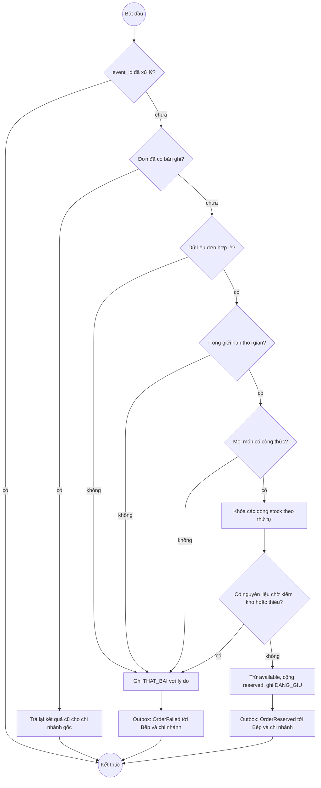

#### 1.2. Xử lý lệnh của Bếp - use case

##### 1.2.1. Hoàn kho hoặc ghi hao hụt - giao dịch

- **Tên Usecase:** Hoàn kho hoặc ghi hao hụt
- **Mô tả Usecase:** Chức năng cho phép Inventory Service hoàn nguyên liệu của một đơn khi Bếp hủy hoặc từ chối, và ghi hao hụt nguyên liệu bị báo hỏng.
- **Tác nhân chính:** Inventory Service (tự động, tin `ReleaseRequested` trên `stock-commands`)
- **Tác nhân phụ:** Kitchen Service (gửi lệnh)
- **Điều kiện bắt đầu:** Bếp đã hủy hoặc từ chối đơn và ghi lệnh hoàn kho vào outbox của Bếp.
- **Điều kiện kết thúc:** nếu bản ghi đang `DANG_GIU`: chuyển `DA_TRA`, mỗi dòng giữ được đóng đúng một lần (`DA_HOAN` hoặc `HAO_HUT`); ngược lại kho không đổi.
- **Trình tự các sự kiện:**
  1. Chuyển bản ghi từ `DANG_GIU` sang `DA_TRA` bằng một câu UPDATE có điều kiện.
  2. Không đổi được: bản ghi đã `DA_TRA` hoặc `DA_DUNG` thì bỏ qua (tin trùng); không có bản ghi hoặc `THAT_BAI` thì ghi cảnh báo `LENH_KHONG_KHOP` và không cộng kho.
  3. Với từng dòng giữ: nếu lý do là `SPOILED_INGREDIENT` và nguyên liệu nằm trong danh sách hỏng thì chuyển lượng giữ sang `wasted` và bật `needs_check`; còn lại thì cộng lại `available`. Lượng hoàn là lượng đã ghi lúc giữ, không tính lại theo công thức.
  4. Mỗi nguyên liệu vừa bị bật cờ: lấy version mới từ `menu_version`, ghi `IngredientCheckChanged` tới `menu-events` cho Bếp.
- **Các yêu cầu phi chức năng:** lệnh tới nhiều lần chỉ cộng kho một lần (kịch bản 5); Kho tắt khi Bếp từ chối thì hoàn đúng một lần khi bật lại (kịch bản 4).
- **Biểu đồ hoạt động:**

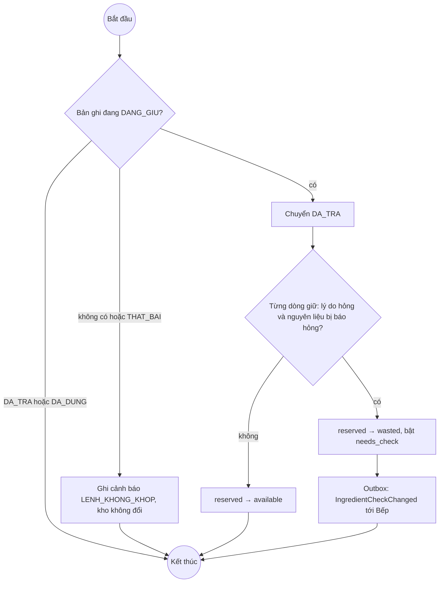

##### 1.2.2. Ghi nhận nguyên liệu đã dùng - giao dịch

- **Tên Usecase:** Ghi nhận nguyên liệu đã dùng
- **Mô tả Usecase:** Chức năng cho phép Inventory Service chuyển lượng đang giữ của một đơn sang đã dùng khi Bếp bắt đầu nấu.
- **Tác nhân chính:** Inventory Service (tự động, tin `StockConsumed` trên `stock-commands`)
- **Tác nhân phụ:** Kitchen Service
- **Điều kiện bắt đầu:** nhân viên bếp đã bấm Bắt đầu nấu.
- **Điều kiện kết thúc:** bản ghi `DA_DUNG`; `reserved` giảm, `consumed` tăng đúng lượng đã giữ; `available` không đổi.
- **Trình tự các sự kiện:** như giao dịch 1.2.1 bước 1–2 với trạng thái đích `DA_DUNG`; sau đó với từng dòng: `reserved` giảm q, `consumed` tăng q, dòng giữ đóng là `DA_DUNG`.
- **Các yêu cầu phi chức năng:** không trừ kho lần hai (kịch bản 43).
- **Biểu đồ hoạt động:**

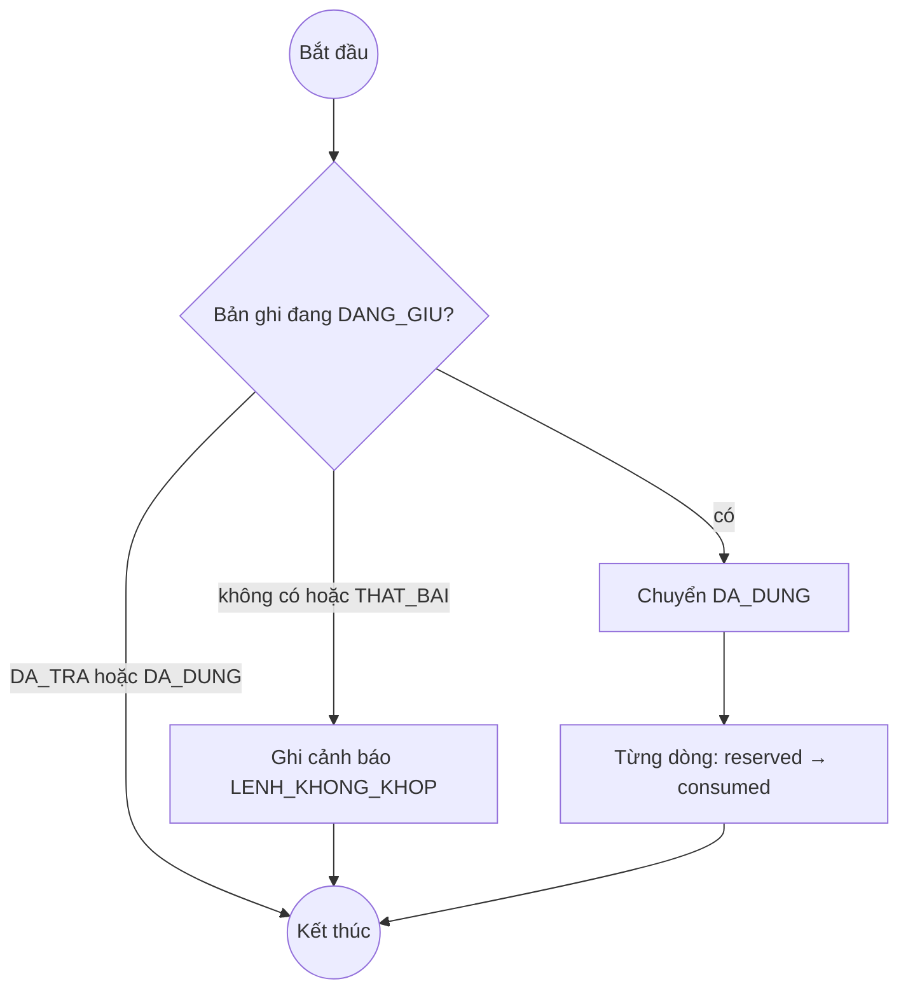

#### 1.3. Quản lý tồn kho - use case

##### 1.3.1. Xem tồn kho - giao dịch

- **Tên Usecase:** Xem tồn kho
- **Mô tả Usecase:** Chức năng cho phép nhân viên kho xem bốn đại lượng của từng nguyên liệu (`available`, `reserved`, `consumed`, `wasted`) và cờ kiểm kho.
- **Tác nhân chính:** Nhân viên kho. **Tác nhân phụ:** không có.
- **Điều kiện bắt đầu:** Inventory Service đang chạy. **Điều kiện kết thúc:** không có.
- **Trình tự các sự kiện:** 1. Nhân viên mở màn hình Kho. 2. Màn hình gọi `GET /stock`. 3. Hệ thống trả danh sách nguyên liệu theo mã.
- **Các yêu cầu phi chức năng:** không.
- **Biểu đồ hoạt động:**

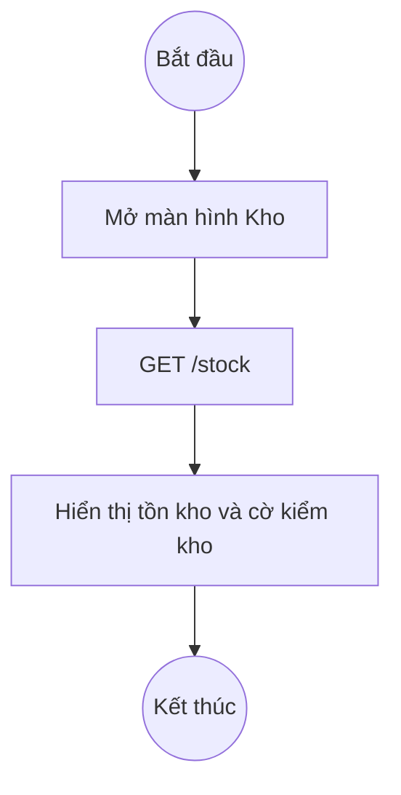

##### 1.3.2. Nhập kho - giao dịch

- **Tên Usecase:** Nhập kho
- **Mô tả Usecase:** Chức năng cho phép nhân viên kho cộng thêm số lượng vào tồn kho khả dụng của một nguyên liệu.
- **Tác nhân chính:** Nhân viên kho. **Tác nhân phụ:** không có.
- **Điều kiện bắt đầu:** nguyên liệu đã có trong `stock`. **Điều kiện kết thúc:** `available` tăng đúng số lượng nhập; cờ kiểm kho không đổi.
- **Trình tự các sự kiện:** 1. Nhân viên chọn nguyên liệu, nhập số lượng. 2. Màn hình gọi `POST /stock/receipts`. 3. Hệ thống kiểm tra số lượng dương (sai: 422), nguyên liệu tồn tại (không: 404). 4. Cộng `available`, commit, trả dòng tồn kho mới.
- **Các yêu cầu phi chức năng:** không.
- **Biểu đồ hoạt động:**

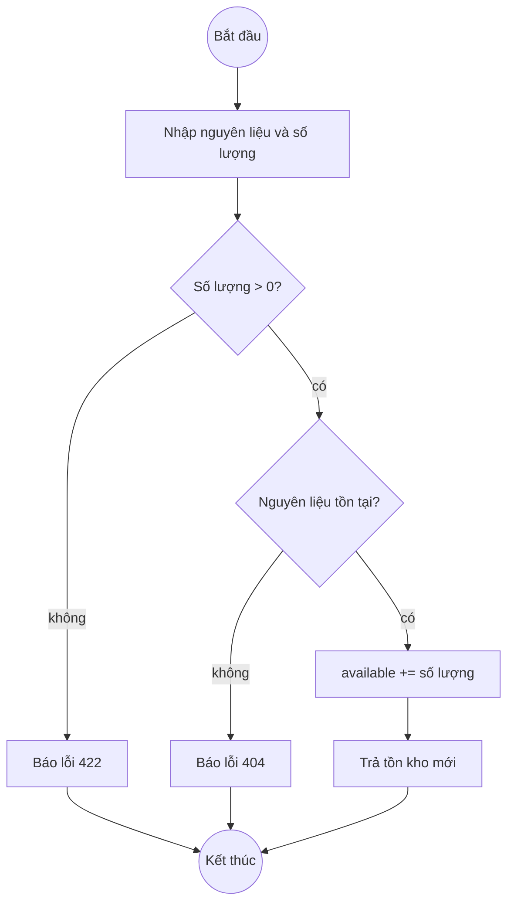

##### 1.3.3. Xác nhận kiểm kho xong - giao dịch

- **Tên Usecase:** Xác nhận kiểm kho xong
- **Mô tả Usecase:** Chức năng cho phép nhân viên kho gỡ cờ kiểm kho của một nguyên liệu sau khi kiểm, và tùy chọn nhập lượng tồn thực tế đếm được.
- **Tác nhân chính:** Nhân viên kho. **Tác nhân phụ:** Kitchen Service (nhận tin gỡ cờ).
- **Điều kiện bắt đầu:** nguyên liệu bị bật cờ sau khi Bếp báo hỏng. **Điều kiện kết thúc:** `needs_check` tắt; nếu có `counted_on_hand` thì `available = counted_on_hand − reserved`; Bếp được báo để gỡ cảnh báo trên phiếu; đơn mới dùng nguyên liệu này lại được giữ.
- **Trình tự các sự kiện:** 1. Nhân viên chọn nguyên liệu, nhập lượng đếm được (nếu có). 2. Màn hình gọi `POST /ingredients/{id}/clear-check`. 3. Hệ thống khóa dòng `stock`; lượng đếm nhỏ hơn lượng đang giữ thì từ chối (409). 4. Gỡ cờ; nếu cờ đang bật thì lấy version mới và ghi `IngredientCheckChanged` (gỡ cờ) vào outbox. 5. Commit, trả tồn kho mới.
- **Các yêu cầu phi chức năng:** tin gỡ cờ mang version lớn hơn tin bật cờ, Bếp không bị đè bởi tin cũ (kịch bản 48).
- **Biểu đồ hoạt động:**

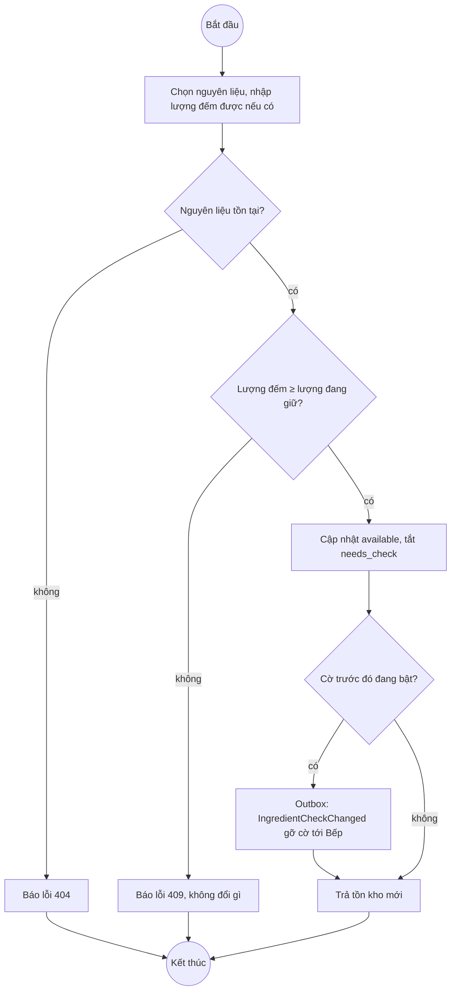

#### 1.4. Theo dõi cảnh báo kho - use case

##### 1.4.1. Xem cảnh báo và độ trễ consumer - giao dịch

- **Tên Usecase:** Xem cảnh báo và độ trễ consumer
- **Mô tả Usecase:** Chức năng cho phép nhân viên kho và người vận hành xem các cảnh báo Luồng D của Kho và biết Kho có đọc tin kịp không. Hệ thống chỉ báo động, không tự sửa dữ liệu.
- **Tác nhân chính:** Nhân viên kho, người vận hành. **Tác nhân phụ:** Kafka (đọc offset của nhóm consumer).
- **Điều kiện bắt đầu:** không có. **Điều kiện kết thúc:** không có.
- **Trình tự các sự kiện:**
  1. `GET /alerts` (lọc được theo `kind`): trả tối đa 100 cảnh báo mới nhất của bảng `alerts`: `CAN_KIEM_TRA` (tin hỏng đã chuyển `dlq`, hoặc đơn cần kiểm tra) và `LENH_KHONG_KHOP` (lệnh hoàn kho hoặc báo đã dùng không khớp bản ghi nào; tồn kho không đổi).
  2. `GET /monitor`: với mỗi topic Kho đọc, hệ thống so offset đã commit của nhóm consumer với offset cuối của partition, trả số tin chưa đọc, thời điểm ghi và tuổi của tin chưa đọc cũ nhất, và đánh dấu `slow` khi tuổi đó quá 5 phút (mục 10 của đặc tả). Không hỏi được Kafka thì `kafka_reachable` là false.
- **Các yêu cầu phi chức năng:** đọc offset không tham gia nhóm consumer, nên không làm nhóm chia lại partition; kết quả giữ 3 giây để màn hình hỏi mỗi 2 giây không dồn lên Kafka.
- **Biểu đồ hoạt động:**

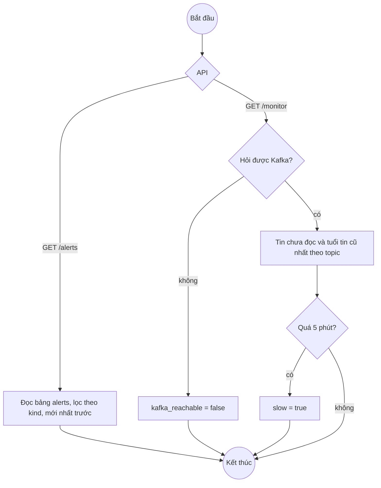

### 2. Bếp - module

#### 2.1. Xử lý phiếu bếp - use case

##### 2.1.1. Xem danh sách phiếu - giao dịch

- **Tên Usecase:** Xem danh sách phiếu
- **Mô tả Usecase:** Chức năng cho phép nhân viên bếp xem các phiếu Chờ nấu và Đang nấu, kèm cảnh báo đỏ trên phiếu Chờ nấu có nguyên liệu đang chờ kiểm kho.
- **Tác nhân chính:** Nhân viên bếp. **Tác nhân phụ:** không có.
- **Điều kiện bắt đầu:** Kitchen Service đang chạy. **Điều kiện kết thúc:** không có.
- **Trình tự các sự kiện:** 1. Nhân viên mở màn hình Bếp. 2. Màn hình gọi `GET /tickets`. 3. Hệ thống trả các phiếu `CHO_NAU`, `DANG_NAU` theo giờ tạo đơn; với phiếu `CHO_NAU`, `warnings` là các nguyên liệu trong `reserved` đang có cờ trong `flagged_ingredients`.
- **Các yêu cầu phi chức năng:** cảnh báo chỉ là cảnh báo, không tự hủy phiếu (Luồng A).
- **Biểu đồ hoạt động:**

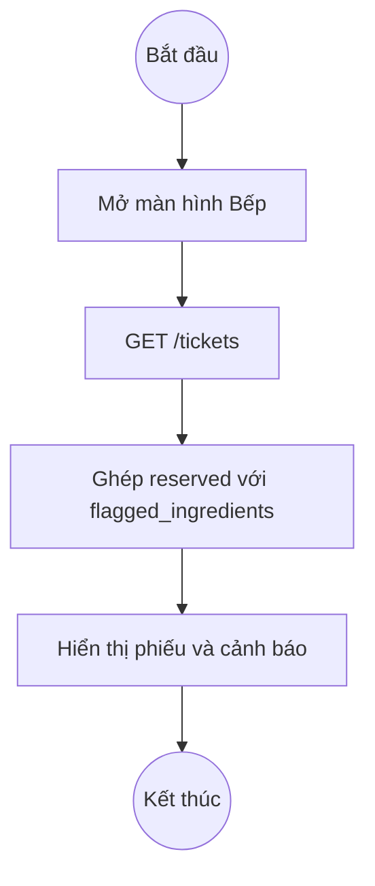

##### 2.1.2. Bắt đầu nấu - giao dịch

- **Tên Usecase:** Bắt đầu nấu
- **Mô tả Usecase:** Chức năng cho phép nhân viên bếp chuyển một phiếu từ Chờ nấu sang Đang nấu.
- **Tác nhân chính:** Nhân viên bếp. **Tác nhân phụ:** Inventory Service (nhận báo đã dùng).
- **Điều kiện bắt đầu:** phiếu đang `CHO_NAU`. **Điều kiện kết thúc:** phiếu `DANG_NAU`; tin `StockConsumed` nằm trong outbox của Bếp.
- **Trình tự các sự kiện:** 1. Nhân viên bấm Bắt đầu nấu. 2. Màn hình gọi `POST /tickets/{order_id}/start`. 3. Hệ thống khóa dòng `kitchen_orders`; không có phiếu thì 404, không còn `CHO_NAU` thì 409 kèm trạng thái hiện tại. 4. Chuyển `DANG_NAU` có điều kiện, ghi `StockConsumed` vào outbox, commit.
- **Các yêu cầu phi chức năng:** bấm đồng thời với Từ chối thì đúng một thao tác thắng (kịch bản 52).
- **Biểu đồ hoạt động:**

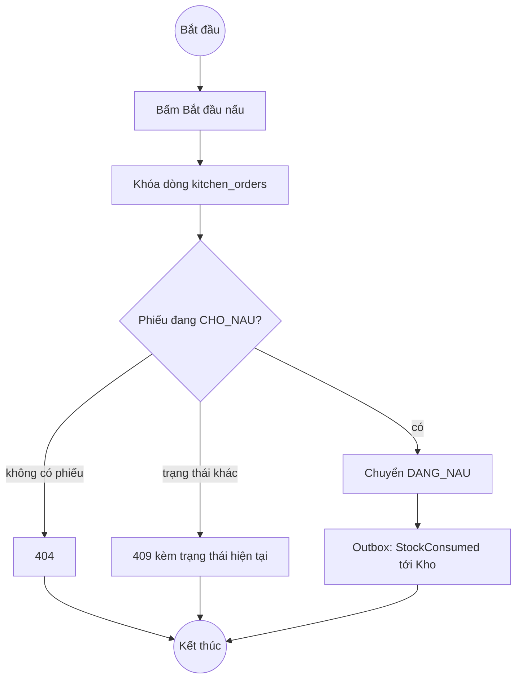

##### 2.1.3. Từ chối phiếu - giao dịch

- **Tên Usecase:** Từ chối phiếu
- **Mô tả Usecase:** Chức năng cho phép nhân viên bếp từ chối một phiếu Chờ nấu với lý do cố định; với lý do nguyên liệu hỏng thì phải chọn nguyên liệu hỏng trong phiếu.
- **Tác nhân chính:** Nhân viên bếp. **Tác nhân phụ:** Inventory Service (nhận lệnh hoàn kho), chi nhánh gốc (nhận Đã hủy).
- **Điều kiện bắt đầu:** phiếu đang `CHO_NAU`. **Điều kiện kết thúc:** phiếu `DA_HUY` (`cancelled_by = KITCHEN`); `OrderCancelled` và `ReleaseRequested` nằm trong outbox trong cùng giao dịch.
- **Trình tự các sự kiện:** 1. Nhân viên chọn lý do (`EQUIPMENT_FAILURE`, `SHORT_STAFFED`, `SPOILED_INGREDIENT`) và nguyên liệu hỏng nếu có. 2. Màn hình gọi `POST /tickets/{order_id}/reject`. 3. Hệ thống kiểm tra lý do và nguyên liệu (sai: 400), khóa phiếu (không có: 404; không còn `CHO_NAU`: 409). 4. Chuyển `DA_HUY`, ghi `OrderCancelled` tới chi nhánh gốc và `ReleaseRequested` tới Kho, commit.
- **Các yêu cầu phi chức năng:** phiếu đang nấu không từ chối được và Kho không nhận lệnh hoàn (kịch bản 50); Kho đang tắt thì chi nhánh vẫn thấy Đã hủy ngay (kịch bản 4).
- **Biểu đồ hoạt động:**

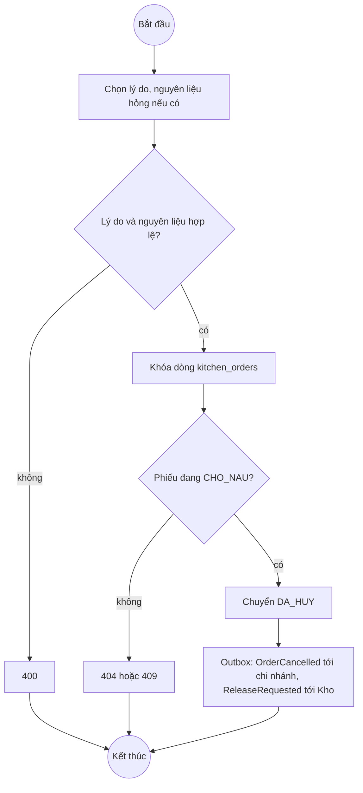

##### 2.1.4. Hoàn tất - giao dịch

- **Tên Usecase:** Hoàn tất
- **Mô tả Usecase:** Chức năng cho phép nhân viên bếp chuyển một phiếu Đang nấu sang Hoàn tất.
- **Tác nhân chính:** Nhân viên bếp. **Tác nhân phụ:** chi nhánh gốc (nhận Hoàn tất).
- **Điều kiện bắt đầu:** phiếu đang `DANG_NAU`. **Điều kiện kết thúc:** phiếu `HOAN_TAT`; `OrderCompleted` nằm trong outbox.
- **Trình tự các sự kiện:** 1. Nhân viên bấm Hoàn tất. 2. Màn hình gọi `POST /tickets/{order_id}/complete`. 3. Hệ thống khóa phiếu (không có: 404; không còn `DANG_NAU`: 409). 4. Chuyển `HOAN_TAT`, ghi `OrderCompleted` tới chi nhánh gốc, commit.
- **Các yêu cầu phi chức năng:** không.
- **Biểu đồ hoạt động:**

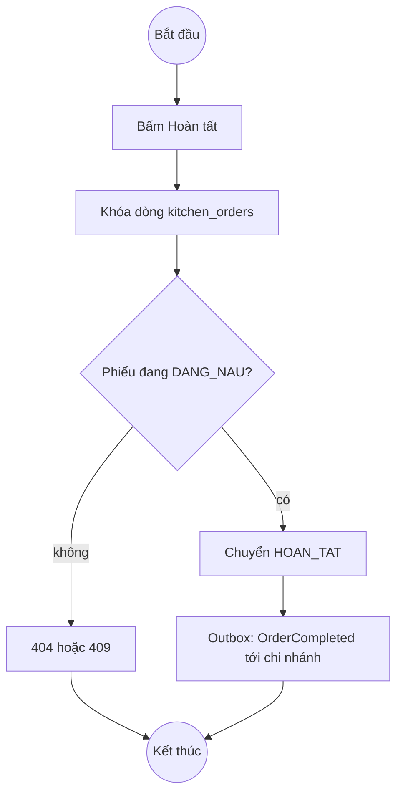

#### 2.2. Nhận đơn và yêu cầu hủy - use case

##### 2.2.1. Nhận đơn đã giữ hoặc thất bại từ Kho - giao dịch

- **Tên Usecase:** Nhận đơn đã giữ hoặc thất bại từ Kho
- **Mô tả Usecase:** Chức năng cho phép Kitchen Service tạo phiếu Chờ nấu cho đơn Kho đã giữ nguyên liệu, và ghi nhận kết quả Thất bại.
- **Tác nhân chính:** Kitchen Service (tự động, tin trên `kitchen-orders`). **Tác nhân phụ:** Inventory Service.
- **Điều kiện bắt đầu:** Kho đã ghi `OrderReserved` hoặc `OrderFailed` vào outbox. **Điều kiện kết thúc:** đơn có đúng một dòng trong `kitchen_orders`.
- **Trình tự các sự kiện:**
  1. Chèn dòng giữ chỗ `CHUA_CO` nếu chưa có, khóa dòng (`SELECT ... FOR UPDATE`).
  2. `OrderReserved`: chưa có bản ghi thì tạo phiếu `CHO_NAU` với `reserved`; bản ghi `HUY_CHO_DON` có chi nhánh gốc trong danh sách yêu cầu hủy thì chuyển `DA_HUY` và gửi lệnh hoàn kho; không có thì bỏ các yêu cầu đó, tạo phiếu và ghi cảnh báo `HUY_SAI_CHI_NHANH`.
  3. `OrderFailed`: chưa có bản ghi hoặc `HUY_CHO_DON` thì ghi `THAT_BAI`.
  4. Đơn đã ở trạng thái kết thúc: trả lại kết quả cũ cho chi nhánh gốc, không gửi lệnh hoàn kho lần hai.
- **Các yêu cầu phi chức năng:** mỗi đơn chỉ một bản ghi (BR8); không bỏ qua tin Thất bại (điều cấm 11).
- **Biểu đồ hoạt động:**

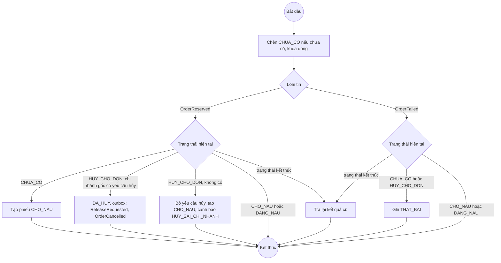

##### 2.2.2. Quyết định yêu cầu hủy - giao dịch

- **Tên Usecase:** Quyết định yêu cầu hủy
- **Mô tả Usecase:** Chức năng cho phép Kitchen Service quyết định một yêu cầu hủy đơn do chi nhánh gửi; Bếp là bên duy nhất quyết định hủy một đơn đã gửi đi (BR7).
- **Tác nhân chính:** Kitchen Service (tự động, tin `CancelRequested` trên `cancel-events.<branch>`). **Tác nhân phụ:** chi nhánh gửi yêu cầu, chi nhánh gốc, Inventory Service (nhận lệnh hoàn kho).
- **Điều kiện bắt đầu (Pre-Condition):** thu ngân hoặc khách hàng đã yêu cầu hủy một đơn mà tin tạo đơn đã được thử gửi (BR9).
- **Điều kiện kết thúc (Post-Condition):** đơn có đúng một dòng trong `kitchen_orders`; câu trả lời cho chi nhánh nằm trong outbox của Bếp.
- **Trình tự các sự kiện:**
  1. Lấy chi nhánh gửi từ tên topic; chèn dòng `CHUA_CO` nếu chưa có, khóa dòng.
  2. Đã biết chi nhánh gốc mà yêu cầu đến từ chi nhánh khác: bỏ qua, không trả lời, ghi cảnh báo `HUY_SAI_CHI_NHANH`.
  3. Chưa có đơn (`CHUA_CO`): tạo bản ghi Chờ hủy `HUY_CHO_DON`, ghi chi nhánh và lý do, trả cam kết `CancelPending` ("bếp sẽ không nấu") cho chi nhánh hỏi. Không bao giờ trả Đã hủy cho đơn chưa tới.
  4. Đang Chờ hủy: thêm chi nhánh mới vào danh sách; yêu cầu lặp lại được trả `CancelPending` lần nữa, lý do đầu tiên được giữ.
  5. Chờ nấu (`CHO_NAU`): chuyển `DA_HUY` (khách hủy), ghi `ReleaseRequested` tới Kho và `OrderCancelled` tới chi nhánh gốc.
  6. Đang nấu hoặc Hoàn tất: giữ nguyên, trả `CancelRejected` ("Không hủy được: bếp đã bắt đầu nấu").
  7. Đã hủy hoặc Thất bại: trả lại kết quả cũ; không bao giờ gửi lệnh hoàn kho lần hai.
- **Các yêu cầu phi chức năng:** hủy và Bắt đầu nấu cùng lúc thì đúng một thao tác thắng (kịch bản 3); hai instance nhận đơn và yêu cầu hủy cùng lúc chỉ tạo một bản ghi (kịch bản 28); Bếp tắt rồi bật lại xử lý đủ mọi tin còn trong Kafka, không mất, không trùng (kịch bản 25).
- **Biểu đồ hoạt động:**

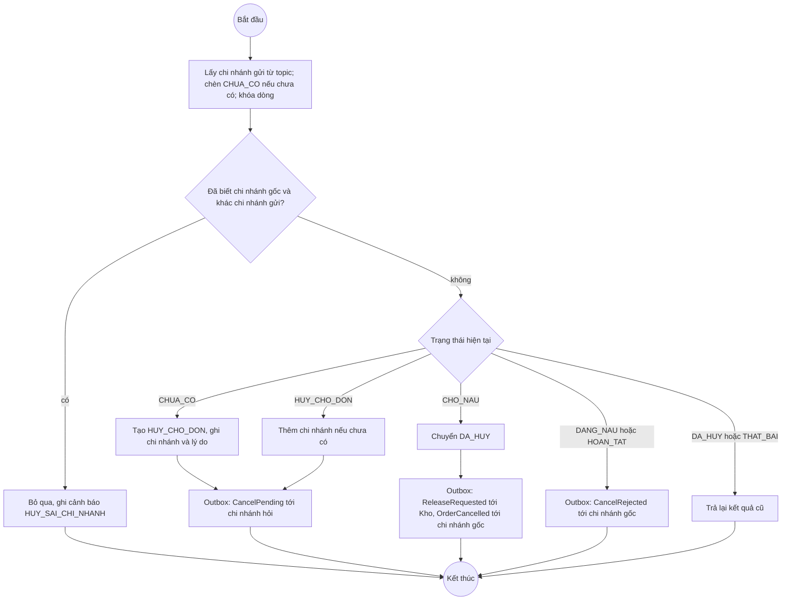

##### 2.2.3. Nhận cờ kiểm kho - giao dịch

- **Tên Usecase:** Nhận cờ kiểm kho
- **Mô tả Usecase:** Chức năng cho phép Kitchen Service ghi nhận nguyên liệu bị bật hoặc gỡ cờ kiểm kho để hiển thị cảnh báo trên phiếu.
- **Tác nhân chính:** Kitchen Service (tự động, tin `IngredientCheckChanged` trên `menu-events`). **Tác nhân phụ:** Inventory Service.
- **Điều kiện bắt đầu:** Kho bật hoặc gỡ cờ một nguyên liệu. **Điều kiện kết thúc:** `flagged_ingredients` giữ trạng thái có version lớn nhất đã nhận.
- **Trình tự các sự kiện:** 1. Đọc `ingredient_id`, `needs_check`, `epoch`, `seq`. 2. Ghi đè dòng của nguyên liệu chỉ khi (`epoch`, `seq`) mới lớn hơn. 3. Commit; danh sách phiếu lần sau hiển thị cảnh báo theo cờ mới.
- **Các yêu cầu phi chức năng:** tin đến muộn với version nhỏ hơn không đè tin mới hơn.
- **Biểu đồ hoạt động:**

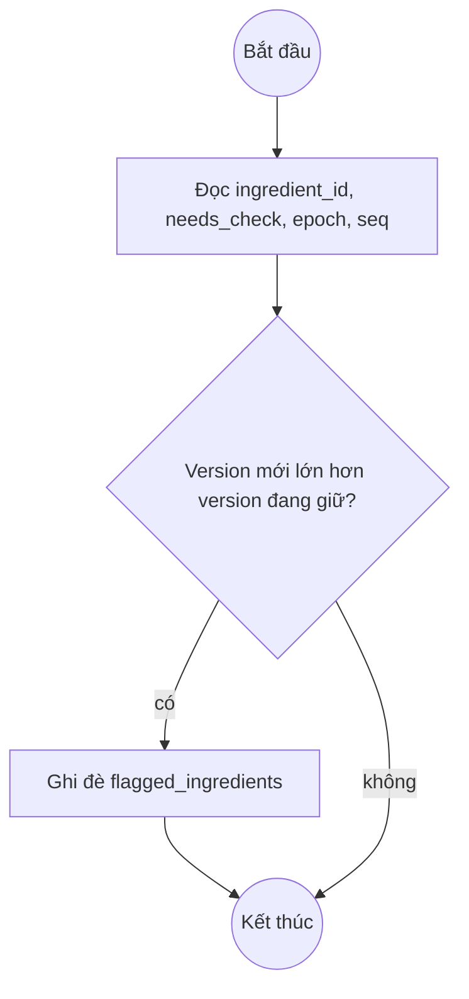

#### 2.3. Theo dõi cảnh báo bếp - use case

##### 2.3.1. Xem cảnh báo và độ trễ consumer - giao dịch

- **Tên Usecase:** Xem cảnh báo và độ trễ consumer
- **Mô tả Usecase:** Chức năng cho phép nhân viên bếp và người vận hành xem các cảnh báo Luồng D của Bếp và biết Bếp có đọc tin kịp không.
- **Tác nhân chính:** Nhân viên bếp, người vận hành. **Tác nhân phụ:** Kafka.
- **Điều kiện bắt đầu:** không có. **Điều kiện kết thúc:** không có.
- **Trình tự các sự kiện:**
  1. `GET /alerts` (lọc được theo `kind`): tối đa 100 cảnh báo mới nhất: `CAN_KIEM_TRA` (tin hỏng, đơn cần kiểm tra) và `HUY_SAI_CHI_NHANH` (yêu cầu hủy đến từ một chi nhánh không phải chi nhánh gốc của đơn; Bếp bỏ qua yêu cầu đó).
  2. `GET /monitor`: như giao dịch 1.4.1, cho các topic Bếp đọc (`kitchen-orders`, `cancel-events.*`, `menu-events`).
- **Các yêu cầu phi chức năng:** như giao dịch 1.4.1; yêu cầu hủy sai chi nhánh bị bỏ qua, phiếu của chi nhánh gốc vẫn vào Chờ nấu, và có cảnh báo (kịch bản 34).
- **Biểu đồ hoạt động:** như giao dịch 1.4.1, với các loại cảnh báo của Bếp.

### 3. Đặt món tại chi nhánh - module

POS01, POS02 và Online chạy cùng một mã nguồn (Local Order Service, Online Order Service), phân biệt bằng `BRANCH_ID`. Chi nhánh chỉ tự quyết định trạng thái trong một trường hợp: hủy một đơn mà tin tạo đơn chưa từng được thử gửi (BR9).

#### 3.1. Đặt đơn - use case

##### 3.1.1. Xem danh mục món - giao dịch

- **Tên Usecase:** Xem danh mục món
- **Mô tả Usecase:** Chức năng cho phép thu ngân hoặc khách hàng online xem danh mục món để chọn khi đặt đơn.
- **Tác nhân chính:** Thu ngân, khách hàng online. **Tác nhân phụ:** không có.
- **Điều kiện bắt đầu:** dịch vụ chi nhánh đã khởi động; mỗi lần khởi động nạp (thêm hoặc cập nhật) danh mục từ `backend/seed/menu.json` vào bảng `dishes`. **Điều kiện kết thúc:** không có.
- **Trình tự các sự kiện:** 1. Mở màn hình đặt món. 2. Màn hình gọi `GET /dishes`. 3. Hệ thống trả các món trong `dishes` của chính chi nhánh.
- **Các yêu cầu phi chức năng:** vẫn trả lời khi chi nhánh mất kết nối Kafka (kịch bản 10), vì chỉ đọc CSDL của chi nhánh.
- **Biểu đồ hoạt động:**

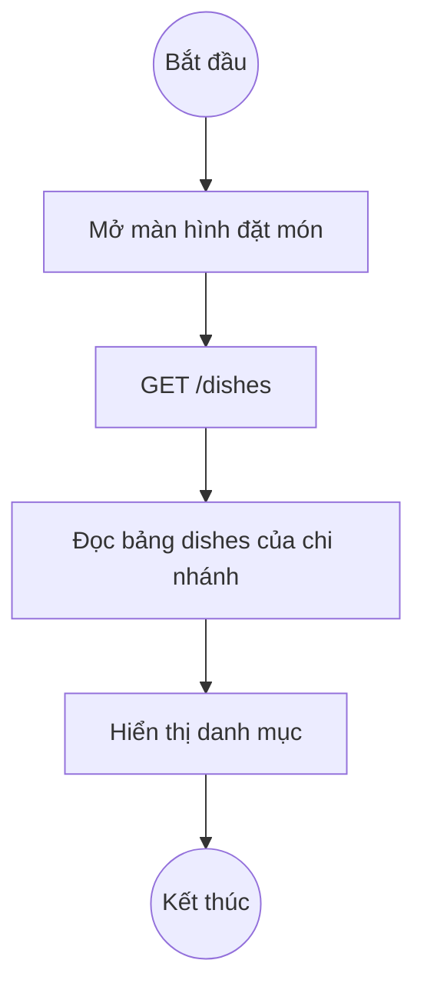

##### 3.1.2. Tạo đơn - giao dịch

- **Tên Usecase:** Tạo đơn
- **Mô tả Usecase:** Chức năng cho phép thu ngân hoặc khách hàng online tạo một đơn mới; đơn được lưu ở trạng thái Chờ kho và xếp vào hàng chờ gửi, kể cả khi mất mạng.
- **Tác nhân chính:** Thu ngân, khách hàng online. **Tác nhân phụ:** không có (Kho nhận đơn sau, qua Kafka).
- **Điều kiện bắt đầu:** đã chọn ít nhất một món. **Điều kiện kết thúc:** đơn `CHO_KHO` trong `orders` và mục `TAO_DON` chưa thử gửi trong `outbox_events`, ghi trong cùng một giao dịch.
- **Trình tự các sự kiện:**
  1. Màn hình gọi `POST /orders` với `items[{dish_id, quantity}]`.
  2. Hệ thống kiểm tra dữ liệu: không có món, số lượng không phải số nguyên dương, món không có trong `dishes` thì trả 400 và không lưu gì (BR9).
  3. Sinh `order_id`, ghi giờ tạo, chép tên món vào `items`.
  4. Ghi đơn `CHO_KHO` và mục `TAO_DON` (tin `OrderCreated` tới `order-events.<branch>`), commit, trả 201.
- **Các yêu cầu phi chức năng:** không chờ Kho; kết quả Đã giữ hoặc Thất bại đến sau qua `status-events.<branch>`. Màn hình hiện "Chưa gửi, bếp chưa nhận" khi mục chưa được thử gửi (BR5).
- **Biểu đồ hoạt động:**

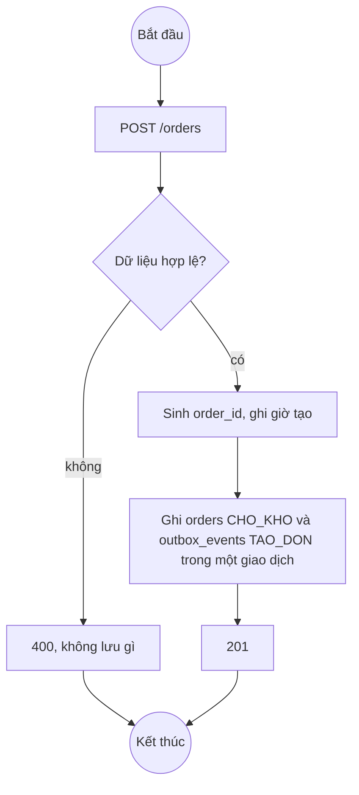

#### 3.2. Hủy đơn - use case

##### 3.2.1. Yêu cầu hủy đơn - giao dịch

- **Tên Usecase:** Yêu cầu hủy đơn
- **Mô tả Usecase:** Chức năng cho phép thu ngân hoặc khách hàng online yêu cầu hủy một đơn với lý do cố định. Đơn chưa từng được thử gửi thì chi nhánh hủy ngay; đơn đã thử gửi thì yêu cầu được gửi cho Bếp quyết định.
- **Tác nhân chính:** Thu ngân, khách hàng online. **Tác nhân phụ:** Kitchen Service (quyết định khi đơn đã thử gửi).
- **Điều kiện bắt đầu:** đơn chưa ở trạng thái kết thúc. **Điều kiện kết thúc:** đơn `DA_HUY` (hủy tại chỗ) hoặc cờ `DANG_YEU_CAU` cùng mục `HUY` trong hàng chờ gửi.
- **Trình tự các sự kiện:**
  1. Chọn lý do (`CHANGED_MIND`, `WAITED_TOO_LONG`, `WRONG_ORDER_ENTERED`); màn hình gọi `POST /orders/{id}/cancel`. Lý do khác: 400.
  2. Khóa dòng `orders` (`SELECT ... FOR UPDATE`). Không có đơn: 404. Đơn đã kết thúc: 409. Đã có yêu cầu đang chờ: 202, không thêm mục `HUY` thứ hai.
  3. Xóa mục `TAO_DON` của đơn với điều kiện `attempted = FALSE`. Xóa được: đơn chưa từng vào Kafka, chuyển `DA_HUY` với lý do đã chọn, trả 200.
  4. Không xóa được (đã thử gửi, kể cả khi lần gửi đó báo lỗi): ghi mục `HUY` (tin `CancelRequested` tới `cancel-events.<branch>`) xếp sau mục tạo đơn, bật cờ `DANG_YEU_CAU` kèm giờ yêu cầu, trả 202. Trạng thái chính chưa đổi.
- **Các yêu cầu phi chức năng:** bấm hủy đúng lúc bộ gửi nhặt mục tạo đơn thì đúng một bên thắng (kịch bản 37); hủy khi mất mạng mà đơn chưa thử gửi thì đơn chắc chắn không được nấu (kịch bản 10); đơn đã thử gửi thì yêu cầu hủy không phải cam kết (kịch bản 36).
- **Biểu đồ hoạt động:**

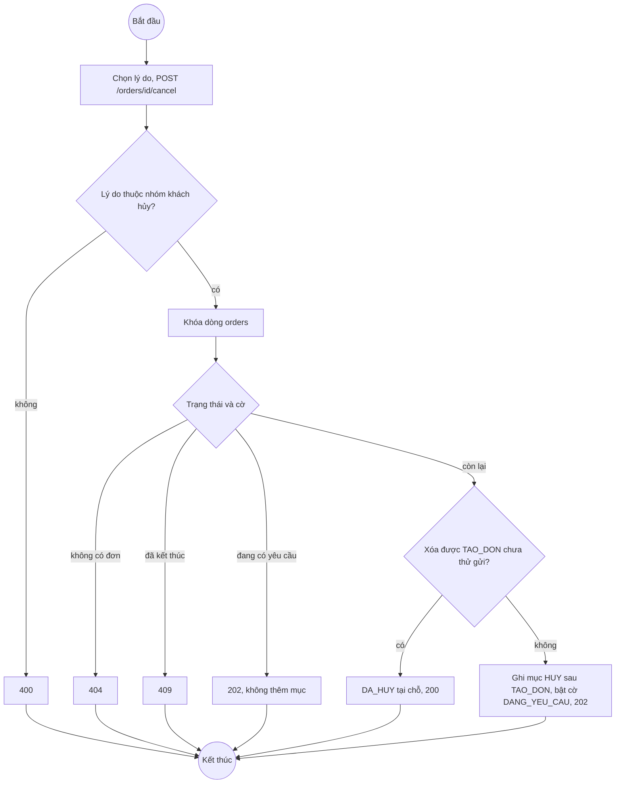

#### 3.3. Theo dõi đơn - use case

##### 3.3.1. Xem danh sách đơn và trạng thái - giao dịch

- **Tên Usecase:** Xem danh sách đơn và trạng thái
- **Mô tả Usecase:** Chức năng cho phép thu ngân hoặc khách hàng online xem các đơn của chi nhánh với trạng thái, cờ yêu cầu hủy, thông báo của Bếp và tình trạng gửi.
- **Tác nhân chính:** Thu ngân, khách hàng online. **Tác nhân phụ:** không có.
- **Điều kiện bắt đầu:** không có. **Điều kiện kết thúc:** không có.
- **Trình tự các sự kiện:** 1. Màn hình gọi `GET /orders` hoặc `GET /orders/{id}`. 2. Hệ thống trả đơn kèm `send_state` của mục tạo đơn và `cancel_send_state` của mục hủy gần nhất: `CHUA_GUI` (chưa gửi, bếp chưa nhận), `DANG_GUI` (đang gửi, chưa biết bếp đã nhận chưa), `DA_GUI` (Kafka đã xác nhận).
- **Các yêu cầu phi chức năng:** Kafka xác nhận không có nghĩa Kho đã nhận đơn (BR9); trạng thái chỉ đổi khi có tin trạng thái.
- **Biểu đồ hoạt động:**

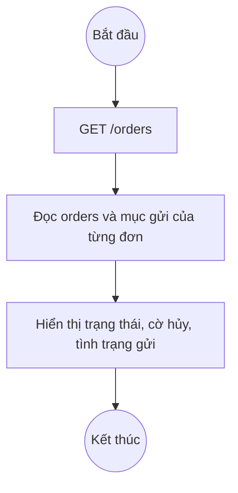

#### 3.4. Giám sát chi nhánh - use case

##### 3.4.1. Xem kết nối, số tin chờ gửi, cảnh báo - giao dịch

- **Tên Usecase:** Xem kết nối, số tin chờ gửi, cảnh báo
- **Mô tả Usecase:** Chức năng cho phép thu ngân xem các mục Luồng D của chi nhánh. Hệ thống chỉ cảnh báo, không tự hủy đơn vì chờ lâu (Q6).
- **Tác nhân chính:** Thu ngân. **Tác nhân phụ:** không có.
- **Điều kiện bắt đầu:** không có. **Điều kiện kết thúc:** không có.
- **Trình tự các sự kiện:** 1. Màn hình gọi `GET /monitor`. 2. Hệ thống trả: kết quả lần thăm dò Kafka gần nhất; số mục chưa được Kafka xác nhận; đơn Chờ kho quá N = 10 phút (kèm nút Yêu cầu hủy trên màn hình); đơn còn trong hàng chờ gửi khi còn dưới 1 giờ nữa là quá X = 4 giờ; đơn có cờ yêu cầu hủy kèm thời gian đã chờ; các tin trạng thái không đọc được hoặc loại lạ (bảng `alerts`, loại `CAN_KIEM_TRA`).
- **Các yêu cầu phi chức năng:** kịch bản 53 (Kho tắt, đơn chờ quá N phút) và 54 (mất mạng, đơn sắp quá hạn).
- **Biểu đồ hoạt động:**

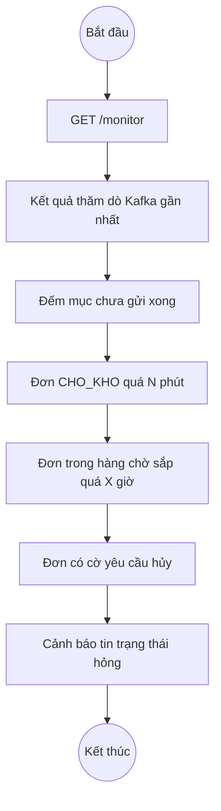

#### 3.5. Đồng bộ đơn với Kho và Bếp - use case

##### 3.5.1. Gửi hàng chờ lên Kafka - giao dịch

- **Tên Usecase:** Gửi hàng chờ lên Kafka
- **Mô tả Usecase:** Chức năng cho phép dịch vụ chi nhánh gửi các mục trong hàng chờ (tạo đơn, yêu cầu hủy) lên Kafka, giữ thứ tự theo từng đơn.
- **Tác nhân chính:** Local Order Service (tự động, luồng chạy nền). **Tác nhân phụ:** Kafka.
- **Điều kiện bắt đầu:** hàng chờ có mục chưa được xác nhận. **Điều kiện kết thúc:** mục được Kafka xác nhận có `sent_at`; mục chưa được xác nhận vẫn nằm trong hàng chờ.
- **Trình tự các sự kiện:**
  1. Lấy mục chưa gửi có `id` nhỏ nhất của mỗi đơn, nên mục hủy không bao giờ đi trước mục tạo đơn của cùng đơn, còn các đơn khác không bị chặn.
  2. Có mục chưa có cờ: thăm dò kết nối Kafka (lấy metadata của cụm, chờ tối đa 2 giây). Thăm dò thất bại: không đặt cờ, không gửi; đơn vẫn hủy tại chỗ được.
  3. Thăm dò vừa thành công: đặt `attempted = TRUE` có điều kiện `sent_at IS NULL` và commit trước khi gửi. Không còn dòng: mục đã bị hủy tại chỗ, bỏ qua.
  4. Gửi với `acks=all`; mục được xác nhận thì ghi `sent_at`. Mục lỗi giữ cờ và được gửi lại với thời gian chờ tăng dần, không bao giờ bị bỏ.
- **Các yêu cầu phi chức năng:** mạng chập chờn lâu không làm mất mục nào, và khi có mạng lại thì gửi đúng thứ tự theo đơn (kịch bản 12); broker leader chết khi đang gửi thì không mất mục đã được xác nhận (kịch bản 31).
- **Biểu đồ hoạt động:**

```mermaid
flowchart TD
  s((Bắt đầu)) --> a[Lấy mục chưa gửi nhỏ nhất của mỗi đơn] --> b{Có mục chưa có cờ?}
  b -- có --> c{Thăm dò Kafka thành công?}
  c -- không --> h[Giữ nguyên, chờ rồi thử lại] --> z((Kết thúc))
  c -- có --> d[Đặt attempted = TRUE, commit] --> e[Gửi lên Kafka]
  b -- không --> e
  e --> f{Kafka xác nhận?}
  f -- có --> g[Ghi sent_at] --> z
  f -- không --> h
```

##### 3.5.2. Áp dụng trạng thái đơn nhận về theo thứ hạng - giao dịch

- **Tên Usecase:** Áp dụng trạng thái đơn nhận về theo thứ hạng
- **Mô tả Usecase:** Chức năng cho phép dịch vụ chi nhánh cập nhật đơn theo tin trạng thái của Kho và Bếp trên `status-events.<branch>`, không bao giờ lùi trạng thái (BR3).
- **Tác nhân chính:** Local Order Service (tự động, consumer). **Tác nhân phụ:** Inventory Service, Kitchen Service.
- **Điều kiện bắt đầu:** có tin trên topic trạng thái của chi nhánh. **Điều kiện kết thúc:** tin được ghi vào `processed_events` cùng giao dịch với thay đổi (nếu có).
- **Trình tự các sự kiện:**
  1. `OrderReserved` (hạng 1), `OrderFailed`, `OrderCancelled`, `OrderCompleted` (hạng 2): cập nhật chỉ khi hạng mới lớn hơn hạng hiện tại; trạng thái kết thúc tắt cờ yêu cầu hủy.
  2. `CancelPending`: bật dòng "bếp sẽ không nấu" (`BEP_KHONG_NAU`) chỉ khi đơn chưa kết thúc và cờ đang `DANG_YEU_CAU`.
  3. `CancelRejected`: tắt cờ và ghi thông báo "Không hủy được: bếp đã bắt đầu nấu", ở mọi hạng.
  4. Tin không đọc được: thử 5 lần rồi chuyển `dlq` và ghi cảnh báo `CAN_KIEM_TRA`; tin loại lạ: ghi cảnh báo và bỏ qua (mục 9 của đặc tả).
- **Các yêu cầu phi chức năng:** Đã hủy đến trước Đã giữ thì giữ Đã hủy (kịch bản 7); Thất bại tắt cờ, và `CancelPending` đến sau bị bỏ qua (kịch bản 8); tin trùng không gây tác dụng lần hai (BR4).
- **Biểu đồ hoạt động:**

```mermaid
flowchart TD
  s((Bắt đầu)) --> a{Loại tin}
  a -- OrderReserved, OrderFailed, OrderCancelled, OrderCompleted --> b{Hạng mới lớn hơn hạng hiện tại?}
  b -- có --> b1[Cập nhật trạng thái; hạng 2 thì tắt cờ] --> z((Kết thúc))
  b -- không --> z
  a -- CancelPending --> c{Chưa kết thúc và cờ DANG_YEU_CAU?}
  c -- có --> c1[Cờ BEP_KHONG_NAU] --> z
  c -- không --> z
  a -- CancelRejected --> d[Tắt cờ, ghi thông báo bếp đã nấu] --> z
  a -- không đọc được hoặc loại lạ --> e[Cảnh báo CAN_KIEM_TRA; không đọc được thì vào dlq] --> z
```

#### 3.6. Nhân bản đơn về trung tâm - use case

##### 3.6.1. Ghi nhịp nhân bản - giao dịch

- **Tên Usecase:** Ghi nhịp nhân bản
- **Mô tả Usecase:** Chức năng cho phép dịch vụ chi nhánh đánh dấu thời điểm mà dữ liệu đơn đã được nhân bản về Central Order Replica, để báo cáo quản lý có mốc "dữ liệu tính đến" của từng chi nhánh.
- **Tác nhân chính:** Local Order Service (tự động, luồng chạy nền). **Tác nhân phụ:** PostgreSQL logical replication.
- **Điều kiện bắt đầu:** dịch vụ chi nhánh đang chạy. **Điều kiện kết thúc:** dòng duy nhất của chi nhánh trong `replication_heartbeat` mang thời điểm mới.
- **Trình tự các sự kiện:**
  1. Mỗi 5 giây, một giao dịch ghi `INSERT ... ON CONFLICT (branch_id) DO UPDATE SET beat_at = now()` theo đồng hồ của CSDL chi nhánh.
  2. Logical replication đưa `orders` và `replication_heartbeat` về `central-db` theo đúng thứ tự commit của chi nhánh.
  3. CSDL chi nhánh không trả lời: ghi log, thử lại ở nhịp sau; trong lúc đó mốc ở trung tâm đứng yên.
- **Các yêu cầu phi chức năng:** cắt nhân bản từ một chi nhánh thì chỉ mốc của chi nhánh đó đứng yên; nối lại thì số liệu khớp CSDL chi nhánh (kịch bản 55).
- **Biểu đồ hoạt động:**

```mermaid
flowchart TD
  s((Bắt đầu)) --> a[Chờ 5 giây] --> b{Ghi được replication_heartbeat?}
  b -- có --> c[beat_at = now của CSDL chi nhánh] --> d[Nhân bản về central-db cùng orders] --> a
  b -- không --> e[Ghi log] --> a
```

### 4. Báo cáo quản lý - module

#### 4.1. Xem báo cáo tổng hợp - use case

##### 4.1.1. Xem báo cáo tổng hợp - giao dịch

- **Tên Usecase:** Xem báo cáo tổng hợp
- **Mô tả Usecase:** Chức năng cho phép quản lý xem số liệu toàn chuỗi; số liệu có thể chậm hơn dữ liệu ở chi nhánh, nên mỗi chi nhánh có mốc "dữ liệu tính đến" (mục 8 của đặc tả).
- **Tác nhân chính:** Quản lý. **Tác nhân phụ:** Central Order Replica.
- **Điều kiện bắt đầu:** không có. **Điều kiện kết thúc:** không có; giao dịch không đổi dữ liệu.
- **Trình tự các sự kiện:**
  1. Màn hình gọi `GET /reports/summary` của Order Query Service.
  2. Hệ thống mở một giao dịch `REPEATABLE READ, READ ONLY` trên `central-db` (không bao giờ đọc CSDL chi nhánh).
  3. Đọc `replication_heartbeat`: mốc "dữ liệu tính đến" và tuổi của nó cho từng chi nhánh.
  4. Đếm `orders` theo chi nhánh, trạng thái và `close_reason`.
  5. Trả mọi chi nhánh được cấu hình (`BRANCHES`), kể cả chi nhánh chưa có dữ liệu (mốc null, số 0): số đơn theo năm trạng thái, tổng, và số đơn Đã hủy, Thất bại theo lý do.
- **Các yêu cầu phi chức năng:** đọc trong một snapshot nên mốc không bao giờ mới hơn số liệu đi kèm; yêu cầu hủy đang chờ ở Bếp không được tính; khi nhân bản từ một chi nhánh bị cắt, báo cáo vẫn xem được (kịch bản 55).
- **Biểu đồ hoạt động:**

```mermaid
flowchart TD
  s((Bắt đầu)) --> a[GET /reports/summary] --> b[Mở snapshot chỉ đọc trên central-db]
  b --> c[Đọc replication_heartbeat: mốc dữ liệu tính đến] --> d[Đếm orders theo chi nhánh, trạng thái, lý do]
  d --> e[Thêm chi nhánh được cấu hình chưa có dữ liệu] --> f[Trả báo cáo] --> z((Kết thúc))
```

## III. THIẾT KẾ CƠ SỞ DỮ LIỆU

### 1. CÁC CƠ SỞ DỮ LIỆU CỦA HỆ THỐNG

Tất cả dùng PostgreSQL 16.14; mỗi dịch vụ chỉ truy cập CSDL của mình.

| TT | Cơ sở dữ liệu | Ghi chú |
|---|---|---|
| 1 | Inventory DB (`inventory-db`, database `inventory`) | Của Inventory Service, dùng chung cho cả chuỗi; hai instance cùng ghi |
| 2 | Kitchen DB (`kitchen-db`, database `kitchen`) | Của Kitchen Service |
| 3 | Branch DB của POS01 (`pos01-db`, database `branch`) | Của Local Order Service POS01; bật logical WAL để nhân bản |
| 4 | Branch DB của POS02 (`pos02-db`) | Cùng cấu trúc với mục 3 |
| 5 | Branch DB của kênh Online (`online-db`) | Cùng cấu trúc với mục 3 |
| 6 | Central Order Replica (`central-db`, database `central`) | Bản sao `orders` và `replication_heartbeat` của mọi chi nhánh, chỉ đọc cho Order Query Service |

### 2. THIẾT KẾ CHI TIẾT CƠ SỞ DỮ LIỆU

#### Sơ đồ CSDL tổng quát

```mermaid
flowchart LR
  subgraph B["Branch DB × 3 (POS01, POS02, ONLINE)"]
    o["orders"] --- ob["outbox_events (hàng chờ gửi)"]
    d["dishes"]
    mc["menu_cache, menu_cache_meta"]
    rh["replication_heartbeat"]
    pb["alerts, processed_events"]
  end
  subgraph I["Inventory DB"]
    st["stock"] --- re["recipes"]
    io["inventory_orders"] --- ir["inventory_reservations"]
    st --- ir
    ds["dish_status, menu_version"]
    ia["alerts, processed_events, outbox_events"]
  end
  subgraph K["Kitchen DB"]
    ko["kitchen_orders"]
    fi["flagged_ingredients"]
    ka["alerts, processed_events, outbox_events"]
  end
  subgraph C["Central Order Replica"]
    co["orders (mọi chi nhánh)"]
    ch["replication_heartbeat"]
  end
  o -.->|logical replication| co
  rh -.->|logical replication| ch
  ob ==>|Kafka: OrderCreated| io
  ia ==>|Kafka: OrderReserved, OrderFailed, IngredientCheckChanged| ko
  ka ==>|Kafka: StockConsumed, ReleaseRequested| io
  ia ==>|Kafka: OrderReserved, OrderFailed| o
  ka ==>|Kafka: CancelPending, CancelRejected, OrderCancelled, OrderCompleted| o
  ob ==>|Kafka: CancelRequested| ko
```

Giữa các CSDL không có khóa ngoại: mỗi đơn mang cùng một `order_id` (UUID do chi nhánh sinh) ở cả ba nơi, và dữ liệu đi giữa chúng qua Kafka (nét đôi) hoặc qua logical replication (nét đứt).

#### 2.1. Các bảng trong cơ sở dữ liệu

| STT | CSDL | Tên bảng | Mô tả |
|---|---|---|---|
| 1 | Inventory DB | `stock` | Mỗi nguyên liệu một dòng: tên, đơn vị, bốn đại lượng `available`, `reserved`, `consumed`, `wasted` và cờ `needs_check` |
| 2 | Inventory DB | `recipes` | Công thức: lượng mỗi nguyên liệu cho một suất của món |
| 3 | Inventory DB | `inventory_orders` | Mỗi đơn đúng một bản ghi kết quả (BR12): `DANG_GIU`, `THAT_BAI`, `DA_TRA`, `DA_DUNG`, chi nhánh gốc, lý do |
| 4 | Inventory DB | `inventory_reservations` | Lượng giữ của từng nguyên liệu cho từng đơn, ghi lúc giữ, và kết quả của dòng (`DA_HOAN`, `DA_DUNG`, `HAO_HUT`) |
| 5 | Inventory DB | `dish_status` | Trạng thái món (Còn, Hết, Ẩn) kèm version (đợt 2) |
| 6 | Inventory DB | `menu_version` | Một dòng duy nhất: bộ đếm version (`epoch`, `seq`) bền vững |
| 7 | Inventory DB | `alerts` | Cảnh báo cho người xem: `CAN_KIEM_TRA`, `LENH_KHONG_KHOP` |
| 8 | Inventory DB | `processed_events` | `event_id` đã xử lý, chống xử lý trùng |
| 9 | Inventory DB | `outbox_events` | Tin chờ gửi lên Kafka, ghi trong cùng giao dịch với thay đổi trạng thái |
| 10 | Kitchen DB | `kitchen_orders` | Mỗi đơn đúng một bản ghi (BR8): phiếu, bản ghi Chờ hủy hoặc kết quả Thất bại; chi nhánh gốc, các chi nhánh đã yêu cầu hủy, nguyên liệu đã giữ |
| 11 | Kitchen DB | `flagged_ingredients` | Cờ kiểm kho nhận từ Kho, kèm version |
| 12 | Kitchen DB | `alerts` | Cảnh báo: `CAN_KIEM_TRA`, `HUY_SAI_CHI_NHANH` |
| 13 | Kitchen DB | `processed_events` | Như mục 8 |
| 14 | Kitchen DB | `outbox_events` | Như mục 9 |
| 15 | Branch DB | `orders` | Đơn của chi nhánh: trạng thái theo thứ hạng, cờ "Đang yêu cầu hủy", lý do |
| 16 | Branch DB | `outbox_events` | Hàng chờ gửi của chi nhánh, có cờ "đã thử gửi" (BR9) |
| 17 | Branch DB | `dishes` | Danh mục món nạp từ file seed, phục vụ màn hình đặt món khi mất mạng |
| 18 | Branch DB | `menu_cache` | Trạng thái món nhận từ Kho, gộp theo version (đợt 2) |
| 19 | Branch DB | `menu_cache_meta` | Một dòng: `epoch` hiện tại và lần cuối nghe được từ Kho (đợt 2) |
| 20 | Branch DB | `replication_heartbeat` | Nhịp nhân bản của chi nhánh, cho mốc "dữ liệu tính đến" |
| 21 | Branch DB | `processed_events` | Như mục 8 |
| 22 | Branch DB | `alerts` | Cảnh báo `CAN_KIEM_TRA`: tin trạng thái không đọc được (đã chuyển `dlq`) hoặc loại lạ (bỏ qua); hiện trên `GET /monitor` |
| 23 | Central Order Replica | `orders` | Bản sao `orders` của mọi chi nhánh |
| 24 | Central Order Replica | `replication_heartbeat` | Bản sao nhịp nhân bản của mọi chi nhánh |

#### 2.2. Thiết kế chi tiết các bảng

Sơ đồ quan hệ và bảng chi tiết của từng CSDL dưới đây được sinh từ các CSDL đang chạy (`backend/scripts/report_schema.py`), nên luôn khớp với migration.

<!-- include: generated/csdl.md -->
