# PHẦN II. NGHIÊN CỨU, PHÂN TÍCH THIẾT KẾ HỆ THỐNG

## I. MÔ HÌNH KIẾN TRÚC TỔNG QUAN (HLD)

Hệ thống đặt hàng tại quầy và online hợp nhất được thiết kế theo kiến trúc hướng sự kiện phân tán, tách biệt hoàn toàn hai kênh tiếp nhận đơn hàng (POS và Online) khỏi cụm xử lý trung tâm gồm Kho nguyên liệu (Inventory Service), Bếp trung tâm (Kitchen Service) và dịch vụ tổng hợp báo cáo (Order Query Service). Mỗi dịch vụ quản lý độc lập một cơ sở dữ liệu riêng, không truy cập chéo bảng dữ liệu của nhau và trao đổi trạng thái qua cụm truyền tin Apache Kafka. Mô hình kiến trúc tổng quan cùng các luồng xử lý chính được minh họa trên Hình 2.1.

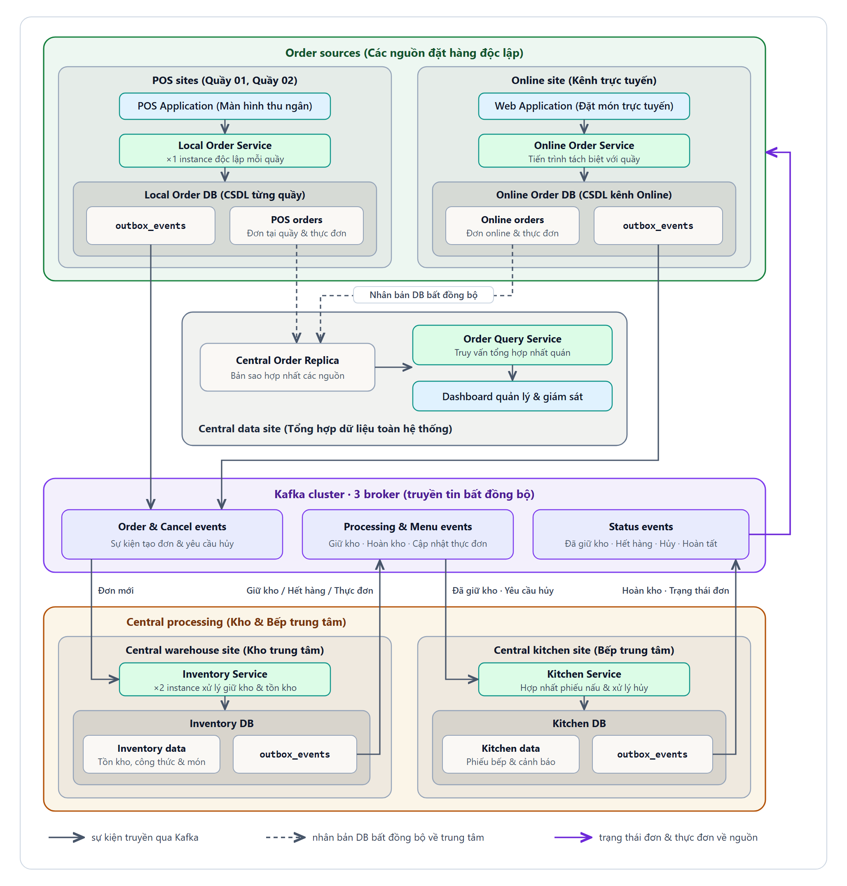

Để bảo đảm đơn hàng từ nhiều nguồn độc lập được hợp nhất đầy đủ và không sai lệch trạng thái khi mạng gián đoạn hoặc có nhiều giao dịch xảy ra đồng thời, toàn bộ kiến trúc tuân thủ ba nguyên tắc thiết kế cốt lõi. Thứ nhất, mọi thao tác tạo đơn hay yêu cầu hủy đều ghi đồng thời bản ghi nghiệp vụ và bản tin chờ gửi vào bảng hàng chờ cục bộ (`outbox_events`) trong cùng một giao dịch cơ sở dữ liệu, sau đó tiến trình nền mới truyền bản tin lên cụm truyền tin ở chế độ xác nhận lưu bền vững. Thứ hai, bên nhận sự kiện kiểm tra mã định danh duy nhất của thông điệp để loại bỏ gói tin lặp và chỉ xác nhận đã đọc sau khi giao dịch dữ liệu hoàn tất; bản tin lỗi định dạng sau năm lần thử được tách sang hàng chờ lỗi kèm cảnh báo vận hành để không làm ách tắc các đơn hàng hợp lệ. Thứ ba, số liệu đơn hàng cùng tín hiệu nhịp đồng bộ từ các kênh nguồn được nhân bản bất đồng bộ về bản sao tập trung Central Order Replica theo đúng thứ tự xác nhận giao dịch, giúp dịch vụ truy vấn tổng hợp báo cáo nhất quán theo một lát cắt thời gian.

Vai trò từng thành phần và kho dữ liệu trong kiến trúc tổng quan được tổng hợp trong Bảng 2.1.

*Bảng 2.1. Thành phần dịch vụ và kho dữ liệu trong kiến trúc hệ thống*

| Thành phần | Tiến trình / Kho dữ liệu | Vai trò trong kiến trúc |
|---|---|---|
| Kênh Quầy (POS01, POS02) | Local Order Service, CSDL từng quầy | Tiếp nhận đơn hàng và yêu cầu hủy tại quầy ngay cả khi mất kết nối mạng; lưu hàng chờ gửi cục bộ và cập nhật trạng thái đơn theo thứ hạng tăng dần. |
| Kênh Trực tuyến (Online) | Online Order Service, CSDL kênh Online | Chạy trên tiến trình và cơ sở dữ liệu độc lập với các quầy bán hàng; tiếp nhận đơn từ xa, theo dõi tiến độ chế biến và đồng bộ cùng chuẩn về trung tâm. |
| Kho nguyên liệu trung tâm | Inventory Service (2 tiến trình song song), Inventory DB | Xử lý song song các đơn từ nhiều nguồn; kiểm tra công thức món, giữ đủ nguyên liệu cho cả đơn hoặc từ chối toàn bộ, hoàn kho, ghi hao hụt và công bố trạng thái món. |
| Bếp trung tâm | Kitchen Service, Kitchen DB | Hợp nhất phiếu chế biến từ tất cả các kênh vào hàng đợi chung, điều phối nấu món và đóng vai trò trọng tài duy nhất phân xử yêu cầu hủy đơn sau khi đã rời điểm bán. |
| Tổng hợp gần thời gian thực | Order Query Service, Central Order Replica | Truy vấn đồng bộ trên bản sao dữ liệu hợp nhất từ các kênh để lập báo cáo tổng hợp kèm mốc thời gian cập nhật của từng nguồn. |
| Hạ tầng truyền thông sự kiện | Apache Kafka (3 broker) | Bảo đảm truyền dẫn thông điệp bất đồng bộ theo cơ chế ít nhất một lần qua các kênh sự kiện tách biệt theo chức năng và theo điểm bán. |

Quy hoạch các luồng thông điệp sự kiện trao đổi liên dịch vụ được trình bày tại Bảng 2.2.

*Bảng 2.2. Quy hoạch luồng sự kiện và thông điệp trao đổi liên dịch vụ*

| Luồng sự kiện | Bên gửi | Bên nhận | Nội dung thông điệp & ý nghĩa nghiệp vụ |
|---|---|---|---|
| Sự kiện tạo đơn theo kênh | Kênh POS01, POS02, ONLINE | Inventory Service | Thông báo đơn hàng mới kèm danh sách món và thời điểm tạo để Kho kiểm tra nguyên liệu. |
| Sự kiện yêu cầu hủy theo kênh | Kênh POS01, POS02, ONLINE | Kitchen Service | Chuyển yêu cầu hủy từ điểm bán tới Bếp phân xử khi gói tạo đơn đã được thử gửi ra mạng. |
| Sự kiện giữ kho tới Bếp | Inventory Service | Kitchen Service | Báo kết quả giữ đủ nguyên liệu (OrderReserved) để lập phiếu nấu hoặc từ chối do hết hàng (OrderFailed). |
| Lệnh xử lý tồn kho | Kitchen Service | Inventory Service | Báo chốt đã tiêu thụ nguyên liệu khi bắt đầu nấu (StockConsumed) hoặc hoàn trả/ghi hao hụt khi hủy phiếu (ReleaseRequested). |
| Phản hồi trạng thái về kênh gốc | Inventory Service, Kitchen Service | Đúng kênh đã phát sinh đơn | Thông báo kết quả giữ kho, hết hàng, hoàn tất nấu, đã hủy, chờ đối chiếu hủy hoặc từ chối hủy vì Bếp đã bắt đầu nấu. |
| Sự kiện thực đơn và kiểm kho | Inventory Service | Kitchen Service và tất cả các kênh | Công bố thay đổi trạng thái món còn/hết/ẩn (DishStatusChanged), cờ cần kiểm kho nguyên liệu (IngredientCheckChanged) và nhịp hoạt động Kho. |
| Hàng chờ bản tin lỗi | Mọi dịch vụ nhận sự kiện | Bộ phận Giám sát vận hành | Lưu riêng các bản tin hỏng cấu trúc hoặc sai phiên bản sau năm lần thử lại để kiểm tra mà không chặn luồng chính. |

## II. DANH SÁCH CHỨC NĂNG PHẦN MỀM

### 2.1. Sơ đồ Use Case tổng quát

Phạm vi tương tác của năm nhóm tác nhân gồm Thu ngân tại quầy, Khách hàng Online, Nhân viên Kho, Nhân viên Bếp và Quản lý / Giám sát vận hành cùng luồng xử lý nền Đồng bộ Outbox & Kafka được khái quát trên Hình 2.2. Hai nhóm tác nhân bán hàng sử dụng chung tập ca sử dụng tiếp nhận và theo dõi đơn trên hai kênh dịch vụ tách biệt, còn hai bộ phận trung tâm nắm quyền kiểm soát tồn kho dùng chung, chế biến hợp nhất và phân xử tranh chấp.

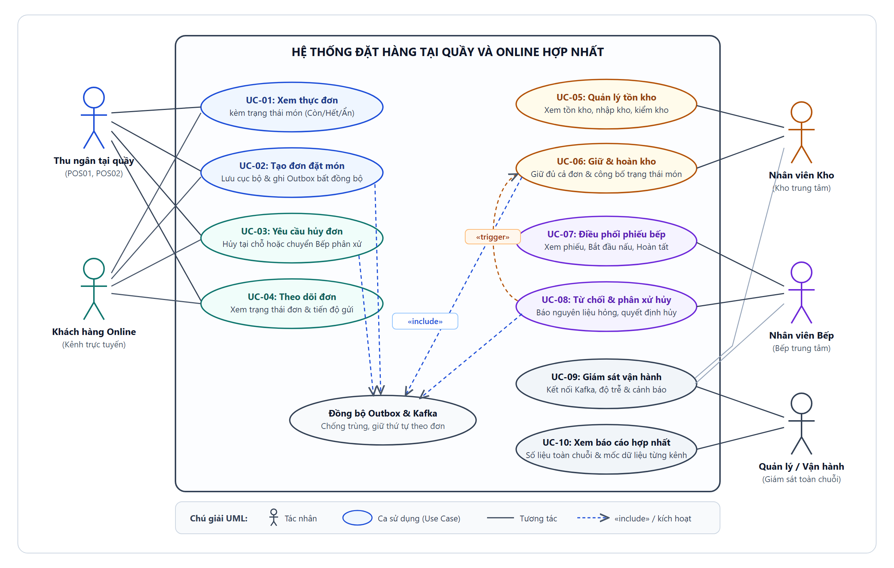

### 2.2. Danh sách chức năng phần mềm

Từ mô hình Use Case trên Hình 2.2, nghiệp vụ toàn hệ thống được phân rã thành bốn phân hệ gồm 10 ca sử dụng và 16 giao dịch trọng tâm như liệt kê trong Bảng 2.3. Các cơ chế xử lý nền phục vụ tính toàn vẹn phân tán như chuyển phát hàng chờ gửi, chống xử lý trùng và phát nhịp đồng bộ được gắn trực tiếp trong luồng của từng giao dịch liên quan.

*Bảng 2.3. Danh sách chức năng phần mềm theo module, use case và giao dịch*

| TT | Tên module | Tên usecase | Giao dịch (Transaction) | Tên tác nhân chính |
|---|---|---|---|---|
| | **1. Tiếp nhận và theo dõi đơn hàng đa kênh (POS & Online)** | | | |
| 1 | | Xem thực đơn và đặt món | GD-01: Xem thực đơn kèm trạng thái còn/hết món | Thu ngân tại quầy, Khách hàng Online |
| 2 | | | GD-02: Tạo đơn đặt món mới và đưa vào hàng chờ gửi | Thu ngân tại quầy, Khách hàng Online |
| 3 | | Hủy đơn đặt món | GD-03: Gửi yêu cầu hủy đơn đặt món | Thu ngân tại quầy, Khách hàng Online |
| 4 | | Theo dõi đơn và giám sát kênh | GD-04: Theo dõi danh sách đơn, tiến độ gửi và cảnh báo kênh | Thu ngân tại quầy, Khách hàng Online |
| | **2. Quản lý kho và giữ nguyên liệu trung tâm (Inventory)** | | | |
| 5 | | Xử lý nguyên liệu cho đơn đa nguồn | GD-05: Tiếp nhận đơn mới, kiểm tra và giữ nguyên liệu | Inventory Service (tự động) |
| 6 | | | GD-06: Hoàn trả nguyên liệu, ghi hao hụt và chốt đã dùng | Inventory Service (tự động) |
| 7 | | Quản lý tồn kho | GD-07: Tra cứu tồn kho, cảnh báo kiểm kho và độ trễ đọc tin | Nhân viên Kho, Quản lý vận hành |
| 8 | | | GD-08: Nhập bổ sung tồn kho nguyên liệu | Nhân viên Kho |
| 9 | | | GD-09: Xác nhận kiểm kho xong và đối chiếu tồn thực tế | Nhân viên Kho |
| 10 | | Đồng bộ trạng thái thực đơn | GD-10: Tính lại, công bố trạng thái món và cấp ảnh chụp thực đơn | Inventory Service, Kênh bán hàng |
| | **3. Điều phối chế biến tại Bếp trung tâm (Kitchen)** | | | |
| 11 | | Tiếp nhận đơn và phân xử hủy | GD-11: Hợp nhất đơn từ Kho, lập phiếu bếp và phân xử yêu cầu hủy | Kitchen Service (tự động) |
| 12 | | Xử lý phiếu chế biến | GD-12: Theo dõi danh sách phiếu chế biến và cảnh báo bếp | Nhân viên Bếp |
| 13 | | | GD-13: Bắt đầu chế biến phiếu bếp | Nhân viên Bếp |
| 14 | | | GD-14: Từ chối phiếu chế biến và báo nguyên liệu hỏng | Nhân viên Bếp |
| 15 | | | GD-15: Xác nhận hoàn tất chế biến món | Nhân viên Bếp |
| | **4. Tổng hợp đơn hàng trung tâm và giám sát toàn chuỗi (Query)** | | | |
| 16 | | Xem báo cáo hợp nhất | GD-16: Tổng hợp và xem báo cáo đơn hàng toàn chuỗi gần thời gian thực | Quản lý chuỗi |

## III. THIẾT KẾ CHỨC NĂNG PHẦN MỀM

### 3.1. Module 1: Tiếp nhận và theo dõi đơn hàng đa kênh (POS & Online)

Hai nhóm điểm bán tại quầy (POS01, POS02) và kênh đặt hàng trực tuyến (ONLINE) dùng chung một mô hình xử lý nghiệp vụ nhưng vận hành trên các tiến trình và cơ sở dữ liệu tách biệt hoàn toàn. Nguyên tắc phân định ranh giới là điểm bán chỉ tự chốt hủy tại chỗ khi gói tin tạo đơn chưa từng được thử gửi ra cụm truyền tin trung tâm; mọi trường hợp đã phát sinh liên lạc mạng đều phải do Bếp trung tâm phân xử.

#### 3.1.1. Xem thực đơn và đặt món

##### GD-01. Xem thực đơn kèm trạng thái món

- **Tên Usecase:** Xem thực đơn kèm trạng thái còn/hết món
- **Mô tả Usecase:** Chức năng cho phép Thu ngân tại quầy hoặc Khách hàng Online xem danh sách món ăn và tình trạng sẵn sàng phục vụ tại thời điểm đặt món, kể cả khi kết nối tới cụm trung tâm tạm thời gián đoạn.
- **Tác nhân chính:** Thu ngân tại quầy, Khách hàng Online
- **Tác nhân phụ:** Inventory Service (cập nhật trạng thái món qua sự kiện và ảnh chụp thực đơn)
- **Điều kiện bắt đầu (Pre-Condition):** Dịch vụ của kênh đã khởi động và có sẵn danh mục món ăn cục bộ.
- **Điều kiện kết thúc (Post-Condition):** Không thay đổi dữ liệu trạng thái; màn hình đặt món hiển thị đúng trạng thái khả dụng và cảnh báo độ mới thực đơn nếu có.
- **Trình tự các sự kiện:**
  1. Người dùng mở màn hình đặt món, hệ thống đọc danh mục món ăn cục bộ kết hợp với bộ đệm trạng thái món hiện giữ tại kênh.
  2. Hệ thống đối chiếu thời điểm liên lạc gần nhất với Kho trung tâm (ngưỡng tươi mới 5 phút) và tình trạng kết nối tới cụm truyền tin.
  3. Nếu dữ liệu còn mới và kết nối ổn định, món Hết hàng bị khóa không cho chọn và món Tạm ẩn được loại khỏi danh sách; nếu dữ liệu quá 5 phút hoặc mất kết nối trung tâm, các món đang đánh dấu hết chuyển sang nhãn "Có thể đã hết" và vẫn cho phép đặt để không gián đoạn bán hàng tại chỗ.
- **Các yêu cầu phi chức năng:** Việc hiển thị thực đơn chỉ đọc trên cơ sở dữ liệu cục bộ của kênh nên phản hồi tức thì ngay cả khi mất mạng ra Kho trung tâm.
- **Biểu đồ hoạt động:** Trình tự kiểm tra độ mới dữ liệu và phân nhánh hiển thị thực đơn được thể hiện trên Hình 2.3.

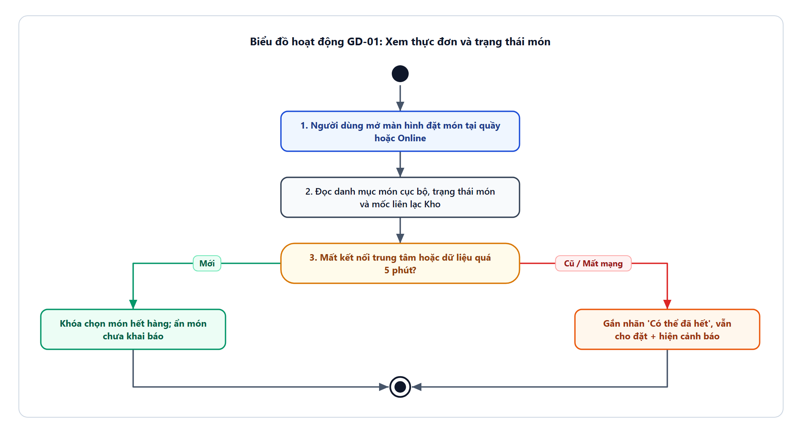

##### GD-02. Tạo đơn đặt món mới và đưa vào hàng chờ gửi

- **Tên Usecase:** Tạo đơn đặt món mới và đưa vào hàng chờ gửi
- **Mô tả Usecase:** Chức năng cho phép Thu ngân hoặc Khách hàng Online lập đơn đặt món mới, lưu bền vững tại chỗ ở trạng thái Chờ kho và xếp vào hàng chờ gửi bất đồng bộ ngay cả khi đường truyền tới cụm trung tâm gặp sự cố.
- **Tác nhân chính:** Thu ngân tại quầy, Khách hàng Online
- **Tác nhân phụ:** Apache Kafka, Inventory Service (tiếp nhận sự kiện tạo đơn)
- **Điều kiện bắt đầu (Pre-Condition):** Người đặt đã chọn ít nhất một món có số lượng nguyên dương thuộc danh mục hiện hành của kênh.
- **Điều kiện kết thúc (Post-Condition):** Đơn được lưu bền vững với trạng thái Chờ kho kèm một mục chờ gửi tương ứng đánh dấu chưa từng thử gửi; sau khi truyền thành công, hệ thống ghi nhận dấu thời gian đã gửi.
- **Trình tự các sự kiện:**
  1. Người dùng xác nhận danh sách món và số lượng cần đặt để gửi yêu cầu tạo đơn.
  2. Hệ thống kiểm tra danh sách món không rỗng, số lượng là số nguyên dương và mọi mã món đều tồn tại trong danh mục; nếu vi phạm thì từ chối yêu cầu và không lưu dữ liệu.
  3. Trong cùng một giao dịch cục bộ, hệ thống cấp mã định danh duy nhất toàn cục cho đơn hàng, lưu bản ghi đơn ở trạng thái Chờ kho đồng thời tạo một mục chờ gửi tạo đơn ở trạng thái chưa từng thử gửi.
  4. Ở luồng đồng bộ nền, hệ thống chọn mục chờ gửi hợp lệ đầu tiên của mỗi đơn, kiểm tra nhanh khả năng kết nối tới cụm truyền tin trong tối đa 2 giây; nếu mất mạng, hệ thống giữ nguyên trạng thái chưa từng thử gửi và chờ chu kỳ sau.
  5. Khi cụm truyền tin sẵn sàng, hệ thống đánh dấu mục chờ gửi sang đã từng thử gửi và xác nhận vào cơ sở dữ liệu trước khi phát thông điệp đi; khi broker xác nhận lưu an toàn mới ghi dấu thời gian hoàn tất gửi, còn nếu đứt kết nối giữa chừng thì giữ cờ đang gửi để gửi lại theo thời gian chờ tăng dần.
- **Các yêu cầu phi chức năng:** Hàng chờ gửi xử lý độc lập theo từng đơn nên lỗi đường truyền ở một đơn không chặn các đơn khác; giao diện phân biệt rõ hai trạng thái "Chưa gửi, bếp chưa nhận" và "Đang gửi, chưa biết bếp đã nhận chưa" để hỗ trợ xử lý hủy chính xác.
- **Biểu đồ hoạt động:** Quy trình tạo đơn nguyên tử và chuyển phát bất đồng bộ qua hàng chờ gửi thể hiện trên Hình 2.4.

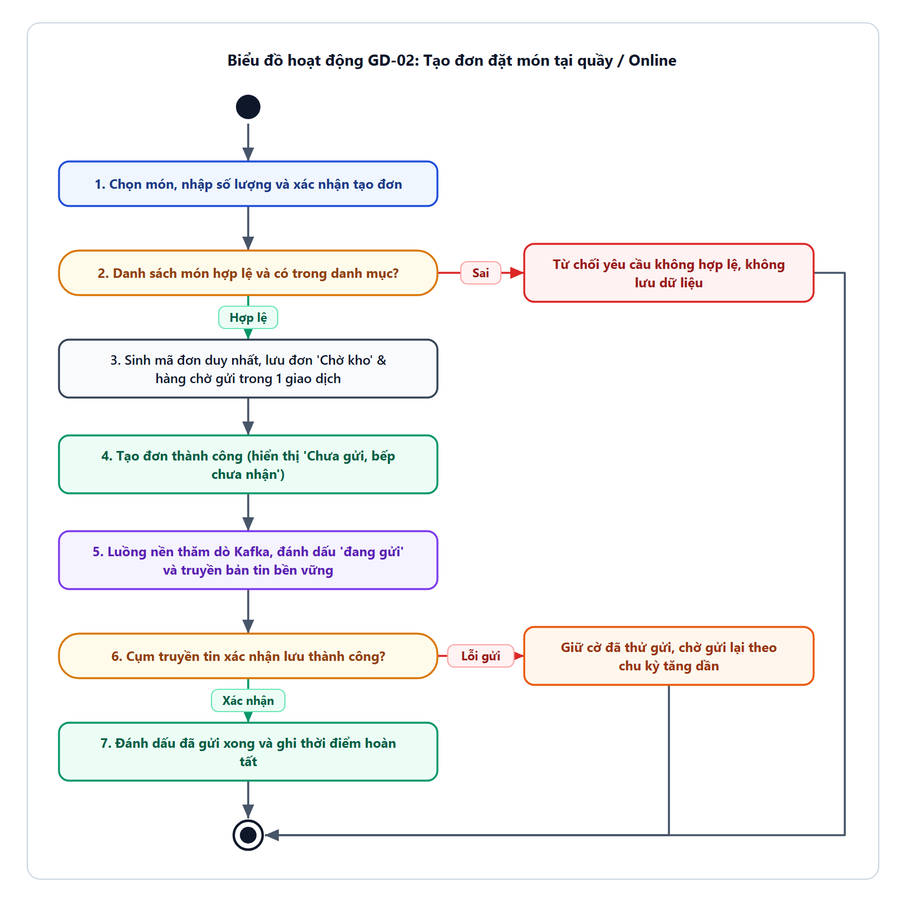

#### 3.1.2. Hủy đơn đặt món

##### GD-03. Gửi yêu cầu hủy đơn đặt món

- **Tên Usecase:** Gửi yêu cầu hủy đơn đặt món
- **Mô tả Usecase:** Chức năng cho phép Thu ngân hoặc Khách hàng Online yêu cầu hủy một đơn chưa kết thúc; đơn chưa từng được thử gửi sẽ hủy ngay tại điểm bán, còn đơn đã thử gửi ra mạng phải chuyển tới Bếp trung tâm quyết định.
- **Tác nhân chính:** Thu ngân tại quầy, Khách hàng Online
- **Tác nhân phụ:** Kitchen Service (trọng tài quyết định khi gói tạo đơn đã rời điểm bán)
- **Điều kiện bắt đầu (Pre-Condition):** Đơn hàng tồn tại trên kênh và chưa nằm ở trạng thái kết thúc (Hoàn tất, Đã hủy hoặc Thất bại).
- **Điều kiện kết thúc (Post-Condition):** Đơn chuyển sang Đã hủy ngay tại điểm bán nếu chưa thử gửi; ngược lại, đơn được bật cờ Đang yêu cầu hủy kèm thông điệp yêu cầu hủy xếp sau mục tạo đơn trong hàng chờ gửi.
- **Trình tự các sự kiện:**
  1. Người dùng chọn một trong ba lý do hủy phía khách hàng (Khách đổi ý, Đợi quá lâu, Nhập nhầm đơn) và gửi lệnh hủy; hệ thống từ chối nếu lý do không hợp lệ.
  2. Hệ thống khóa độc quyền bản ghi đơn hàng tại kênh; nếu không tìm thấy đơn thì báo lỗi không tồn tại, nếu đơn đã kết thúc thì báo xung đột trạng thái, còn nếu đơn đang ở trạng thái chờ hủy thì xác nhận giữ nguyên yêu cầu trước đó.
  3. Hệ thống thực hiện thao tác rút mục chờ gửi tạo đơn với điều kiện mục đó chưa từng được thử gửi; nếu rút thành công, đơn chuyển ngay sang Đã hủy tại chỗ.
  4. Nếu không rút được (tức gói tạo đơn đã từng thử gửi hoặc đã gửi thành công ra mạng), hệ thống ghi một yêu cầu hủy nối sau mục tạo đơn trong hàng chờ gửi và chuyển cờ đơn sang Đang yêu cầu hủy, chờ Bếp trung tâm phản hồi.
- **Các yêu cầu phi chức năng:** Phép rút mục chờ có điều kiện giải quyết triệt để xung đột khi người dùng bấm hủy trùng thời điểm luồng nền bắt đầu gửi đơn, bảo đảm đúng một bên thực hiện thành công và đơn đã hủy tại chỗ không bao giờ xuất hiện ở Bếp.
- **Biểu đồ hoạt động:** Hai nhánh hủy cục bộ tại điểm bán và chuyển Bếp phân xử được mô tả trên Hình 2.5.

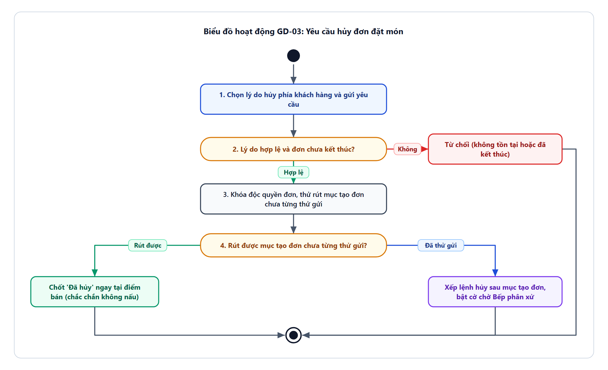

#### 3.1.3. Theo dõi đơn và giám sát kênh

##### GD-04. Theo dõi danh sách đơn, tiến độ gửi và cảnh báo kênh

- **Tên Usecase:** Theo dõi danh sách đơn, tiến độ gửi và cảnh báo kênh
- **Mô tả Usecase:** Chức năng cho phép Thu ngân hoặc Khách hàng Online quan sát danh sách đơn theo trạng thái gửi mới nhất, đồng thời dịch vụ kênh tiếp nhận phản hồi từ Kho và Bếp mà không làm lùi trạng thái khi thông điệp đến lệch thứ tự.
- **Tác nhân chính:** Thu ngân tại quầy, Khách hàng Online
- **Tác nhân phụ:** Inventory Service, Kitchen Service (phát sự kiện cập nhật trạng thái về đúng kênh gốc)
- **Điều kiện bắt đầu (Pre-Condition):** Dịch vụ kênh đang hoạt động và lắng nghe luồng phản hồi trạng thái dành riêng cho kênh đó.
- **Điều kiện kết thúc (Post-Condition):** Màn hình hiển thị danh sách đơn kèm trạng thái gửi và cảnh báo kênh; các thông điệp hợp lệ được ghi nhận chống trùng và cập nhật trạng thái đơn theo quy tắc tăng dần.
- **Trình tự các sự kiện:**
  1. Giao diện tra cứu định kỳ danh sách đơn cùng trạng thái truyền tin (Chưa gửi, Đang gửi, Đã gửi), đồng thời kiểm tra kết nối cụm truyền tin, các đơn chờ kho quá ngưỡng 10 phút, đơn sắp quá hạn 4 giờ và các cảnh báo lỗi tại kênh.
  2. Khi nhận sự kiện phản hồi từ Kho hoặc Bếp, hệ thống kiểm tra mã sự kiện đã xử lý để loại bỏ bản tin trùng lặp.
  3. Với kết quả tiến độ chính (Đã giữ kho thuộc hạng 1; Thất bại, Đã hủy, Hoàn tất thuộc hạng 2), hệ thống chỉ ghi nhận khi thứ hạng mới cao hơn thứ hạng hiện tại của đơn, đồng thời xóa cờ chờ hủy khi đơn đã kết thúc.
  4. Với phản hồi phân xử hủy khi Bếp chưa thấy đơn, đơn được gắn ghi chú "Bếp sẽ không nấu" nếu vẫn chưa kết thúc; ngược lại nếu Bếp báo đã nấu, hệ thống gỡ cờ chờ hủy và hiện thông báo "Không hủy được: bếp đã bắt đầu nấu".
  5. Bản tin hỏng cấu trúc sau năm lần thử được đưa sang hàng chờ lỗi kèm ghi nhận cảnh báo kiểm tra cho vận hành.
- **Các yêu cầu phi chức năng:** Quy tắc cập nhật theo thứ hạng tăng dần bảo đảm dù thông báo Đã hủy đến trước thông báo Đã giữ kho do trễ mạng, kết quả cuối cùng của đơn hàng vẫn giữ đúng là Đã hủy.
- **Biểu đồ hoạt động:** Quy trình tiếp nhận, chống trùng và cập nhật trạng thái đơn theo thứ hạng thể hiện trên Hình 2.6.

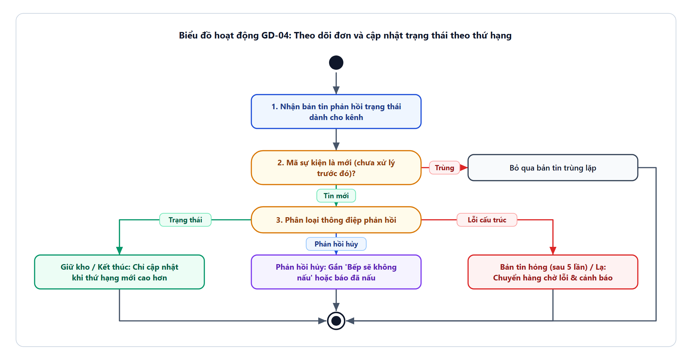

### 3.2. Module 2: Quản lý kho và giữ nguyên liệu trung tâm (Inventory)

Kho trung tâm triển khai hai tiến trình xử lý song song cùng đọc luồng đơn hàng mới từ tất cả các kênh, giúp tăng thông lượng phục vụ đồng thời kiểm chứng khả năng khóa tuần tự trên kho nguyên liệu dùng chung khi có xung đột giữa đơn tại quầy và đơn trực tuyến.

#### 3.2.1. Xử lý nguyên liệu cho đơn đa nguồn

##### GD-05. Tiếp nhận đơn mới, kiểm tra và giữ nguyên liệu

- **Tên Usecase:** Tiếp nhận đơn mới, kiểm tra và giữ nguyên liệu
- **Mô tả Usecase:** Chức năng cho phép dịch vụ Kho tiếp nhận sự kiện đơn hàng mới từ mọi kênh bán hàng, kiểm tra đầy đủ điều kiện hợp lệ và giữ trọn vẹn nguyên liệu cho cả đơn hoặc từ chối toàn bộ đơn.
- **Tác nhân chính:** Inventory Service (tiến trình xử lý sự kiện tự động)
- **Tác nhân phụ:** Kitchen Service, kênh đã tạo đơn (nhận kết quả giữ kho hoặc thất bại)
- **Điều kiện bắt đầu (Pre-Condition):** Kênh phát sinh đơn đã gửi thông điệp tạo đơn mới lên hệ thống truyền tin.
- **Điều kiện kết thúc (Post-Condition):** Mỗi mã đơn chỉ có tối đa một hồ sơ giữ kho (Đang giữ hoặc Thất bại); các dòng giữ chi tiết và thông điệp kết quả được lưu nguyên tử để phát sang Bếp và kênh gốc.
- **Trình tự các sự kiện:**
  1. Tiến trình nhận sự kiện kiểm tra mã thông điệp chống trùng; nếu đã xử lý trước đó thì bỏ qua ngay.
  2. Nếu mã đơn hàng đã có hồ sơ giữ kho từ trước (trường hợp kênh gửi lại sự kiện khác mã thông điệp), dịch vụ phát trả lại kết quả cũ về kênh gốc và kết thúc mà không trừ thêm tồn kho.
  3. Dịch vụ kiểm tra tính hợp lệ của dữ liệu món ăn (Dữ liệu đơn không hợp lệ), ngưỡng quá hạn tạo đơn 4 giờ (Đơn quá hạn), mốc tạo đơn không vượt quá 5 phút ở tương lai (Thời gian tạo không hợp lệ) và mọi món trong đơn đều đã khai báo định lượng (Món chưa có công thức).
  4. Dịch vụ khóa tuần tự các bản ghi tồn kho nguyên liệu cần dùng theo thứ tự mã nguyên liệu tăng dần; nếu có nguyên liệu đang bị gắn cờ kiểm kho (Chờ kiểm kho) hoặc không đủ lượng khả dụng (Không đủ nguyên liệu), đơn bị từ chối toàn phần.
  5. Khi đủ nguyên liệu cho tất cả món trong đơn, hệ thống trừ lượng Khả dụng, cộng sang lượng Đang giữ, lưu chi tiết từng nguyên liệu giữ cho đơn ở trạng thái Đang giữ, tính lại trạng thái các món liên quan và ghi thông điệp giữ thành công gửi tới Bếp cùng kênh gốc. Ngược lại, hệ thống ghi nhận Thất bại và báo về hai phía.
- **Các yêu cầu phi chức năng:** Quy ước khóa nguyên liệu theo thứ tự mã tăng dần loại bỏ hoàn toàn tình trạng kẹt khóa chéo (deadlock) và bảo đảm tồn khả dụng không bao giờ âm khi hai tiến trình Kho xử lý đồng thời các đơn tranh chấp cùng nguyên liệu.
- **Biểu đồ hoạt động:** Trình tự kiểm tra điều kiện, khóa nguyên liệu và chốt kết quả giữ kho được trình bày trên Hình 2.7.

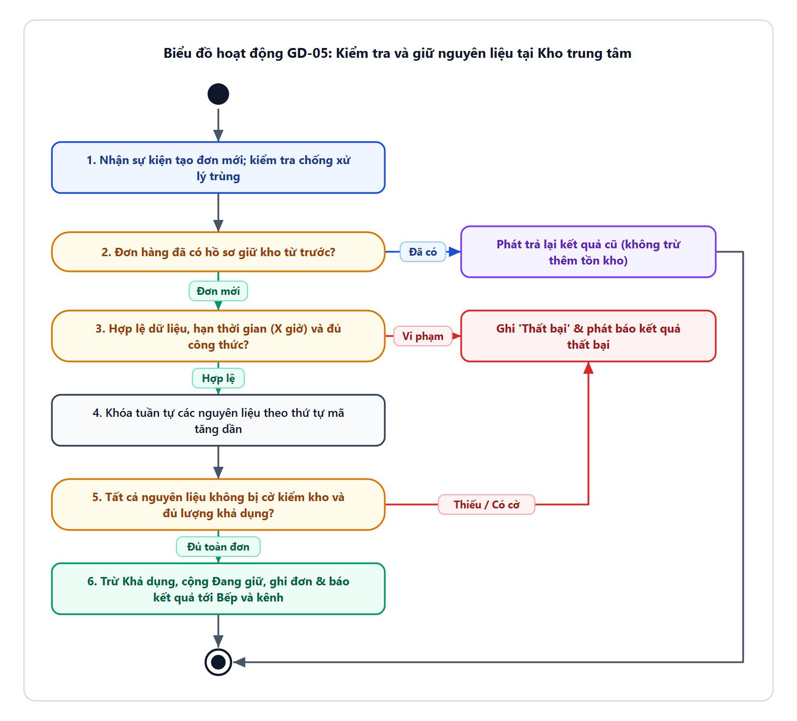

##### GD-06. Hoàn trả nguyên liệu, ghi hao hụt và chốt đã dùng

- **Tên Usecase:** Hoàn trả nguyên liệu, ghi hao hụt và chốt đã dùng
- **Mô tả Usecase:** Chức năng cho phép Kho thực thi lệnh nguyên liệu gửi từ Bếp trung tâm để chốt tiêu thụ khi bắt đầu nấu, hoàn trả lượng đang giữ khi hủy phiếu hoặc ghi nhận hao hụt kèm bật cờ kiểm kho nếu Bếp báo nguyên liệu hỏng.
- **Tác nhân chính:** Inventory Service (tiến trình xử lý lệnh tự động)
- **Tác nhân phụ:** Kitchen Service (gửi lệnh nguyên liệu và nhận thông báo cờ kiểm kho)
- **Điều kiện bắt đầu (Pre-Condition):** Bếp trung tâm đã chuyển một phiếu sang Đang nấu, Đã hủy hoặc Từ chối và phát lệnh nguyên liệu tương ứng.
- **Điều kiện kết thúc (Post-Condition):** Hồ sơ giữ kho chuyển từ Đang giữ sang Đã dùng hoặc Đã trả; từng dòng nguyên liệu giữ được đóng đúng theo trạng thái tiêu thụ, hoàn trả hoặc hao hụt.
- **Trình tự các sự kiện:**
  1. Tiến trình nhận lệnh kiểm tra mã chống trùng và thực hiện cập nhật có điều kiện chuyển hồ sơ giữ kho từ Đang giữ sang trạng thái đích (Đã dùng hoặc Đã trả).
  2. Nếu không có bản ghi nào thay đổi: trường hợp hồ sơ đã đóng hợp lệ trước đó thì bỏ qua an toàn; trường hợp đơn chưa từng giữ hoặc trước đó thất bại thì ghi cảnh báo Lệnh không khớp và giữ nguyên số lượng tồn kho.
  3. Đối với lệnh chốt tiêu thụ khi Bếp bắt đầu nấu, toàn bộ lượng nguyên liệu của đơn chuyển từ Đang giữ sang Đã dùng.
  4. Đối với lệnh hoàn kho, nếu Bếp báo lý do Nguyên liệu hỏng kèm danh sách nguyên liệu cụ thể, các nguyên liệu hỏng chuyển từ Đang giữ sang Hao hụt, đồng thời bật cờ Cần kiểm kho và phát thông báo sang Bếp; những nguyên liệu còn lại được cộng trả về Khả dụng đúng bằng số lượng đã giữ lúc đầu mà không phụ thuộc việc thay đổi công thức về sau.
- **Các yêu cầu phi chức năng:** Mỗi lệnh chốt hoặc hoàn nguyên liệu chỉ được áp dụng lên số liệu tồn kho đúng một lần duy nhất dù thông điệp có bị truyền lặp trên mạng.
- **Biểu đồ hoạt động:** Cơ chế kiểm tra điều kiện chuyển trạng thái và phân nhánh xử lý lệnh Kho thể hiện trên Hình 2.8.

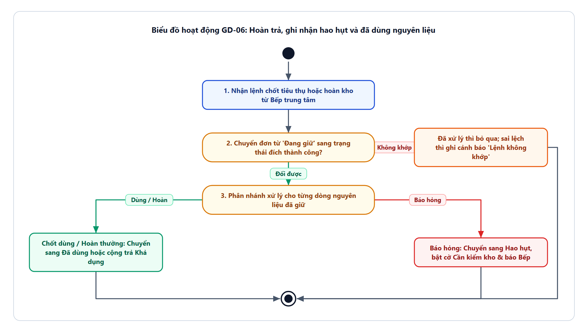

#### 3.2.2. Quản lý tồn kho

##### GD-07. Tra cứu tồn kho, cảnh báo kiểm kho và độ trễ đọc tin

- **Tên Usecase:** Tra cứu tồn kho, cảnh báo kiểm kho và độ trễ đọc tin
- **Mô tả Usecase:** Chức năng cho phép Nhân viên Kho và Quản lý vận hành theo dõi bốn chỉ số tồn kho của từng nguyên liệu, xem danh sách cảnh báo bất thường và giám sát độ trễ xử lý tin của cụm Kho.
- **Tác nhân chính:** Nhân viên Kho, Quản lý vận hành
- **Tác nhân phụ:** Apache Kafka (đọc thông tin vị trí đọc tin của cụm Kho)
- **Điều kiện bắt đầu (Pre-Condition):** Dịch vụ Kho trung tâm đang hoạt động.
- **Điều kiện kết thúc (Post-Condition):** Trả về dữ liệu chỉ đọc phục vụ hiển thị, không làm biến đổi tồn kho hay trạng thái đơn.
- **Trình tự các sự kiện:**
  1. Màn hình Kho truy xuất danh sách nguyên liệu kèm bốn chỉ số Khả dụng, Đang giữ, Đã dùng, Hao hụt và cờ Cần kiểm kho (ưu tiên các nguyên liệu đang có cờ kiểm kho lên đầu danh sách).
  2. Ở góc nhìn giám sát, hệ thống lấy tối đa 100 cảnh báo mới nhất (Cần kiểm tra, Lệnh không khớp) đồng thời đối chiếu số lượng bản tin chờ đọc tại cụm truyền tin, đánh dấu cảnh báo chậm nếu có bản tin tồn đọng lâu hơn 5 phút.
- **Các yêu cầu phi chức năng:** Việc đo độ trễ sử dụng truy vấn siêu dữ liệu tách biệt hoàn toàn với phiên xử lý đơn nên không gây xáo trộn phân chia tải của cụm Kho; kết quả đo được giữ đệm ngắn hạn (3 giây) để tránh dồn tải khi giao diện làm mới tự động.
- **Biểu đồ hoạt động:** Ba nhánh tra cứu tồn kho, cảnh báo và độ trễ xử lý được trình bày trên Hình 2.9.

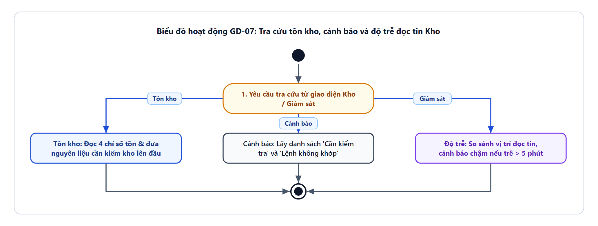

##### GD-08. Nhập bổ sung tồn kho nguyên liệu

- **Tên Usecase:** Nhập bổ sung tồn kho nguyên liệu
- **Mô tả Usecase:** Chức năng cho phép Nhân viên Kho bổ sung lượng tồn kho khả dụng cho một nguyên liệu và kích hoạt đánh giá lại trạng thái còn/hết của các món liên quan.
- **Tác nhân chính:** Nhân viên Kho
- **Tác nhân phụ:** Các kênh bán hàng (nhận cập nhật nếu có món chuyển lại sang Còn hàng)
- **Điều kiện bắt đầu (Pre-Condition):** Nguyên liệu cần nhập đã tồn tại trong danh mục tồn kho.
- **Điều kiện kết thúc (Post-Condition):** Lượng Khả dụng tăng đúng bằng số lượng nhập vào; cờ kiểm kho hiện có giữ nguyên trạng thái.
- **Trình tự các sự kiện:**
  1. Nhân viên Kho chọn nguyên liệu cần nhập, điền số lượng bổ sung và xác nhận nhập kho.
  2. Hệ thống kiểm tra số lượng nhập là số dương có tối đa ba chữ số thập phân và kiểm tra mã nguyên liệu có tồn tại; nếu sai định dạng hoặc không tồn tại thì từ chối yêu cầu.
  3. Dịch vụ khóa dòng nguyên liệu, cộng lượng nhập vào cột Khả dụng, tính lại trạng thái các món sử dụng nguyên liệu này và trả về thông tin tồn kho sau cập nhật.
- **Các yêu cầu phi chức năng:** Thao tác cộng tồn kho và tính lại trạng thái món diễn ra trong cùng một giao dịch theo đúng thứ tự khóa tránh deadlock.
- **Biểu đồ hoạt động:** Quy trình kiểm tra đầu vào và cập nhật bổ sung tồn kho thể hiện trên Hình 2.10.

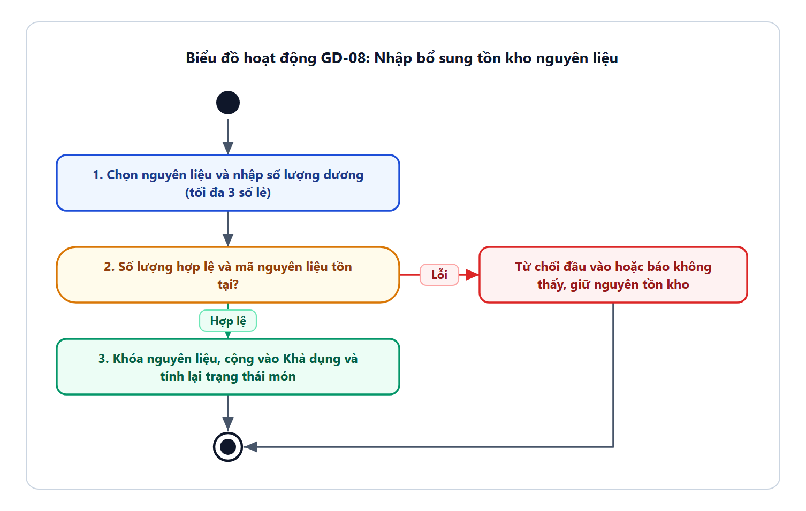

##### GD-09. Xác nhận kiểm kho xong và đối chiếu tồn thực tế

- **Tên Usecase:** Xác nhận kiểm kho xong và đối chiếu tồn thực tế
- **Mô tả Usecase:** Chức năng cho phép Nhân viên Kho xác nhận hoàn tất kiểm đếm thực tế một nguyên liệu đang bị gắn cờ, cập nhật lại lượng khả dụng và gửi thông báo để Bếp gỡ cảnh báo trên các phiếu chờ.
- **Tác nhân chính:** Nhân viên Kho
- **Tác nhân phụ:** Kitchen Service (nhận sự kiện gỡ cờ kiểm kho), các kênh bán hàng (nhận trạng thái món cập nhật)
- **Điều kiện bắt đầu (Pre-Condition):** Nguyên liệu tồn tại trong danh mục kho (thường đang gắn cờ Cần kiểm kho sau khi Bếp báo hỏng).
- **Điều kiện kết thúc (Post-Condition):** Cờ Cần kiểm kho được tắt; nếu có nhập số đếm thực tế, lượng Khả dụng mới bằng số lượng thực đếm trừ đi phần Đang giữ; sự kiện gỡ cờ mang phiên bản tăng đơn điệu được ghi nhận để phát sang Bếp.
- **Trình tự các sự kiện:**
  1. Nhân viên Kho chọn nguyên liệu đang gắn cờ, nhập tùy chọn tổng lượng tồn đếm được thực tế và xác nhận hoàn tất kiểm kho.
  2. Dịch vụ kiểm tra nguyên liệu tồn tại, khóa bản ghi nguyên liệu và đối chiếu nếu lượng thực đếm nhỏ hơn phần Đang giữ thì từ chối thao tác vì xung đột, yêu cầu xử lý xong các phiếu đang giữ nguyên liệu trước.
  3. Nếu đạt điều kiện, hệ thống cập nhật lượng Khả dụng mới (nếu có số đếm), tắt cờ Cần kiểm kho, tăng bộ đếm phiên bản để ghi nhận sự kiện gỡ cờ tới Bếp và tính lại trạng thái các món liên quan.
- **Các yêu cầu phi chức năng:** Số phiên bản đính kèm thông điệp gỡ cờ luôn lớn hơn thông điệp bật cờ trước đó, bảo đảm thông điệp trễ mạng không thể làm Bếp hiển thị sai cờ cảnh báo.
- **Biểu đồ hoạt động:** Luồng đối chiếu lượng giữ hiện hữu và gỡ cờ kiểm kho được mô tả trên Hình 2.11.

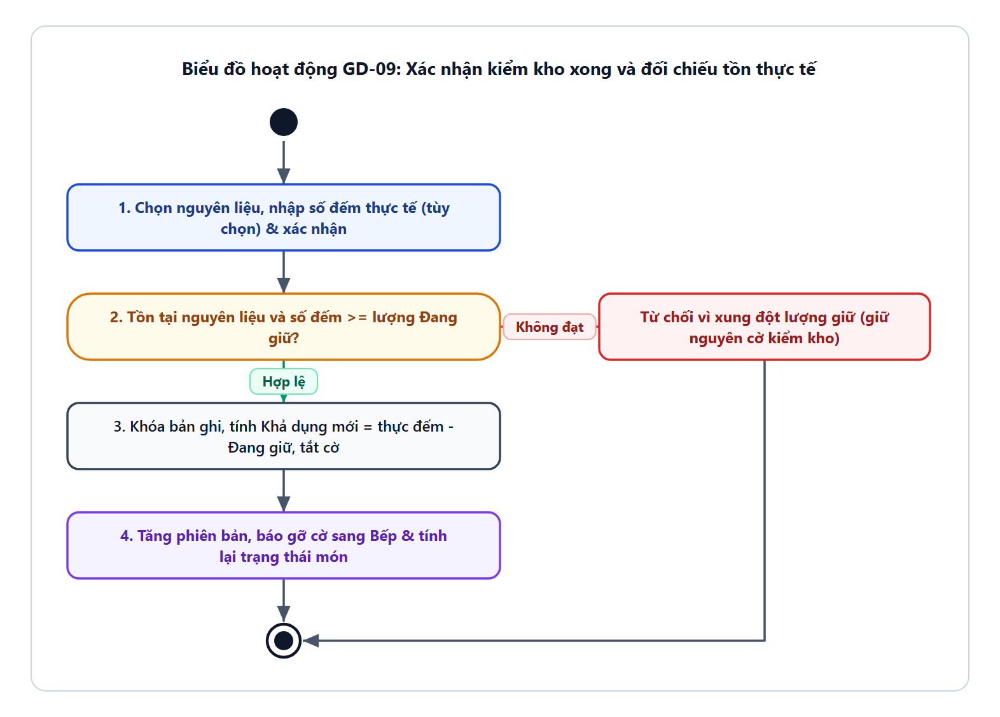

#### 3.2.3. Đồng bộ trạng thái thực đơn

##### GD-10. Tính lại, công bố trạng thái món và cấp ảnh chụp thực đơn

- **Tên Usecase:** Tính lại, công bố trạng thái món và cấp ảnh chụp thực đơn
- **Mô tả Usecase:** Chức năng cho phép Kho tự động tính lại trạng thái Còn hàng / Hết hàng / Tạm ẩn của các món ăn sau mỗi biến động tồn kho, phát thông báo kèm số phiên bản tăng dần, đồng thời cung cấp ảnh chụp thực đơn toàn phần và hỗ trợ nâng thế hệ phiên bản khi phục hồi dữ liệu.
- **Tác nhân chính:** Inventory Service, các Kênh bán hàng
- **Tác nhân phụ:** Kitchen Service (nhận lại trạng thái cờ kiểm kho khi nâng thế hệ)
- **Điều kiện bắt đầu (Pre-Condition):** Có giao dịch làm thay đổi tồn kho/cờ kiểm kho, hoặc một điểm bán vừa khởi động lại cần đồng bộ toàn phần.
- **Điều kiện kết thúc (Post-Condition):** Trạng thái các món tại Kho khớp với tồn kho; món có thay đổi phát sự kiện cập nhật mang phiên bản mới; sau khi nâng thế hệ, mọi món mang số thế hệ mới nhất.
- **Trình tự các sự kiện:**
  1. Trong cùng giao dịch làm đổi tồn kho, dịch vụ khóa danh sách trạng thái món liên quan theo thứ tự mã món tăng dần để đánh giá điều kiện phục vụ.
  2. Món đạt trạng thái Còn hàng khi mọi nguyên liệu trong công thức đều đủ cho ít nhất một suất và không bị gắn cờ kiểm kho; chuyển Hết hàng nếu thiếu nguyên liệu hoặc đang kiểm kho; chuyển Tạm ẩn khi chưa khai báo công thức.
  3. Nếu trạng thái món thay đổi so với trước, dịch vụ lấy số phiên bản tăng đơn điệu mới, cập nhật bảng trạng thái món và đẩy thông điệp cập nhật tới các kênh; định kỳ mỗi 60 giây, Kho cũng phát tín hiệu nhịp để các kênh xác nhận kết nối.
  4. Khi điểm bán yêu cầu đồng bộ toàn phần, Kho cung cấp ảnh chụp toàn bộ trạng thái món kèm phiên bản hiện hành; khi quản trị viên kích hoạt nâng thế hệ phiên bản mới, Kho đánh số thế hệ tiếp theo, tính lại toàn bộ thực đơn và gửi đồng bộ lại danh sách cờ kiểm kho cho Bếp.
- **Các yêu cầu phi chức năng:** Thứ tự khóa cố định (đơn hàng → nguyên liệu → trạng thái món → bộ đếm phiên bản) loại bỏ xung đột khóa giữa nhiều giao dịch chạy song song; các kênh bán hàng chỉ ghi đè bộ đệm khi nhận được phiên bản mới hơn bản đang giữ.
- **Biểu đồ hoạt động:** Hai nhánh cập nhật gia tăng và đồng bộ toàn phần/nâng thế hệ thể hiện trên Hình 2.12.

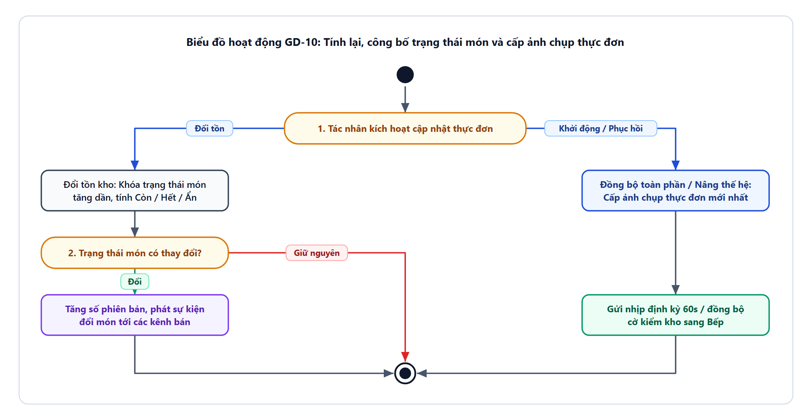

### 3.3. Module 3: Điều phối chế biến tại Bếp trung tâm (Kitchen)

Dịch vụ Bếp trung tâm hợp nhất toàn bộ đơn hàng đã giữ nguyên liệu thành công từ cả kênh tại quầy và kênh trực tuyến thành một hàng đợi phiếu chế biến thống nhất, đồng thời đóng vai trò trọng tài duy nhất phân xử mọi lệnh hủy phát sinh sau khi đơn đã rời điểm bán.

#### 3.3.1. Tiếp nhận đơn và phân xử hủy

##### GD-11. Hợp nhất đơn từ Kho, lập phiếu bếp và phân xử yêu cầu hủy

- **Tên Usecase:** Hợp nhất đơn từ Kho, lập phiếu bếp và phân xử yêu cầu hủy
- **Mô tả Usecase:** Chức năng cho phép Bếp trung tâm tiếp nhận kết quả giữ kho để lập phiếu nấu, đồng thời xử lý nhất quán mọi tình huống lệnh hủy từ điểm bán đến trước, đến sau hoặc đến cùng lúc với thông tin đơn hàng.
- **Tác nhân chính:** Kitchen Service (tiến trình xử lý sự kiện tự động)
- **Tác nhân phụ:** Inventory Service, các kênh bán hàng gốc
- **Điều kiện bắt đầu (Pre-Condition):** Có sự kiện kết quả giữ kho gửi tới Bếp hoặc yêu cầu hủy gửi từ một điểm bán.
- **Điều kiện kết thúc (Post-Condition):** Mỗi đơn hàng có duy nhất một hồ sơ phiếu tại Bếp; các thông điệp hoàn kho và phản hồi kết quả về đúng kênh tạo đơn được ghi nguyên tử vào hàng chờ gửi.
- **Trình tự các sự kiện:**
  1. Tiến trình nhận tin kiểm tra mã sự kiện chống trùng, tạo sẵn bản ghi giữ chỗ nếu chưa từng thấy mã đơn rồi khóa độc quyền hồ sơ phiếu tại Bếp.
  2. Khi nhận kết quả giữ kho thành công: nếu đơn đang ở trạng thái Chưa có, Bếp lập phiếu Chờ nấu kèm phần nguyên liệu đã giữ; nếu trước đó đã ghi nhận yêu cầu hủy từ đúng kênh tạo đơn (Hủy chờ đơn), Bếp chốt thẳng Đã hủy, phát lệnh hoàn kho sang Kho và báo Đã hủy về kênh gốc; nếu phiếu đã kết thúc từ trước thì chỉ phản hồi lại kết quả cũ.
  3. Khi nhận kết quả từ chối do hết hàng, Bếp cập nhật hồ sơ sang Thất bại và đóng các ghi chú hủy đang chờ (nếu có).
  4. Khi nhận yêu cầu hủy từ điểm bán, hệ thống xác thực tên kênh gửi dựa trên luồng sự kiện tiếp nhận (không tin vào thông tin tự khai bên trong thông điệp); nếu không khớp với kênh đã tạo đơn, hệ thống bỏ qua lệnh hủy và ghi nhận Cảnh báo hủy sai kênh.
  5. Với yêu cầu hủy đúng kênh: nếu Bếp Chưa có thông tin đơn, hệ thống đánh dấu Hủy chờ đơn và phản hồi "Bếp sẽ không nấu" (tuyệt đối không tự chốt đã hủy khi chưa thấy đơn); nếu phiếu đang Chờ nấu, Bếp chuyển ngay sang Đã hủy kèm lệnh hoàn kho; nếu phiếu đang Đang nấu hoặc Hoàn tất, Bếp phản hồi Từ chối hủy; nếu đã chốt trước đó thì giữ nguyên kết quả và không phát lệnh hoàn kho lần hai.
- **Các yêu cầu phi chức năng:** Khóa độc quyền trên hồ sơ phiếu tại Bếp bảo đảm các sự kiện đến đồng thời hoặc đảo thứ tự giữa Kho và điểm bán luôn dẫn tới một kết cục nhất quán tuyệt đối ở cả ba phía.
- **Biểu đồ hoạt động:** Quy trình phân nhánh tiếp nhận đơn và phân xử yêu cầu hủy tại Bếp thể hiện trên Hình 2.13.

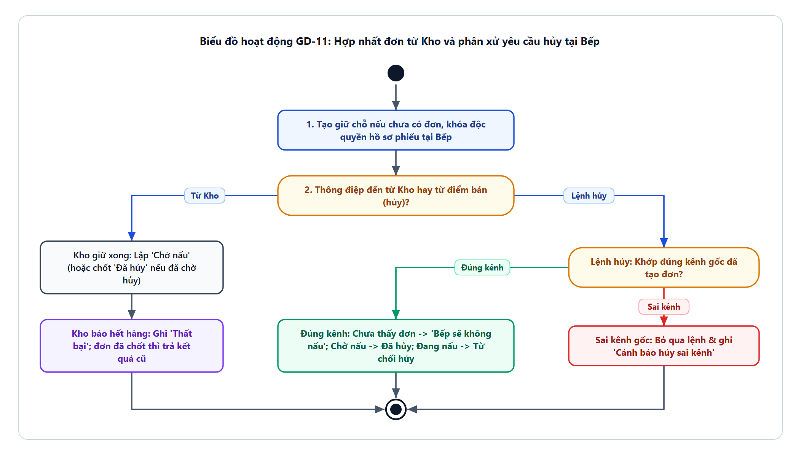

#### 3.3.2. Xử lý phiếu chế biến

##### GD-12. Theo dõi danh sách phiếu chế biến và cảnh báo bếp

- **Tên Usecase:** Theo dõi danh sách phiếu chế biến và cảnh báo bếp
- **Mô tả Usecase:** Chức năng cho phép Nhân viên Bếp quan sát hai cột hàng đợi Chờ nấu và Đang nấu hợp nhất từ mọi nguồn bán hàng, kèm cảnh báo các phiếu có nguyên liệu đang cần kiểm kho và cảnh báo vận hành tại Bếp.
- **Tác nhân chính:** Nhân viên Bếp
- **Tác nhân phụ:** Inventory Service (cập nhật cờ kiểm kho theo phiên bản), Apache Kafka
- **Điều kiện bắt đầu (Pre-Condition):** Dịch vụ Bếp trung tâm đang hoạt động.
- **Điều kiện kết thúc (Post-Condition):** Màn hình Bếp hiển thị đầy đủ phiếu theo thứ tự thời gian kèm cờ cảnh báo chính xác, không làm thay đổi dữ liệu đơn hàng.
- **Trình tự các sự kiện:**
  1. Giao diện Bếp tải đồng thời hai danh sách phiếu Chờ nấu và Đang nấu hợp nhất từ các quầy POS và kênh Online, kèm bộ đếm tổng số phiếu mỗi trạng thái.
  2. Hệ thống đối chiếu danh sách nguyên liệu giữ trên từng phiếu Chờ nấu với bảng nguyên liệu đang bị gắn cờ tại Bếp để gắn nhãn cảnh báo đỏ giúp đầu bếp kiểm tra thực tế.
  3. Song song đó, khu vực giám sát hiển thị các cảnh báo Hủy sai kênh, Bản tin cần kiểm tra và độ trễ xử lý sự kiện của Bếp.
- **Các yêu cầu phi chức năng:** Cảnh báo kiểm kho chỉ nhằm nhắc nhân viên Bếp xác minh chất lượng nguyên liệu thực tế trước khi nấu mà không tự động hủy đơn của khách hàng.
- **Biểu đồ hoạt động:** Quy trình hợp nhất phiếu chế biến và gắn cảnh báo kiểm kho được minh họa trên Hình 2.14.

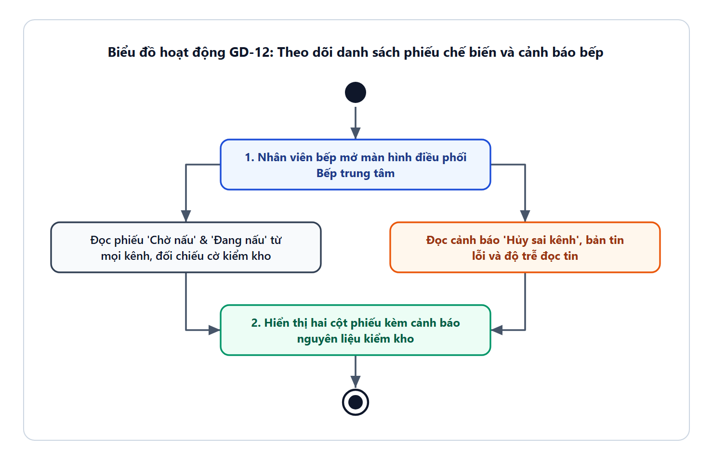

##### GD-13. Bắt đầu chế biến phiếu bếp

- **Tên Usecase:** Bắt đầu chế biến phiếu bếp
- **Mô tả Usecase:** Chức năng cho phép Nhân viên Bếp xác nhận bắt đầu nấu một phiếu đang chờ, đánh dấu ranh giới không còn hủy được đơn và báo Kho chốt tiêu thụ nguyên liệu.
- **Tác nhân chính:** Nhân viên Bếp
- **Tác nhân phụ:** Inventory Service (tiếp nhận lệnh chốt tiêu thụ nguyên liệu)
- **Điều kiện bắt đầu (Pre-Condition):** Phiếu chế biến tồn tại và đang ở trạng thái Chờ nấu.
- **Điều kiện kết thúc (Post-Condition):** Phiếu chuyển sang Đang nấu; lệnh chốt tiêu thụ nguyên liệu nằm trong hàng chờ gửi sang Kho; từ thời điểm này mọi yêu cầu hủy đều bị từ chối.
- **Trình tự các sự kiện:**
  1. Nhân viên Bếp chọn phiếu cần chế biến và bấm Bắt đầu nấu.
  2. Hệ thống khóa độc quyền hồ sơ phiếu tại Bếp; nếu không tìm thấy hoặc phiếu đã bị hủy hay chuyển trạng thái trước đó (ví dụ điểm bán vừa hủy trùng lúc), dịch vụ từ chối thao tác kèm trạng thái mới nhất của phiếu.
  3. Khi phiếu hợp lệ ở trạng thái Chờ nấu, hệ thống cập nhật sang Đang nấu và ghi đồng thời lệnh chốt đã tiêu thụ nguyên liệu vào hàng chờ gửi sang Kho trong cùng giao dịch.
- **Các yêu cầu phi chức năng:** Thao tác khóa bản ghi phiếu bảo đảm khi nhân viên Bếp bấm nấu trùng thời điểm có yêu cầu hủy từ quầy hoặc trực tuyến, chỉ một quyết định thắng cuộc và tất cả dịch vụ nhìn thấy cùng một trạng thái.
- **Biểu đồ hoạt động:** Luồng khóa bản ghi phiếu và phát lệnh tiêu thụ nguyên liệu thể hiện trên Hình 2.15.

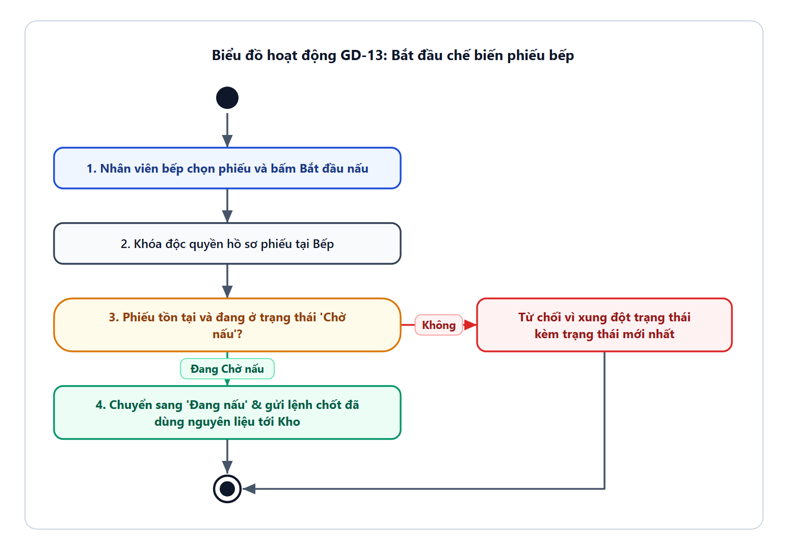

##### GD-14. Từ chối phiếu chế biến và báo nguyên liệu hỏng

- **Tên Usecase:** Từ chối phiếu chế biến và báo nguyên liệu hỏng
- **Mô tả Usecase:** Chức năng cho phép Nhân viên Bếp từ chối một phiếu đang chờ nấu với lý do cố định; riêng trường hợp nguyên liệu hỏng bắt buộc chỉ định rõ nguyên liệu nào để Kho ghi hao hụt và bật cờ kiểm kho.
- **Tác nhân chính:** Nhân viên Bếp
- **Tác nhân phụ:** Inventory Service (nhận lệnh hoàn kho hoặc ghi hao hụt), kênh gốc tạo đơn (nhận trạng thái Đã hủy)
- **Điều kiện bắt đầu (Pre-Condition):** Phiếu chế biến đang ở trạng thái Chờ nấu.
- **Điều kiện kết thúc (Post-Condition):** Phiếu chuyển sang Đã hủy (do Bếp hủy); thông báo hủy về kênh gốc và lệnh hoàn kho/hao hụt tới Kho cùng được ghi vào hàng chờ gửi.
- **Trình tự các sự kiện:**
  1. Nhân viên Bếp chọn lý do từ chối (Hỏng thiết bị, Thiếu nhân lực hoặc Nguyên liệu hỏng kèm danh sách nguyên liệu bị hỏng trên phiếu) và xác nhận từ chối.
  2. Hệ thống kiểm tra lý do hợp lệ và xác minh các nguyên liệu báo hỏng phải thuộc phần nguyên liệu đã giữ cho phiếu; nếu sai thì từ chối yêu cầu.
  3. Hệ thống khóa bản ghi phiếu tại Bếp, kiểm tra lại điều kiện đang Chờ nấu (từ chối nếu đã chuyển sang Đang nấu hoặc đã hủy), chuyển trạng thái sang Đã hủy và ghi đồng thời thông báo hủy về kênh gốc cùng lệnh hoàn kho tới Kho trong cùng giao dịch.
- **Các yêu cầu phi chức năng:** Kể cả khi dịch vụ Kho tạm thời ngưng hoạt động, điểm bán vẫn nhận ngay kết quả Đã hủy trực tiếp từ Bếp để báo khách, còn lệnh hoàn kho nằm an toàn trong hàng đợi chờ Kho xử lý khi phục hồi.
- **Biểu đồ hoạt động:** Quy trình kiểm tra nguyên liệu báo hỏng và đồng bộ hai phía thể hiện trên Hình 2.16.

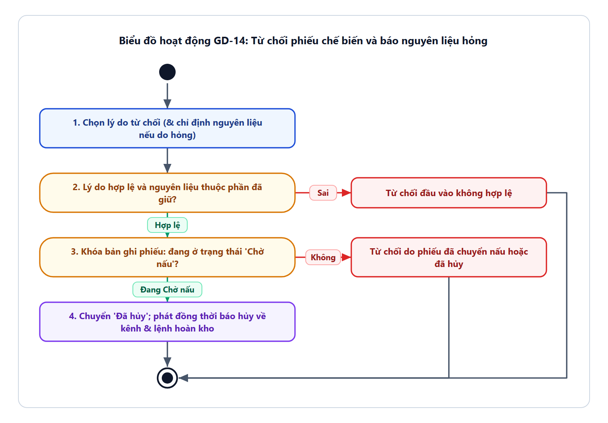

##### GD-15. Xác nhận hoàn tất chế biến món

- **Tên Usecase:** Xác nhận hoàn tất chế biến món
- **Mô tả Usecase:** Chức năng cho phép Nhân viên Bếp xác nhận đã nấu xong một phiếu đang chế biến để chuyển thông báo hoàn thành về điểm bán hoặc khách hàng trực tuyến.
- **Tác nhân chính:** Nhân viên Bếp
- **Tác nhân phụ:** Kênh gốc tạo đơn (nhận sự kiện hoàn tất đơn)
- **Điều kiện bắt đầu (Pre-Condition):** Phiếu tồn tại và đang ở trạng thái Đang nấu.
- **Điều kiện kết thúc (Post-Condition):** Phiếu chuyển sang Hoàn tất; thông báo hoàn tất được ghi vào hàng chờ gửi về đúng kênh tạo đơn.
- **Trình tự các sự kiện:**
  1. Nhân viên Bếp chọn phiếu đã nấu xong và bấm Hoàn tất.
  2. Hệ thống khóa độc quyền bản ghi phiếu tại Bếp; nếu không tìm thấy hoặc phiếu không ở trạng thái Đang nấu, dịch vụ từ chối thao tác do xung đột trạng thái.
  3. Dịch vụ cập nhật trạng thái phiếu sang Hoàn tất và ghi sự kiện hoàn tất đơn vào hàng chờ gửi về kênh tạo đơn trong cùng một giao dịch.
- **Các yêu cầu phi chức năng:** Bước hoàn tất không cần phát thêm thông điệp tới Kho vì lượng nguyên liệu của đơn đã được chốt tiêu thụ ở bước Bắt đầu nấu.
- **Biểu đồ hoạt động:** Quy trình khóa bản ghi và phát sự kiện hoàn tất chế biến được minh họa trên Hình 2.17.

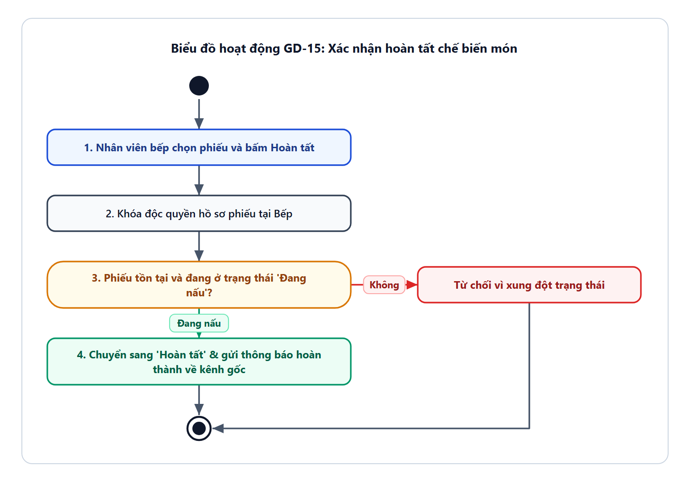

### 3.4. Module 4: Tổng hợp đơn hàng trung tâm và giám sát toàn chuỗi (Query)

#### 3.4.1. Xem báo cáo hợp nhất

##### GD-16. Tổng hợp và xem báo cáo đơn hàng toàn chuỗi gần thời gian thực

- **Tên Usecase:** Tổng hợp và xem báo cáo đơn hàng toàn chuỗi gần thời gian thực
- **Mô tả Usecase:** Chức năng cho phép Quản lý chuỗi xem bảng thống kê số lượng đơn theo trạng thái và lý do đóng của từng kênh (POS01, POS02, ONLINE) kèm mốc thời gian "Dữ liệu tính đến" phản ánh độ trễ đồng bộ từng nguồn.
- **Tác nhân chính:** Quản lý chuỗi
- **Tác nhân phụ:** Central Order Replica (bản sao tổng hợp nhận nhân bản từ các nguồn)
- **Điều kiện bắt đầu (Pre-Condition):** Đường truyền nhân bản dữ liệu từ các điểm bán và kênh trực tuyến về trung tâm đã được thiết lập; dịch vụ truy vấn báo cáo đang hoạt động.
- **Điều kiện kết thúc (Post-Condition):** Trả về số liệu thống kê nhất quán giữa số lượng đơn và mốc cập nhật từng kênh, không làm thay đổi dữ liệu gốc.
- **Trình tự các sự kiện:**
  1. Ở tiến trình nền, mỗi dịch vụ kênh ghi nhận mốc nhịp đồng bộ định kỳ mỗi 5 giây vào cơ sở dữ liệu riêng; cơ chế nhân bản bất đồng bộ đẩy đồng thời các đơn hàng mới và mốc nhịp đồng bộ về bản sao trung tâm Central Order Replica theo đúng thứ tự xác nhận giao dịch.
  2. Khi Quản lý mở màn hình báo cáo, giao diện gửi yêu cầu tải số liệu tổng hợp tới dịch vụ truy vấn trung tâm.
  3. Dịch vụ mở một giao dịch đọc nhất quán trên cùng một lát cắt thời gian tại Central Order Replica, đọc đồng thời mốc nhịp đồng bộ mới nhất của từng kênh (tính tuổi độ trễ dữ liệu) và tổng hợp số lượng đơn theo từng kênh, năm trạng thái chính cùng chi tiết lý do hủy/thất bại.
  4. Kênh đã khai báo nhưng chưa có nhịp nhân bản trả về mốc chưa đồng bộ với số lượng bằng 0; toàn bộ bảng thống kê được hiển thị lên màn hình Quản lý kèm nhãn "Dữ liệu tính đến" riêng cho từng nguồn.
- **Các yêu cầu phi chức năng:** Đọc cả bảng nhịp đồng bộ và bảng đơn hàng trong cùng một lát cắt thời gian bảo đảm mốc "Dữ liệu tính đến" không bao giờ chạy trước tập đơn thực tế trong cùng báo cáo; khi một kênh đứt nhân bản, các kênh còn lại vẫn cập nhật bình thường trong khi độ trễ kênh gặp sự cố hiển thị rõ cho quản lý nhận biết.
- **Biểu đồ hoạt động:** Mối liên kết giữa luồng nhân bản dữ liệu nền và truy vấn báo cáo nhất quán thể hiện trên Hình 2.18.

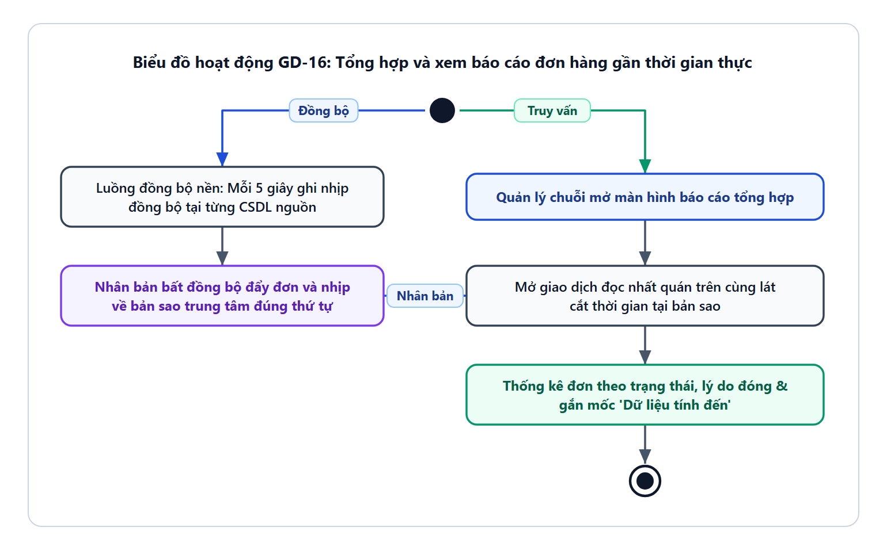

## IV. THIẾT KẾ CƠ SỞ DỮ LIỆU

### 4.1. Các cơ sở dữ liệu của hệ thống

Áp dụng mô hình phân tách dữ liệu theo dịch vụ (Database-per-Service), mỗi dịch vụ quản lý một cơ sở dữ liệu PostgreSQL 16 riêng biệt như liệt kê trong Bảng 2.4. Hai quầy bán hàng và kênh đặt món trực tuyến dùng chung một cấu trúc lược đồ Branch DB nhưng tách thành ba cơ sở dữ liệu độc lập có bật kênh nhân bản logic để đẩy dữ liệu về bản sao trung tâm.

*Bảng 2.4. Danh mục các cơ sở dữ liệu trong hệ thống*

| TT | Cơ sở dữ liệu | Lược đồ / Định danh DB | Vai trò lưu trữ |
|---|---|---|---|
| 1 | Inventory DB | `inventory` (Kho trung tâm) | Cơ sở dữ liệu nguyên liệu và công thức dùng chung toàn chuỗi; hai tiến trình Inventory Service cùng truy cập và điều phối tranh chấp bằng khóa dòng. |
| 2 | Kitchen DB | `kitchen` (Bếp trung tâm) | Lưu phiếu chế biến hợp nhất từ mọi nguồn, hàng chờ hủy sớm và cờ kiểm kho nhận từ Kho trung tâm. |
| 3 | Branch DB (POS01) | `branch` (Kênh POS01) | Lưu đơn hàng, hàng chờ gửi và bộ đệm thực đơn của quầy POS01; kích hoạt luồng nhân bản về trung tâm. |
| 4 | Branch DB (POS02) | `branch` (Kênh POS02) | Cùng cấu trúc lược đồ với POS01, phục vụ độc lập cho quầy POS02. |
| 5 | Branch DB (ONLINE) | `branch` (Kênh ONLINE) | Cùng cấu trúc lược đồ với điểm bán tại quầy, phục vụ riêng cho tiến trình đặt hàng trực tuyến. |
| 6 | Central Order Replica | `central` (Tổng hợp) | Bản sao tập trung hợp nhất đơn hàng và nhịp đồng bộ từ cả ba nguồn POS01, POS02, ONLINE, cấp quyền chỉ đọc cho dịch vụ truy vấn báo cáo. |

### 4.2. Thiết kế chi tiết cơ sở dữ liệu

Kiến trúc lưu trữ không sử dụng khóa ngoại vật lý liên cơ sở dữ liệu mà liên thông nghiệp vụ thông qua định danh duy nhất toàn cục `order_id` (`UUID`) do kênh phát sinh tạo ra. Các thay đổi trạng thái giữa nhóm nguồn phát sinh đơn, Kho và Bếp truyền qua cụm truyền tin bằng cặp bảng hàng chờ gửi `outbox_events` và chống trùng `processed_events`, còn luồng dữ liệu báo cáo hợp nhất đi qua nhân bản bất đồng bộ từ ba cơ sở dữ liệu nguồn về Central Order Replica. Toàn bộ liên kết thực thể liên dịch vụ được minh họa trên Hình 2.19.

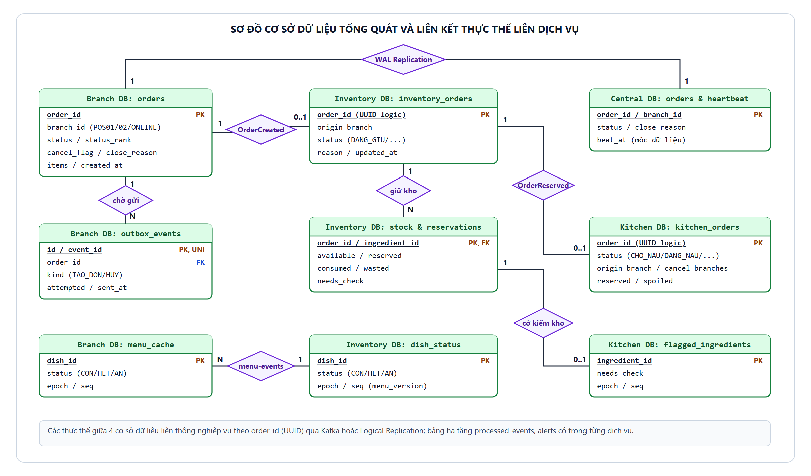

#### 4.2.1. Các bảng trong cơ sở dữ liệu

Tổng cộng 24 bảng dữ liệu trên bốn lược đồ cơ sở dữ liệu của hệ thống được liệt kê đầy đủ kèm vai trò trong Bảng 2.5.

*Bảng 2.5. Danh mục 24 bảng dữ liệu trên bốn lược đồ cơ sở dữ liệu*

| STT | Cơ sở dữ liệu | Tên bảng | Mô tả vai trò |
|---|---|---|---|
| 1 | Inventory DB | `stock` | Lưu từng nguyên liệu với đơn vị tính, bốn đại lượng tồn (`available`, `reserved`, `consumed`, `wasted`) và cờ kiểm kho `needs_check`. |
| 2 | Inventory DB | `recipes` | Lưu định lượng nguyên liệu cần giữ cho một phần của từng món ăn. |
| 3 | Inventory DB | `inventory_orders` | Lưu kết quả giữ kho duy nhất cho mỗi đơn hàng (đang giữ, thất bại, đã trả, đã dùng) cùng kênh gốc và lý do. |
| 4 | Inventory DB | `inventory_reservations` | Ghi chi tiết số lượng đã giữ của từng nguyên liệu cho từng đơn và kết quả đóng dòng (đã hoàn, đã dùng, hao hụt). |
| 5 | Inventory DB | `dish_status` | Lưu trạng thái phục vụ hiện hành của từng món (còn, hết, ẩn) kèm bộ đếm phiên bản `(epoch, seq)`. |
| 6 | Inventory DB | `menu_version` | Bảng một dòng duy nhất đóng vai trò bộ đếm phiên bản `(epoch, seq)` bền vững trong cơ sở dữ liệu. |
| 7 | Inventory DB | `alerts` | Ghi nhận các cảnh báo vận hành tại Kho (cần kiểm tra bản tin hoặc lệnh không khớp). |
| 8 | Inventory DB | `processed_events` | Lưu danh sách mã sự kiện `event_id` đã xử lý nhằm bảo đảm chống xử lý lặp thông điệp. |
| 9 | Inventory DB | `outbox_events` | Hàng chờ sự kiện ghi trong cùng giao dịch nghiệp vụ để chuyển phát sang cụm truyền tin. |
| 10 | Kitchen DB | `kitchen_orders` | Lưu hồ sơ duy nhất của mỗi đơn tại Bếp qua các trạng thái từ chưa có đơn, hủy chờ đơn, chờ nấu, đang nấu tới hoàn tất/hủy/thất bại. |
| 11 | Kitchen DB | `flagged_ingredients` | Lưu danh sách nguyên liệu đang bị gắn cờ kiểm kho kèm phiên bản `(epoch, seq)` nhận từ Kho. |
| 12 | Kitchen DB | `alerts` | Lưu các cảnh báo tại Bếp (lỗi định dạng bản tin và hủy sai kênh tạo đơn). |
| 13 | Kitchen DB | `processed_events` | Bảng chống xử lý trùng mã sự kiện cho tiến trình nhận tin của Bếp. |
| 14 | Kitchen DB | `outbox_events` | Hàng chờ sự kiện gửi lệnh nguyên liệu tới Kho và thông báo kết quả về kênh gốc. |
| 15 | Branch DB | `orders` | Lưu đơn hàng tại từng kênh với trạng thái tăng dần theo `status_rank`, cờ yêu cầu hủy và thông báo phản hồi hủy. |
| 16 | Branch DB | `outbox_events` | Hàng chờ gửi có cờ `attempted` phân biệt đơn chưa từng thử gửi và đơn đã gửi ra mạng. |
| 17 | Branch DB | `dishes` | Danh mục món ăn cục bộ của điểm bán, giúp tiếp nhận đơn ngay cả khi mất kết nối mạng trung tâm. |
| 18 | Branch DB | `menu_cache` | Bộ đệm trạng thái món nhận từ Kho, hợp nhất đơn điệu theo phiên bản `(epoch, seq)`. |
| 19 | Branch DB | `menu_cache_meta` | Bảng một dòng lưu thế hệ `epoch` đang giữ, `newest_epoch` và mốc liên lạc `last_heard_at` với Kho. |
| 20 | Branch DB | `replication_heartbeat` | Ghi nhận nhịp thời gian mỗi 5 giây tại nguồn để xác định mốc dữ liệu của báo cáo hợp nhất. |
| 21 | Branch DB | `processed_events` | Bảng chống xử lý trùng thông điệp trạng thái nhận từ Kho và Bếp. |
| 22 | Branch DB | `alerts` | Ghi nhận cảnh báo bản tin trạng thái hỏng định dạng hoặc sai loại. |
| 23 | Central Order Replica | `orders` | Bản sao tập trung hợp nhất mọi đơn hàng nhân bản từ hai quầy POS và kênh Online. |
| 24 | Central Order Replica | `replication_heartbeat` | Bản sao mốc thời gian đồng bộ mới nhất của từng kênh phục vụ màn hình Quản lý. |

#### 4.2.2. Thiết kế chi tiết các bảng

Sơ đồ thực thể – quan hệ chi tiết của từng cơ sở dữ liệu (Hình 2.20 đến Hình 2.23) cùng đặc tả từng trường dữ liệu của 24 bảng (Bảng 2.6 đến Bảng 2.29) dưới đây được tổng hợp đồng bộ từ bốn lược đồ cơ sở dữ liệu PostgreSQL 16 đang vận hành của hệ thống.

<!-- include: generated/csdl.md -->

<!--PAGEBREAK-->
