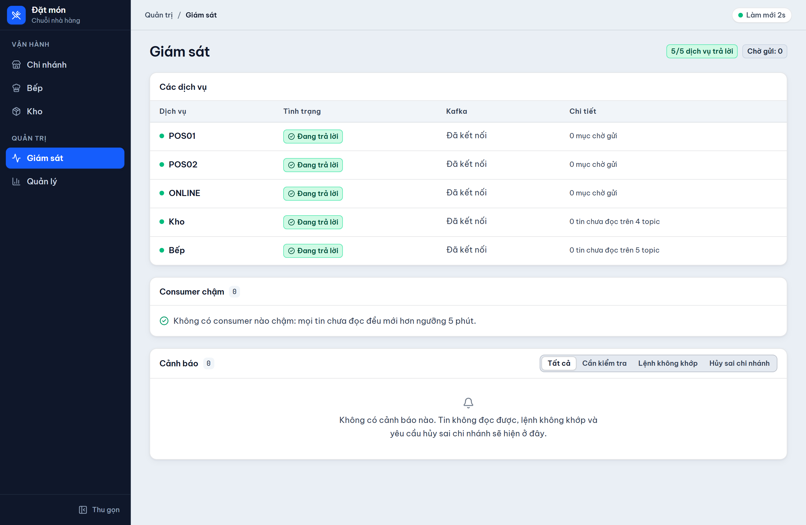
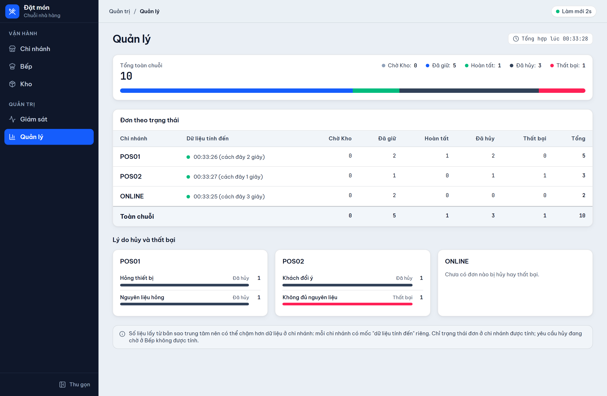

# PHẦN III. XÂY DỰNG, PHÁT TRIỂN HỆ THỐNG

## I. MÔ TẢ CÔNG NGHỆ SỬ DỤNG

Hệ thống đặt hàng tại quầy và online hợp nhất được phát triển hoàn toàn trên nền tảng mã nguồn mở, đóng gói dưới dạng các container độc lập và giao tiếp thông qua hợp đồng dữ liệu chặt chẽ giữa giao diện, các dịch vụ REST và cụm truyền tin sự kiện. Toàn bộ công nghệ và phiên bản triển khai thực tế của hệ thống được trình bày chi tiết theo năm nhóm nền tảng dưới đây và tổng hợp trong Bảng 3.1.

### 1.1. Kiến trúc hệ thống và hạ tầng triển khai

Hệ thống áp dụng kiến trúc microservices hướng sự kiện, đóng gói toàn bộ thành phần qua Docker Compose gồm 14 container lõi (mở rộng đầy đủ 21 container ở cấu hình đa điểm bán). Để phục vụ kiểm thử chia cắt mạng từng kênh mà không làm gián đoạn cụm trung tâm, hạ tầng container được tách thành 9 vùng mạng nội bộ cô lập theo đúng đường đi dữ liệu: mạng truyền tin sự kiện, mạng Kho, mạng Bếp, ba mạng riêng của từng kênh bán hàng, mạng nhân bản dữ liệu, mạng giao tiếp API và mạng kiểm thử. Các dịch vụ nghiệp vụ backend sử dụng chung một ảnh nền Python chuẩn hóa, phân tách vai trò vận hành thông qua cấu hình triển khai và tự động khởi tạo lược đồ cơ sở dữ liệu khi khởi động.

### 1.2. Nền tảng phát triển Back-end và hạ tầng truyền thông sự kiện

Các dịch vụ xử lý nghiệp vụ được phát triển bằng ngôn ngữ Python 3.12.13, quản lý phụ thuộc qua uv 0.13.6, gồm bốn khối dịch vụ độc lập (Kênh đặt hàng, Kho trung tâm, Bếp trung tâm, Tổng hợp báo cáo) cùng thư viện dùng chung cho lớp kết nối sự kiện và chuẩn thông điệp. Giao diện lập trình ứng dụng REST được xây dựng trên khung FastAPI 0.162.0 chạy máy chủ ASGI Uvicorn 0.54.0, kết nối PostgreSQL qua trình điều khiển psycopg 3.3.8 và trao đổi với cụm thông điệp qua thư viện confluent-kafka 2.16.1.

Lớp truyền thông sự kiện sử dụng Apache Kafka 4.3.2 vận hành ở chế độ 3 broker đồng thuận KRaft (không phụ thuộc ZooKeeper) với hệ số sao chép 3, yêu cầu tối thiểu 2 bản sao đồng bộ xác nhận ghi bền vững, tắt cơ chế tự tạo chủ đề ngoài quy hoạch và lưu trữ nhật ký 168 giờ. Phía gửi áp dụng chế độ xác nhận ghi toàn cụm kèm chống trùng lặp giao vận khi truyền phát từ hàng chờ gửi cục bộ; phía nhận tắt xác nhận đọc tự động, ghi nhận mã định danh sự kiện trong cùng giao dịch cập nhật nghiệp vụ và chỉ xác nhận hoàn tất đọc sau khi cơ sở dữ liệu lưu thành công. Những bản tin sai định dạng sau tối đa 5 lần thử được tách sang hàng chờ bản tin lỗi kèm cảnh báo vận hành để không gây tắc nghẽn luồng đơn hàng hợp lệ.

### 1.3. Hệ quản trị cơ sở dữ liệu

Dữ liệu của toàn chuỗi được lưu trữ trên sáu thực thể PostgreSQL 16.14 độc lập tương ứng với bốn mô hình cơ sở dữ liệu đã thiết kế ở Phần II (Kho trung tâm, Bếp trung tâm, hai quầy thu ngân POS01, POS02, kênh Online và bản sao tổng hợp trung tâm). Ba cơ sở dữ liệu tại quầy và kênh trực tuyến kích hoạt cơ chế nhân bản logic theo nhật ký ghi trước để phát hành liên tục dữ liệu đơn hàng và nhịp đồng bộ về bản sao trung tâm theo đúng thứ tự xác nhận giao dịch. Tại đầu đọc tập trung, dịch vụ Tổng hợp báo cáo mở giao dịch chỉ đọc ở mức cô lập đọc lặp lại nhất quán nhằm bảo đảm tổng số liệu đơn hàng và mốc thời gian cập nhật từng điểm bán thuộc cùng một lát cắt thời gian thống nhất.

### 1.4. Nền tảng phát triển Web Application

Giao diện điều hành và đặt món được xây dựng dưới dạng ứng dụng đơn trang (SPA) trên nền React 19.3.1 kết hợp TypeScript 5.9.3 và công cụ biên dịch Vite 8.3.6. Máy chủ proxy định tuyến các nhóm yêu cầu từ trình duyệt theo từng kênh bán hàng và cụm trung tâm tới đúng cổng dịch vụ tương ứng mà không để trình duyệt phụ thuộc cấu hình cổng nội bộ.

Điều hướng giữa năm màn hình nghiệp vụ sử dụng React Router 8.5.1; trạng thái bất đồng bộ và làm mới dữ liệu gần thời gian thực được quản lý bởi TanStack Query 5.107.1 với chu kỳ làm mới tự động 2 giây (tự tạm dừng khi ẩn thẻ trình duyệt) và làm mới tức thời bộ đệm sau mỗi thao tác ghi. Giao diện xây dựng trên Tailwind CSS 4.3.5, các hộp thoại và danh sách chọn chuẩn khả năng tiếp cận từ Radix UI, bộ biểu tượng Lucide React 1.77.0 cùng cặp phông chữ Be Vietnam Pro và JetBrains Mono. Kiểu dữ liệu trao đổi ở phía giao diện được sinh tự động từ đặc tả OpenAPI của các dịch vụ backend qua openapi-typescript 7.13.0, kết hợp kiểm thử thành phần trên Vitest 5.1.0 và MSW 3.0.4.

### 1.5. Nền tảng phát triển Mobile Application và khả năng đáp ứng thiết bị

Kênh đặt món trực tuyến và các màn hình vận hành không triển khai ứng dụng di động gốc riêng mà áp dụng thiết kế web đáp ứng (responsive design) trên nền hệ thống lưới của Tailwind CSS 4. Ở kích thước màn hình nhỏ dưới 768 pixel, thanh điều hướng cố định bên trái tự động chuyển thành ngăn kéo bật tắt từ cạnh trên, lưới thẻ món ăn co từ ba cột xuống một hoặc hai cột, bảng đơn hàng và bảng tồn kho hỗ trợ cuộn ngang giữ nguyên cột định danh, và toàn bộ nút thao tác duy trì vùng chạm tối thiểu 44 pixel. Cách tổ chức này bảo đảm khách hàng đặt món từ điện thoại hay thu ngân sử dụng máy tính bảng vẫn tương tác qua cùng hợp đồng REST API duy nhất với máy trạm tại quầy.

*Bảng 3.1. Tổng hợp công nghệ, thư viện và công cụ triển khai hệ thống*

| Nhóm nền tảng | Công nghệ / Thư viện | Phiên bản | Vai trò trong hệ thống |
|---|---|---|---|
| Kiến trúc & Container | Docker Compose, uv | uv 0.13.6 | Đóng gói dịch vụ độc lập, cô lập 9 vùng mạng dữ liệu, chạy kiểm thử và mô phỏng lỗi mạng. |
| Back-end & API | Python, FastAPI, Uvicorn | 3.12.13 / 0.162.0 / 0.54.0 | Xây dựng REST API bất đồng bộ cho các dịch vụ nguồn, Kho, Bếp và Tổng hợp báo cáo. |
| Truyền tin & DB Client | Apache Kafka, confluent-kafka, psycopg | 4.3.2 / 2.16.1 / 3.3.8 | Truyền sự kiện KRaft 3 broker, chuyển phát hàng chờ gửi, chống trùng và khóa dòng PostgreSQL. |
| Hệ quản trị CSDL | PostgreSQL | 16.14 | Lưu trữ tách biệt theo dịch vụ; nhân bản logic từ ba nhánh nguồn về trung tâm. |
| Web Application | React, TypeScript, Vite, React Router | 19.3.1 / 5.9.3 / 8.3.6 / 8.5.1 | Giao diện đơn trang 5 màn hình vận hành và đặt món, định tuyến và proxy dịch vụ. |
| Dữ liệu & UI Frontend | TanStack Query, Tailwind CSS, Radix UI, Lucide React | 5.107.1 / 4.3.5 / 1.77.0 | Làm mới dữ liệu 2 giây gần thời gian thực, thành phần hộp thoại chuẩn A11y và biểu diễn số liệu. |
| Sinh hợp đồng & Kiểm thử | openapi-typescript, Vitest, MSW | 7.13.0 / 5.1.0 / 3.0.4 | Đồng bộ kiểu TypeScript từ OpenAPI của backend và kiểm thử giao diện độc lập. |

Chi tiết phân bổ cổng dịch vụ và nhóm chức năng REST API kết nối giữa giao diện với bốn khối dịch vụ backend được thống kê trong Bảng 3.2.

*Bảng 3.2. Phân bổ cổng dịch vụ và danh mục giao diện lập trình ứng dụng (REST API)*

| Dịch vụ (Cổng triển khai) | Nhóm đường dẫn API | Chức năng và phản hồi chính |
|---|---|---|
| Kênh đặt hàng (POS01: 8301, POS02: 8302, Online: 8303) | Xem thực đơn, tra cứu đơn và giám sát kết nối (`/dishes`, `/menu`, `/orders`, `/monitor`) | Cung cấp thực đơn cục bộ kèm ngưỡng tin cậy 5 phút, danh sách tối đa 200 đơn và bộ đếm hàng chờ gửi. |
| Kênh đặt hàng (Ghi nhận đơn & Hủy) | Lập đơn mới và gửi yêu cầu hủy (`/orders`, `/orders/{id}/cancel`) | Tạo đơn mới (mã 201), hủy ngay tại quầy khi chưa gửi (mã 200), chuyển Bếp (mã 202), báo xung đột (mã 409). |
| Kho trung tâm (Kho 1: 8101, Kho 2: 8102) | Tra cứu tồn kho, cảnh báo, giám sát và ảnh chụp thực đơn (`/stock`, `/alerts`, `/monitor`, `/menu/snapshot`) | Trả về bốn chỉ số tồn kho nguyên liệu, tối đa 100 cảnh báo gần nhất, độ trễ xử lý và bản sao thực đơn. |
| Kho trung tâm (Nhập, Kiểm kho, Khôi phục) | Nhập hàng, xác nhận kiểm kho và tăng mốc phiên bản (`/stock/receipts`, `/clear-check`, `/epoch/bump`) | Cộng tồn kho khả dụng (mã 200), gỡ cờ kiểm kho (mã 409 nếu nhỏ hơn mức đang giữ), nâng phiên bản thực đơn. |
| Bếp trung tâm (Bếp: 8201) | Tra cứu phiếu chế biến, bộ đếm trạng thái, cảnh báo và giám sát (`/tickets`, `/tickets/counts`, `/alerts`, `/monitor`) | Hợp nhất hàng đợi phiếu Chờ nấu và Đang nấu từ ba nguồn kèm cảnh báo nguyên liệu hỏng và hủy lệch nguồn. |
| Bếp trung tâm (Điều phối nấu) | Bắt đầu nấu, từ chối phiếu và hoàn tất món (`/tickets/{id}/start`, `/reject`, `/complete`) | Chuyển trạng thái phiếu sang Đang nấu, Đã hủy hoặc Hoàn tất (mã 200); chặn thao tác tranh chấp (mã 409). |
| Tổng hợp báo cáo (Báo cáo: 8401) | Đọc báo cáo tổng hợp toàn chuỗi (`/reports/summary`) | Đọc nhất quán trên bản sao trung tâm, trả thống kê 5 trạng thái, lý do đóng đơn và mốc cập nhật từng kênh. |

## II. MÔ TẢ GIAO DIỆN HỆ THỐNG

Hệ thống giao diện được tổ chức thống nhất trên một khung điều hướng chung với thanh thực đơn tối màu bên trái chia làm hai nhóm: nhóm Vận hành ("Chi nhánh", "Bếp", "Kho") và nhóm Quản trị ("Giám sát", "Quản lý"). Thanh tiêu đề phía trên hiển thị vị trí màn hình hiện tại cùng chỉ báo tự động đồng bộ "Làm mới 2s". Nội dung chi tiết của từng màn hình chụp trực tiếp trên hệ thống đang vận hành được mô tả ở các mục sau.

### 2.1. Màn hình Chi nhánh Quầy và Đặt hàng Online

Màn hình Chi nhánh là điểm tiếp nhận đơn dùng chung cho cả quầy thu ngân (POS01, POS02) và kênh đặt món trực tuyến (ONLINE), cho phép chuyển đổi nhanh nguồn bán hàng ở góc trên bên phải như minh họa trên Hình 3.1.

Phía trên tiêu đề hiển thị trực quan hai nhãn giám sát tại điểm bán gồm tình trạng liên kết tới cụm thông điệp ("Đã kết nối Kafka" hoặc cảnh báo mất kết nối) và bộ đếm "mục chờ gửi" hiện còn trong hàng chờ cục bộ. Khu vực lập đơn chia làm hai vùng tỷ lệ 8:4: bên trái là lưới thẻ món ăn nổi bật trạng thái phục vụ (các món đang thiếu nguyên liệu hoặc bị cờ kiểm kho như Cơm tấm sườn tự động khóa chọn với nhãn đỏ "Hết", hoặc chuyển nhãn vàng "Có thể đã hết" nếu mất mạng hoặc dữ liệu quá 5 phút); bên phải là Phiếu đặt món nền tối tóm tắt tổng số phần, danh sách món vừa chọn cùng hai nút "Xóa chọn" và "Tạo đơn".

Phần dưới của màn hình là bảng Đơn của chi nhánh (nạp mặc định 20 đơn mới nhất kèm tùy chọn mở rộng tới 200 đơn) hiển thị mã định danh đơn kèm nút sao chép, giờ tạo, chi tiết món, huy hiệu trạng thái hiện hành ("Chờ Kho", "Đã giữ", "Hoàn tất", "Đã hủy", "Thất bại") kèm lý do đóng đơn, chỉ báo trạng thái chuyển phát ở cột Gửi đi ("Đã gửi đi", "Đang gửi", "Chưa gửi") và nút "Hủy đơn" cho phép mở hộp thoại chọn lý do hủy đối với các đơn chưa kết thúc.

### 2.2. Màn hình Điều phối Bếp trung tâm

Màn hình Bếp cung cấp bảng điều phối phiếu chế biến hợp nhất (KDS) giúp nhân viên Bếp xử lý tuần tự toàn bộ đơn đã giữ đủ nguyên liệu từ các quầy POS và kênh Online trên một giao diện duy nhất, thể hiện ở Hình 3.2.

Bố cục chia thành hai làn xử lý song song tỷ lệ 8:4: làn Chờ nấu (nền xanh nhạt bên trái) hiển thị dạng lưới hai cột giúp quan sát nhiều phiếu cùng lúc, còn làn Đang nấu (nền vàng ấm bên phải) tập trung các món đang chế biến. Trên mỗi thẻ phiếu, thông tin được sắp xếp theo thứ tự ưu tiên thao tác bếp: mã đơn, nhãn nguồn chi nhánh ("Chi nhánh POS01", "Chi nhánh POS02", "Chi nhánh ONLINE"), giờ tạo đơn, tên món và số lượng cỡ chữ đậm lớn, tiếp theo là khung tóm tắt Nguyên liệu đã giữ để đối chiếu định lượng trước khi nấu.

Khi một nguyên liệu nằm trong danh sách gắn cờ kiểm kho từ Kho trung tâm, thẻ phiếu liên quan (như phiếu của POS02 có sử dụng Sườn trên Hình 3.2) lập tức hiển thị khung cảnh báo đỏ nhắc đầu bếp kiểm tra thực tế trước khi chế biến. Hai nút hành động kích thước lớn ở chân thẻ ("Bắt đầu nấu" / "Từ chối" ở làn chờ và "Hoàn tất" ở làn đang nấu) cho phép tương tác nhanh; nút "Từ chối" mở hộp thoại chọn lý do cố định và yêu cầu chỉ định rõ nguyên liệu bị hỏng nếu phát sinh hao hụt.

### 2.3. Màn hình Quản lý Kho nguyên liệu

Màn hình Kho giúp nhân viên Kho kiểm soát toàn bộ số liệu tồn kho dùng chung cho các kênh bán hàng, nhập bổ sung hàng mới và xử lý các nguyên liệu bị Bếp báo hỏng như trên Hình 3.3.

Thanh tiêu đề tóm tắt nhanh quy mô kho ("12 nguyên liệu") kèm huy hiệu cảnh báo đỏ ("1 chờ kiểm kho") và dải thông báo nổi bật ở đầu trang khi có nguyên liệu bị gắn cờ làm tạm ngừng bán các món liên quan. Bảng Tồn kho toàn chuỗi luôn tự động sắp xếp các nguyên liệu có cờ kiểm kho (ví dụ Sườn) lên đầu bảng với nền hàng màu hồng nhạt để ưu tiên xử lý.

Dưới tên mỗi nguyên liệu là thanh tỷ lệ phân bổ tồn kho biểu diễn trực quan tỷ trọng giữa ba phần Có thể giữ (xanh dương), Đang giữ (hổ phách) và Hao hụt (đỏ), đi kèm bốn cột số liệu định dạng thập phân căn lề phải giúp dễ đối chiếu. Ở cột Thao tác, nguyên liệu đang gắn cờ được bổ sung nút "Kiểm kho xong" (mở hộp thoại cho phép nhập tùy chọn số đếm thực tế) bên cạnh nút "Nhập kho" cho phép bổ sung lượng tồn khả dụng theo từng nguyên liệu.

### 2.4. Màn hình Giám sát vận hành phân tán

Màn hình Giám sát phục vụ quản trị viên và người vận hành theo dõi trạng thái sống của toàn bộ năm dịch vụ đầu mối, hàng chờ gửi và nhật ký cảnh báo bất thường trong một góc nhìn chỉ đọc duy nhất (Hình 3.4).

Góc trên bên phải hiển thị hai huy hiệu tổng quan gồm số dịch vụ đang phản hồi ("5/5 dịch vụ trả lời") và tổng số bản tin còn tồn trong hàng chờ gửi của cả ba chi nhánh ("Chờ gửi: 0"). Khối Các dịch vụ liệt kê trạng thái phản hồi HTTP ("Đang trả lời" / "Không trả lời"), kết nối tới cụm thông điệp ("Đã kết nối" / "Mất kết nối Kafka") và thông số nghiệp vụ chi tiết từng nút ("0 mục chờ gửi" tại các kênh nguồn, "0 tin chưa đọc trên 4 topic" ở Kho và "0 tin chưa đọc trên 5 topic" ở Bếp).

Hai khối phía dưới theo dõi riêng sự cố bất đồng bộ gồm bảng Consumer chậm (cảnh báo khi có kênh tin xuất hiện thông điệp chưa đọc cũ hơn ngưỡng 5 phút) và khung Cảnh báo tích hợp bốn bộ lọc nhanh ("Tất cả", "Cần kiểm tra", "Lệnh không khớp", "Hủy sai chi nhánh") giúp khoanh vùng bản tin lỗi hoặc thao tác hủy lệch nguồn.

### 2.5. Màn hình Quản lý và Báo cáo hợp nhất

Màn hình Quản lý hiển thị số liệu tổng hợp toàn chuỗi được truy vấn độc lập từ bản sao trung tâm, kết hợp thống kê trạng thái đơn theo kênh và phân tích nguyên nhân đơn hủy hoặc thất bại trên Hình 3.5.

Khối đầu trang ghi nhận mốc giờ tổng hợp báo cáo ("Tổng hợp lúc ...") và thẻ Tổng toàn chuỗi kèm thanh tỷ lệ phân bổ tổng số đơn (10) theo năm trạng thái chính (Chờ Kho, Đã giữ, Hoàn tất, Đã hủy, Thất bại). Bảng Đơn theo trạng thái tách riêng số liệu cho từng nguồn POS01, POS02, ONLINE và dòng tổng hợp "Toàn chuỗi"; cột Dữ liệu tính đến hiển thị dấu thời gian nhịp nhân bản gần nhất kèm độ trễ tính bằng giây và đèn báo trạng thái nhân bản của riêng từng kênh (xanh lá khi mới hơn 30 giây, vàng khi trễ hơn 30 giây, xám khi chưa có dữ liệu).

Khu vực Lý do hủy và thất bại trình bày các thẻ riêng cho từng chi nhánh với biểu đồ thanh ngang đối chiếu tỷ lệ từng nguyên nhân đóng đơn (Hỏng thiết bị, Nguyên liệu hỏng, Khách đổi ý, Không đủ nguyên liệu), đồng thời đặt hộp thông tin ở cuối trang nhấn mạnh báo cáo phản ánh trạng thái tại bản sao trung tâm kèm độ trễ nhân bản riêng của từng điểm bán.

## III. CÀI ĐẶT CƠ CHẾ XỬ LÝ PHÂN TÁN TRỌNG TÂM

Bên cạnh hợp đồng REST API và năm màn hình điều hành, tính toàn vẹn của dữ liệu phân tán được bảo đảm bởi bốn cơ chế phối hợp xử lý giữa tầng dịch vụ và cơ sở dữ liệu như sau.

### 3.1. Cơ chế hàng chờ gửi cục bộ và bảo toàn thứ tự sự kiện theo đơn hàng

Tại mỗi điểm bán (hai quầy thu ngân và kênh trực tuyến), dịch vụ nguồn không gửi sự kiện trực tiếp ra mạng ngay trong luồng tiếp nhận đơn hàng để tránh trường hợp đơn đã lưu cục bộ nhưng bản tin bị thất lạc khi đường truyền chập chờn. Thay vào đó, thông điệp tạo đơn và thông điệp yêu cầu hủy đều được ghi cùng lúc vào bảng hàng chờ cục bộ trong chính giao dịch cơ sở dữ liệu của đơn hàng, rồi tiến trình chuyển phát nền thực hiện tuần tự theo ba nguyên tắc:

1. Bảo toàn thứ tự trong từng đơn và song song giữa các đơn: mỗi nhịp quét (tối đa 100 bản ghi mỗi lượt), tiến trình chỉ lấy duy nhất thông điệp chưa gửi lâu nhất của từng đơn hàng riêng biệt. Nhờ vậy, yêu cầu hủy của một đơn tuyệt đối không vượt trước sự kiện tạo đơn cùng mã, trong khi các đơn hàng khác vẫn đi qua song song mà không bị nghẽn đầu hàng.
2. Thăm dò trạng thái kết nối trước khi thử gửi lần đầu: đối với bản ghi chưa từng thử phát lên mạng, tiến trình kiểm tra nhanh kết nối tới cụm thông điệp với ngưỡng chờ 2 giây để cập nhật bảng giám sát. Nếu đang mất kết nối, bản ghi tiếp tục giữ trạng thái chưa từng gửi giúp thu ngân có thể hủy ngay tại quầy; nếu mạng thông, hệ thống ghi dấu mốc đã bắt đầu thử gửi bền vững trước khi truyền đi.
3. Thử gửi lại vô hạn sau khi đã rời điểm bán: khi sự kiện đã vượt qua mốc thử gửi đầu tiên, mọi lỗi kết nối tạm thời đều được giữ lại trong hàng chờ để thử phát lặp lại cho tới khi cụm thông điệp xác nhận đã lưu bền vững ở tất cả bản sao đồng bộ, bảo đảm không đánh mất đơn hàng khi mạng phục hồi.

### 3.2. Giữ nguyên liệu nguyên tử, khóa dòng chống deadlock và chống trùng tại Kho

Hai thực thể dịch vụ Kho trung tâm chạy song song cùng chia sẻ một cơ sở dữ liệu tồn kho dùng chung, nên hai đơn hàng gửi từ hai điểm bán khác nhau có thể tranh chấp đúng một nguyên liệu vào cùng thời điểm. Để loại trừ âm kho, bế tắc khóa tài nguyên và xử lý trùng lặp thông điệp, mỗi giao dịch giữ nguyên liệu thực hiện đủ năm bước kiểm soát nối tiếp:

1. Chặn xử lý trùng lặp theo mã sự kiện: ngay đầu giao dịch, dịch vụ ghi nhận mã định danh duy nhất của sự kiện vào bảng chống trùng lặp. Nếu mã sự kiện đã tồn tại, giao dịch lập tức hoàn tác và xác nhận đã xử lý xong bản tin để tránh trừ tồn kho nhiều lần khi thông điệp bị gửi lặp.
2. Nhất quán kết quả theo mã đơn hàng: nếu mã đơn hàng đã có quyết định trước đó trong hồ sơ giữ kho, hệ thống phát lại nguyên vẹn kết quả cũ về kênh bán hàng thay vì tính toán lại.
3. Kiểm tra thời hạn hợp lệ của đơn hàng: từ chối ngay các đơn quá hạn hơn 4 giờ tính từ thời điểm lập tại nguồn hoặc có dấu thời gian vượt trước đồng hồ trung tâm quá 5 phút nhằm loại bỏ bản tin lạc quá cũ do lỗi đồng hồ hoặc mất mạng kéo dài.
4. Sắp xếp khóa tài nguyên theo thứ tự toàn cục: gom tổng định lượng từng nguyên liệu của tất cả món trong đơn, sắp xếp tăng dần theo mã nguyên liệu rồi mới khóa từng dòng tồn kho để cập nhật. Việc mọi giao dịch đồng loạt khóa tài nguyên theo cùng một chiều cố định triệt tiêu hoàn toàn nguy cơ khóa chéo (deadlock) giữa hai thực thể Kho.
5. Quyết định giữ dứt điểm theo nguyên tắc toàn bộ hoặc không: chỉ cần một nguyên liệu bị gắn cờ chờ kiểm kho hoặc có lượng tồn khả dụng nhỏ hơn tổng định lượng yêu cầu thì toàn bộ đơn hàng chuyển sang Thất bại (tuyệt đối không trừ một phần). Ngược lại, dịch vụ trừ tồn khả dụng, tăng lượng đang giữ, lưu định lượng chi tiết theo đơn để phục vụ hoàn trả chính xác về sau và ghi đồng thời hai sự kiện đầu ra tới Bếp và về chi nhánh trong cùng một giao dịch.

### 3.3. Phân xử tranh chấp hai chiều tại Bếp trung tâm

Do yêu cầu hủy đơn từ các điểm bán và thông tin giữ nguyên liệu thành công từ Kho đi theo hai kênh sự kiện độc lập, hai bản tin của cùng một đơn có thể đến Bếp theo bất kỳ thứ tự nào hoặc đụng độ trực tiếp với thao tác bấm Bắt đầu nấu của đầu bếp. Toàn bộ luồng biến đổi trạng thái phiếu tại Bếp đều đi qua một điểm khóa phân xử duy nhất:

1. Hủy đến trước khi phiếu được lập từ Kho: nếu lệnh hủy tới trước, Bếp khởi tạo trước bản ghi giữ chỗ nội bộ ở trạng thái Chưa có, lưu nguồn yêu cầu hủy và chuyển phiếu sang Hủy chờ đơn kèm phản hồi "Bếp sẽ không nấu". Khi thông tin giữ kho chuyển tới sau và bắt gặp trạng thái này, Bếp lập tức chốt Đã hủy và gửi lệnh hoàn kho toàn bộ nguyên liệu đã giữ.
2. Tranh chấp đồng thời giữa hủy đơn và bắt đầu nấu: khi lệnh hủy từ quầy và nút bấm Bắt đầu nấu chạm tới cùng một phiếu Chờ nấu, giao dịch lấy được khóa hàng trước sẽ chốt trạng thái sang Đang nấu (kèm lệnh chốt tiêu thụ nguyên liệu) hoặc Đã hủy (kèm lệnh hoàn kho); giao dịch đến sau đọc được trạng thái mới lập tức từ chối thao tác xung đột kèm thông báo không thể hủy vì bếp đã bắt đầu nấu.
3. Kiểm tra nguồn chi nhánh của lệnh hủy: mọi thông điệp hủy chỉ được chấp nhận khi định danh kênh phát sinh trùng khớp với nguồn chi nhánh gốc đã ghi trên phiếu; mọi trường hợp lệch nguồn bị từ chối xử lý và ghi nhận ngay vào bảng cảnh báo Hủy sai chi nhánh để phục vụ giám sát.

### 3.4. Nhân bản bất đồng bộ và đọc báo cáo nhất quán trên bản sao trung tâm

Để màn hình Quản lý phản hồi tức thời mà không gửi truy vấn phân tán xuống từng điểm bán hay làm chậm luồng bán hàng, ba cơ sở dữ liệu tại hai quầy thu ngân và kênh trực tuyến bật cơ chế nhân bản logic liên tục cả bảng đơn hàng lẫn bảng nhịp đồng bộ về bản sao tổng hợp trung tâm.

Mỗi khi phục vụ yêu cầu xem báo cáo, dịch vụ Tổng hợp báo cáo mở một giao dịch chỉ đọc ở mức cô lập đọc lặp lại nhất quán để truy vấn song song nhịp đồng bộ mới nhất và tổng số đơn theo từng kênh, từng trạng thái và từng lý do đóng đơn trong cùng một ảnh chụp thời gian duy nhất, sau đó kết thúc giao dịch ngay để giải phóng tài nguyên đọc. Nhờ tính chất đồng bộ theo đúng thứ tự xác nhận từ các nguồn, mốc thời gian "Dữ liệu tính đến" hiển thị trên màn hình Quản lý luôn khớp tuyệt đối với tập đơn đã tổng hợp được ngay cả khi một quầy thu ngân đang mất kết nối mạng.
