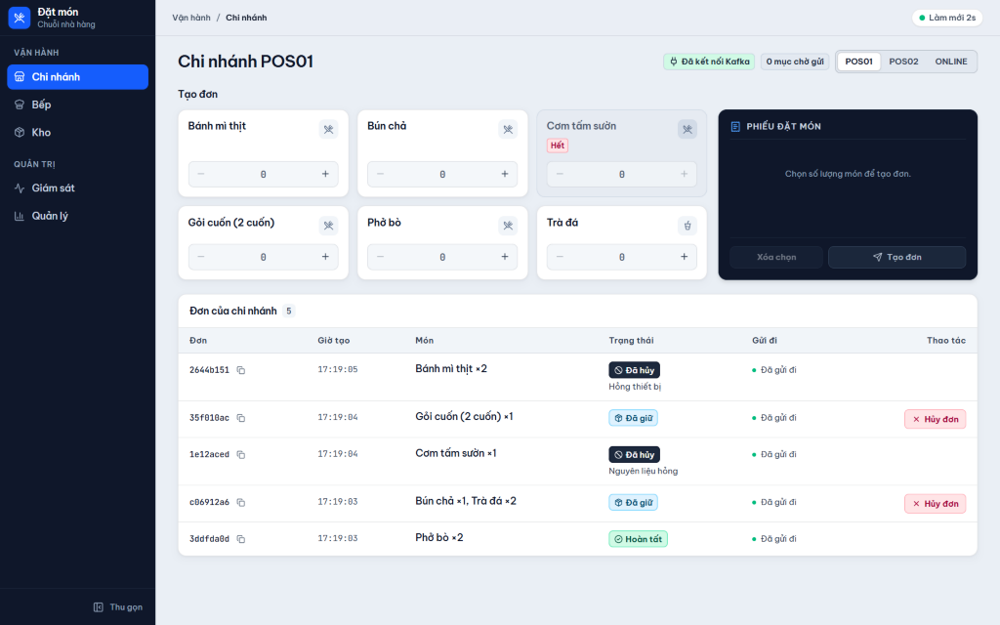
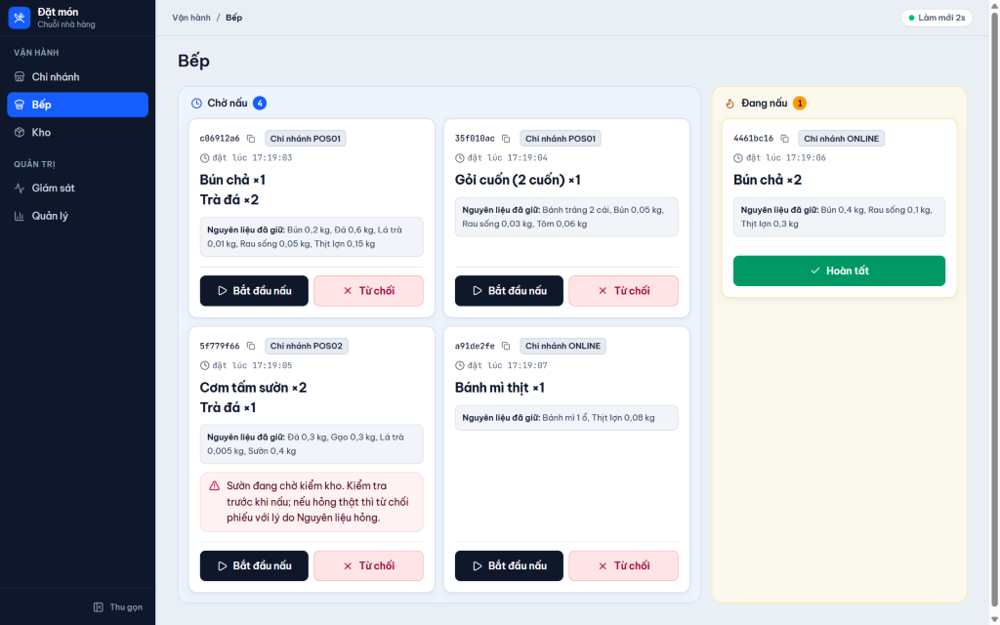
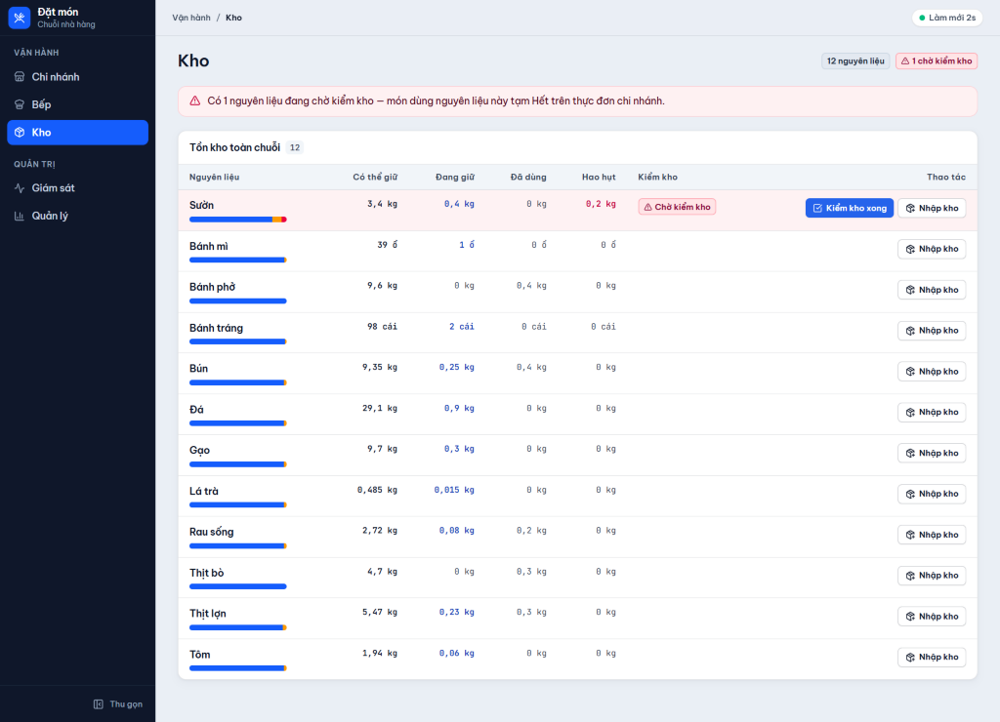
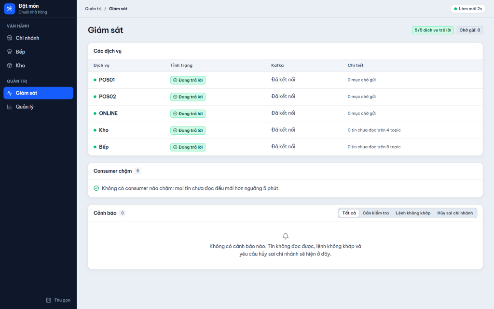
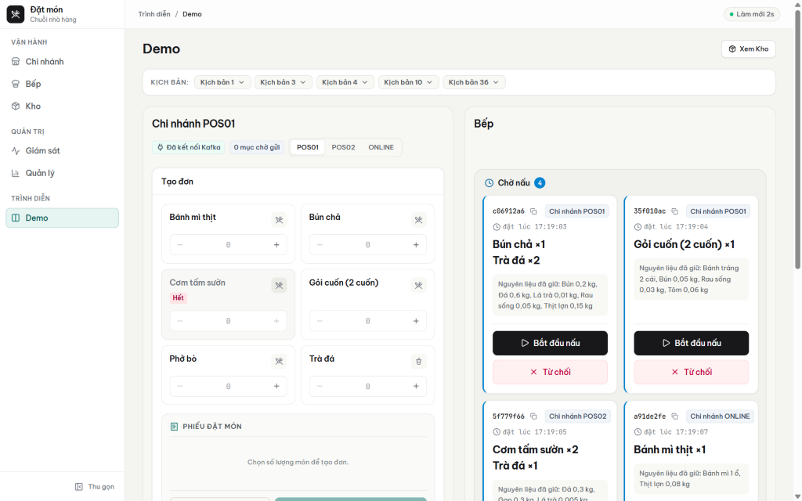
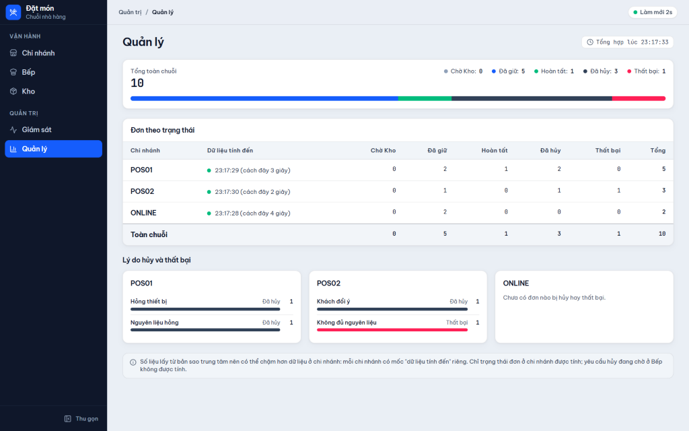

# PHẦN III. XÂY DỰNG, PHÁT TRIỂN HỆ THỐNG

## I. MÔ TẢ CÔNG NGHỆ SỬ DỤNG

- **Kiến trúc hệ thống:** microservices hướng sự kiện, toàn bộ là phần mềm nguồn mở. Các dịch vụ chỉ trao đổi qua Kafka theo mô hình at-least-once; mỗi dịch vụ có CSDL riêng; tin gửi đi qua outbox; consumer chống trùng bằng `processed_events`. Báo cáo quản lý đọc Central Order Replica được nhân bản bằng PostgreSQL logical replication. Toàn bộ hệ thống (21 container) chạy bằng Docker Compose.
- **Nền tảng phát triển back-end:** Python 3.12, FastAPI và Uvicorn cho API; psycopg 3 với SQL viết tay, không dùng ORM, vì các quy tắc tranh chấp dựa trực tiếp vào `SELECT ... FOR UPDATE`, `ON CONFLICT`, `SAVEPOINT` và UPDATE có điều kiện; `confluent-kafka` với vòng lặp consumer tự viết theo 5 bước (ghi `processed_events`, áp dụng bảng trạng thái, ghi outbox, commit DB, rồi mới commit offset).
- **Message broker:** Apache Kafka 4.3.2, chế độ KRaft, 3 broker; mọi topic có 3 bản sao, `min.insync.replicas=2`; producer dùng `acks=all` và `enable.idempotence=true`.
- **Hệ quản trị cơ sở dữ liệu:** PostgreSQL 16.14, mỗi CSDL một container; các CSDL chi nhánh bật `wal_level=logical` để nhân bản về Central Order Replica.
- **Nền tảng phát triển web application:** TypeScript 5.9, React 19 với Vite, React Router, Tailwind CSS v4, Radix UI, Lucide Icons, font đóng gói offline (`Be Vietnam Pro`, `JetBrains Mono`), TanStack Query (làm mới trạng thái định kỳ); kiểu dữ liệu API sinh từ tài liệu OpenAPI của từng dịch vụ.
- **Nền tảng phát triển mobile application:** không có. Kênh Online là một màn hình web dùng chung luồng với POS.
- **Công cụ chất lượng mã nguồn:** Ruff, Pyright (chế độ strict) cho Python; Biome, `tsc` cho TypeScript; GitHub Actions chạy kiểm tra tự động.

## II. MÔ TẢ GIAO DIỆN HỆ THỐNG

Màn hình chỉ hiển thị điều các dịch vụ trả về và không tự quyết định trạng thái nào. Mọi màn hình làm mới dữ liệu 2 giây một lần trong lúc đang mở. Giao diện thiết kế theo kiến trúc màu tương phản đa tầng: thanh điều hướng trái tối (`#0F172A`) làm mỏ neo thị giác trên nền làm việc xanh-xám mát (`#EAEFF5`) và thẻ trắng nổi khối, thanh trên hiển thị đường dẫn màn hình kèm nhịp làm mới 2s; ở màn Chi nhánh, lưới thẻ món đặt trực tiếp trên nền cạnh Phiếu đặt món nền tối, còn màn Bếp phân màu hai làn Chờ nấu / Đang nấu rõ rệt. Khi một dịch vụ không trả lời, màn hình hiện băng cảnh báo đỏ và giữ dữ liệu cũ. Ảnh chụp dưới mỗi mục lấy từ hệ thống đang chạy, với dữ liệu tạo bằng `backend/scripts/demo_data.py`.

### 1. Màn hình Chi nhánh (POS và Online)

Đường dẫn `/branch/POS01`, `/branch/POS02`, `/branch/ONLINE`; người dùng là thu ngân hoặc khách hàng online. Màn hình gồm:

- **Thanh trên:** trạng thái kết nối Kafka của chi nhánh (kết quả lần thăm dò gần nhất), số mục chờ gửi lấy từ `GET /monitor`, và bộ chuyển đổi chi nhánh (`POS01`, `POS02`, `ONLINE`).
- **Cảnh báo Luồng D:** đơn chờ Kho quá N phút kèm nút Yêu cầu hủy; đơn còn trong hàng chờ sắp quá hạn X giờ; đơn đang yêu cầu hủy kèm thời gian đã chờ; tin trạng thái không đọc được.
- **Tạo đơn (POS 2 vùng):** bên trái là lưới thẻ món của chi nhánh (`GET /dishes`, dùng được khi mất mạng) với bộ tăng/giảm số lượng ngay trên thẻ; bên phải là khung **Phiếu đặt món** liệt kê các món đang chọn, tổng số phần, nút Xóa chọn và nút Tạo đơn. Đơn hiện ở Chờ Kho cho tới khi có tin trạng thái.
- **Tình trạng món trên form đặt món** (`GET /menu`, Luồng C): khi dữ liệu từ Kho còn mới, món Hết bị khóa và ghi "Hết"; khi dữ liệu đã cũ quá 5 phút hoặc chi nhánh mất kết nối Kafka, món Hết ghi "Có thể đã hết" và vẫn đặt được, kèm một dòng chung "Tình trạng món có thể đã thay đổi."; món Ẩn không hiện. Đây là luật duy nhất chỉ nằm trên màn hình: Kho vẫn quyết định từng đơn.
- **Danh sách đơn:** mã đơn rút gọn (bấm để chép mã đầy đủ), giờ tạo, món, trạng thái dạng nhãn có màu và biểu tượng, cờ yêu cầu hủy, lý do, thông báo "Không hủy được: bếp đã bắt đầu nấu", tình trạng gửi theo BR5 ("Chưa gửi, bếp chưa nhận", "Đang gửi, chưa biết bếp đã nhận chưa"), và nút Hủy đơn. Đơn đã kết thúc hoặc đang có yêu cầu hủy thì không có nút này. Danh sách hiện 20 đơn mới nhất (`GET /orders?limit=20`); nút "Xem thêm 20 đơn cũ hơn" mở rộng tới tối đa 200 đơn. Lúc đầu màn tải cả 200 đơn sau mỗi 2 giây và bị giật khi dữ liệu nhiều; giờ mỗi lần hỏi lại chỉ còn khoảng 7 KB thay vì 67 KB.
- **Hộp thoại hủy:** bắt buộc chọn lý do thuộc nhóm khách hủy, kèm lời giải thích: đơn chưa gửi đi thì hủy ngay, đơn đã gửi thì Bếp quyết định. Kết quả 200 báo đã hủy tại chi nhánh; 202 báo đã gửi yêu cầu tới Bếp và chưa chắc hủy được; 409 báo đơn vừa đổi trạng thái rồi tải lại.

### 2. Màn hình Bếp

Đường dẫn `/kitchen`; người dùng là nhân viên bếp, trên máy tính bảng (1024×768) hoặc màn hình treo tường (1920×1080). Màn hình gồm:

- **Cảnh báo của Bếp** (`GET /alerts`), đặt trên cùng: yêu cầu hủy từ chi nhánh không phải chi nhánh gốc (`HUY_SAI_CHI_NHANH`, kèm chi nhánh gốc và các chi nhánh bị bỏ qua, để kiểm tra cấu hình chi nhánh gửi) và đơn cần kiểm tra (`CAN_KIEM_TRA`).
- **Hai cột Chờ nấu và Đang nấu**, dạng bảng phiếu KDS (mỗi làn có màu chấm trạng thái và tổng số phiếu từ `GET /tickets/counts`; các thẻ phiếu có chiều cao đồng đều với viền mảnh đồng bộ theo làn và cụm nút ghim sát đáy) (`GET /tickets?limit=20`). Phiếu đã kết thúc không hiện ở đây. Mỗi cột hiện 20 phiếu cũ nhất (bếp làm theo thứ tự đến); nút "Xem thêm" hiện thêm 20 phiếu. Với 581 phiếu đang chờ, mỗi lần hỏi lại còn khoảng 8 KB thay vì 224 KB. Mỗi phiếu ưu tiên cỡ chữ lớn cho tên món và số lượng, kèm mã đơn, chi nhánh gốc, giờ đặt và nguyên liệu đã giữ. Phiếu Chờ nấu có nguyên liệu đang chờ kiểm kho thì hiện cảnh báo đỏ nêu tên nguyên liệu (Luồng A, bước 6); đây chỉ là cảnh báo, hệ thống không tự hủy phiếu.
- **Nút theo trạng thái:** phiếu Chờ nấu có Bắt đầu nấu và Từ chối; phiếu Đang nấu chỉ có Hoàn tất. Nút cao ít nhất 44px, cách nhau 8px, để bấm nhanh khi đang đeo găng. Trả 409 nghĩa là phiếu vừa đổi trạng thái (thua trong tranh chấp với một yêu cầu hủy, BR7): màn hình báo ngắn rồi tải lại, không coi là lỗi.
- **Hộp thoại từ chối:** bắt buộc chọn lý do thuộc nhóm Bếp từ chối; với lý do Nguyên liệu hỏng phải chọn ít nhất một nguyên liệu trong danh sách đã giữ của phiếu. Bếp kiểm tra lại và trả 400 nếu không nhận, lỗi hiện ngay trong hộp thoại.

### 3. Màn hình Kho

Đường dẫn `/inventory`; người dùng là nhân viên kho. Màn hình gồm:

- **Cảnh báo của Kho** (`GET /alerts`): lệnh hoàn kho hoặc báo đã dùng không khớp bản ghi nào (`LENH_KHONG_KHOP`, tồn kho không đổi, cần kiểm tra bằng tay) và đơn cần kiểm tra (`CAN_KIEM_TRA`).
- **Tồn kho toàn chuỗi** (`GET /stock`): mỗi nguyên liệu có bốn đại lượng của mục 3.3 đặc tả (có thể giữ, đang giữ, đã dùng, hao hụt) kèm đơn vị, thanh tỷ lệ trực quan (có thể giữ / đang giữ / hao hụt) dưới tên nguyên liệu, và nhãn "Chờ kiểm kho" nếu bị cờ. Nguyên liệu bị cờ xếp lên đầu, đi kèm dải cảnh báo tóm tắt phía trên bảng.
- **Nhập kho:** hộp thoại nhập số lượng dương, tối đa 3 chữ số thập phân (`POST /stock/receipts`); Kho trả 422 thì báo ngay dưới ô nhập.
- **Kiểm kho xong** (chỉ có trên nguyên liệu bị cờ, `POST /ingredients/{id}/clear-check`): gỡ cờ, có thể kèm tồn đếm được. Nếu tồn đếm được ít hơn lượng đang giữ, Kho trả 409; màn hình nêu lượng đang giữ và hướng dẫn từ chối các phiếu còn giữ nguyên liệu đó trên màn Bếp rồi kiểm kho lại.

### 4. Màn hình Giám sát

Đường dẫn `/monitor`; người dùng là người vận hành. Màn hình gom Luồng D của mọi dịch vụ và không có thao tác nào đổi trạng thái đơn: hệ thống chỉ báo động, không tự hủy đơn vì đơn đã chờ lâu (mục 8 của đặc tả).

- **Các dịch vụ:** mỗi dịch vụ một dòng (POS01, POS02, ONLINE, Kho, Bếp) với tình trạng trả lời và kết nối Kafka. Dòng chi nhánh (`GET /monitor` của chi nhánh) có số mục chờ gửi và số đơn đang bị cảnh báo; dòng Kho và Bếp (`GET /monitor` của hai dịch vụ này) có số tin chưa đọc trên các topic. Dịch vụ không trả lời thì dòng đó hiện "Không trả lời" kèm lần trả lời cuối, các dòng khác vẫn chạy.
- **Consumer chậm:** topic có tin chưa đọc cũ hơn ngưỡng 5 phút (mục 10 của đặc tả), kèm số tin chưa đọc và tuổi tin cũ nhất.
- **Cảnh báo:** gộp cảnh báo của Kho, Bếp (`GET /alerts`) và tin trạng thái không đọc được của từng chi nhánh, mới nhất lên đầu, lọc được theo loại (`CAN_KIEM_TRA`, `LENH_KHONG_KHOP`, `HUY_SAI_CHI_NHANH`).

### 5. Trang Demo

Đường dẫn `/demo/POS01` (hoặc `POS02`, `ONLINE`); dùng khi trình diễn. Trang đặt màn Chi nhánh và màn Bếp cạnh nhau, dùng lại đúng hai màn đó (hai làn của Bếp tự xếp dọc khi thu hẹp bề ngang để không tràn nút) và không có trạng thái riêng, kèm nút **Xem Kho** để mở nhanh bảng tồn kho khi cần. Phía trên là thanh chọn gọn các kịch bản demo của mục 12 đặc tả (1, 3, 4, 10, 36): bấm vào từng kịch bản để mở các bước, lệnh `bin/chaos` và kết quả mong đợi. Kịch bản 10 và 36 đi thành cặp để cho thấy ranh giới của cam kết khi hủy lúc mất mạng.

### 6. Màn hình Quản lý

Đường dẫn `/reports`; người dùng là Quản lý. Màn hình chỉ đọc một API, `GET /reports/summary` của Order Query Service. Dịch vụ này đọc Central Order Replica, không bao giờ đọc CSDL của chi nhánh, nên số liệu có thể chậm hơn dữ liệu ở chi nhánh (mục 8 của đặc tả). Màn hình không có thao tác nào làm đổi dữ liệu.

- **Tổng quan chuỗi:** hiển thị tổng số đơn toàn chuỗi kèm thanh tỷ lệ phân bổ 5 trạng thái (`CHO_KHO`, `DA_GIU`, `HOAN_TAT`, `DA_HUY`, `THAT_BAI`).
- **Đơn theo trạng thái:** mỗi chi nhánh một dòng với chấm tín hiệu độ mới và mốc "dữ liệu tính đến hh:mm:ss" kèm "cách đây bao lâu", số đơn ở từng trạng thái (Chờ Kho, Đã giữ, Hoàn tất, Đã hủy, Thất bại) và tổng; dòng cuối cộng cho toàn chuỗi. Chi nhánh chưa có dữ liệu nào sang tới trung tâm thì hiện "Chưa có dữ liệu".
- **Mốc "dữ liệu tính đến"** là `beat_at` của bảng `replication_heartbeat` mà chi nhánh cập nhật mỗi 5 giây và đã sang tới trung tâm. Nhân bản áp dụng giao dịch của một chi nhánh theo đúng thứ tự commit, nên mọi thay đổi đơn mà chi nhánh commit trước mốc đó đều đã có trong số liệu. Khi nhân bản từ một chi nhánh bị cắt (kịch bản 55), mốc của chi nhánh đó đứng yên và "cách đây" tăng dần, trong khi các chi nhánh khác vẫn mới.
- **Lý do hủy và thất bại:** mỗi chi nhánh một thẻ, liệt kê số đơn Đã hủy theo lý do (của khách hoặc của Bếp khi từ chối phiếu) và số đơn Thất bại theo lý do của Kho, kèm thanh tỷ lệ ngang theo từng lý do.
- Ghi chú ở chân trang nêu rõ chỉ trạng thái đơn ở chi nhánh được tính: yêu cầu hủy đang chờ ở Bếp không phải trạng thái kết thúc nên không được tính.

