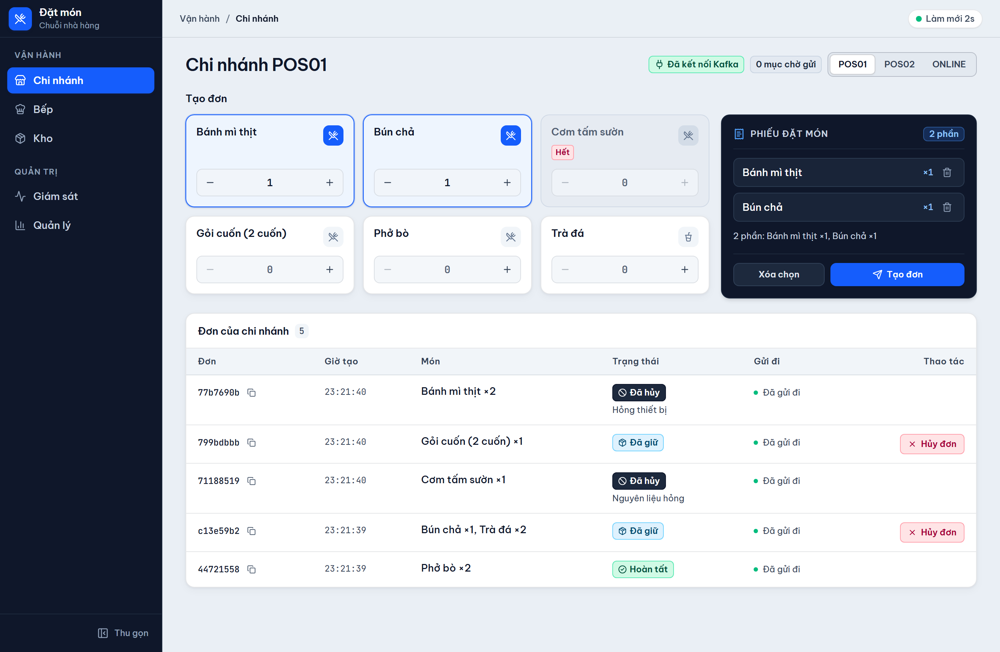
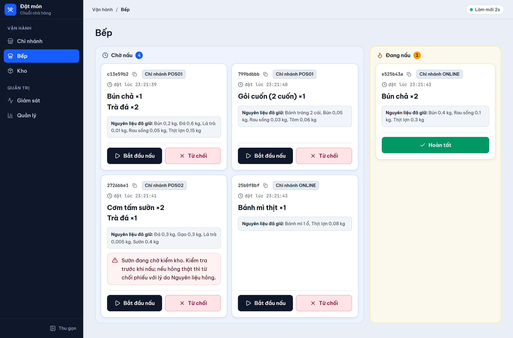
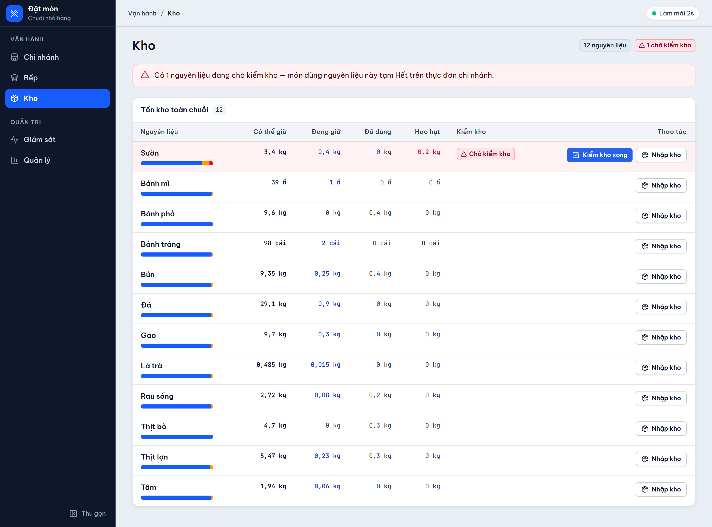

# PHẦN III. XÂY DỰNG, PHÁT TRIỂN HỆ THỐNG

## I. MÔ TẢ CÔNG NGHỆ SỬ DỤNG

Hệ thống được xây dựng hoàn toàn trên nền tảng mã nguồn mở, đóng gói thành các container độc lập và giao tiếp qua hợp đồng dữ liệu chuẩn hóa. Năm nhóm nền tảng công nghệ được trình bày dưới đây và tổng hợp chi tiết phiên bản trong Bảng 3.1.

### 1.1. Kiến trúc hệ thống và hạ tầng triển khai

Hệ thống áp dụng kiến trúc microservices hướng sự kiện trên Docker Compose, gồm 14 container lõi và mở rộng lên 21 container ở cấu hình đa điểm bán kèm kiểm thử. Hạ tầng tách thành 9 vùng mạng nội bộ cô lập theo đường đi dữ liệu (truyền tin sự kiện, Kho, Bếp, ba kênh bán hàng, nhân bản dữ liệu, giao tiếp API và kiểm thử) để mô phỏng sự cố mạng từng kênh mà không làm gián đoạn cụm trung tâm. Toàn bộ dịch vụ nghiệp vụ backend dùng chung một ảnh nền Python chuẩn hóa, phân tách vai trò qua cấu hình triển khai và tự khởi tạo lược đồ cơ sở dữ liệu khi khởi động.

### 1.2. Nền tảng phát triển Back-end và hạ tầng truyền thông sự kiện

Các dịch vụ nghiệp vụ viết bằng Python 3.12 (quản lý phụ thuộc qua `uv`), chia thành bốn nhóm tiến trình độc lập (Kênh đặt hàng triển khai riêng cho `POS01`, `POS02`, `ONLINE`; Kho trung tâm; Bếp trung tâm; Tổng hợp báo cáo) cùng gói dùng chung cho lớp kết nối sự kiện. Các REST API xây dựng trên FastAPI và máy chủ ASGI Uvicorn, thao tác PostgreSQL qua `psycopg` và trao đổi thông điệp qua `confluent-kafka`.

Lớp truyền tin sử dụng Apache Kafka 4.3 vận hành cụm 3 broker đồng thuận KRaft [10] (không dùng ZooKeeper) với hệ số sao chép 3, yêu cầu tối thiểu 2 bản sao đồng bộ khi xác nhận ghi, tắt cơ chế tự tạo topic ngoài quy hoạch và lưu nhật ký 168 giờ. Phía gửi bật xác nhận toàn cụm kèm chống trùng lặp giao vận; phía nhận tắt tự động xác nhận đọc và chỉ xác nhận vị trí đọc sau khi giao dịch cơ sở dữ liệu thành công [12]. Bản tin sai định dạng sau 5 lần thử hoặc sai phiên bản lược đồ được chuyển sang topic `dlq` kèm cảnh báo vận hành.

### 1.3. Hệ quản trị cơ sở dữ liệu

Hệ thống lưu trữ dữ liệu trên sáu thực thể PostgreSQL 16 độc lập tương ứng bốn mô hình lược đồ từ Phần II (Kho trung tâm, Bếp trung tâm, `POS01`, `POS02`, `ONLINE` và bản sao tổng hợp trung tâm). Ba cơ sở dữ liệu bán hàng kích hoạt nhân bản logic theo nhật ký ghi trước [11] để truyền liên tục đơn hàng và nhịp đồng bộ về bản sao trung tâm theo đúng thứ tự xác nhận giao dịch. Tại đầu đọc tập trung, dịch vụ Tổng hợp báo cáo mở giao dịch chỉ đọc ở mức cô lập `REPEATABLE READ` [11], [13] để bảo đảm số liệu đơn hàng và mốc cập nhật từng kênh thuộc cùng một lát cắt thời gian.

### 1.4. Nền tảng phát triển Web Application

Giao diện điều hành và đặt món xây dựng dưới dạng ứng dụng đơn trang trên nền React 19, TypeScript và Vite, đi qua máy chủ proxy để định tuyến yêu cầu tới đúng cổng dịch vụ của từng kênh và cụm trung tâm. Điều hướng giữa năm màn hình do React Router đảm nhiệm; trạng thái bất đồng bộ và làm mới định kỳ 2 giây (tạm dừng khi ẩn thẻ trình duyệt, làm mới ngay sau thao tác ghi) do TanStack Query xử lý.

Thành phần giao diện dùng Tailwind CSS 4, Radix UI chuẩn khả năng tiếp cận và bộ biểu tượng Lucide React. Kiểu dữ liệu phía trình duyệt được sinh tự động từ đặc tả OpenAPI của backend qua `openapi-typescript`, kết hợp kiểm thử thành phần trên Vitest và MSW.

### 1.5. Nền tảng phát triển Mobile Application và khả năng đáp ứng thiết bị

Kênh đặt món trực tuyến và màn hình vận hành không phát triển ứng dụng di động gốc riêng mà áp dụng thiết kế web đáp ứng trên hệ thống lưới của Tailwind CSS 4. Ở màn hình dưới 768 pixel, thanh điều hướng chuyển thành ngăn kéo từ cạnh trên, lưới thẻ món ăn co về một đến hai cột, bảng dữ liệu giữ cố định cột định danh khi cuộn ngang và toàn bộ nút thao tác duy trì vùng chạm tối thiểu 44 pixel, tương tác qua cùng hợp đồng REST API với máy trạm tại quầy.

| Nhóm nền tảng | Công nghệ / Thư viện | Phiên bản | Vai trò trong hệ thống |
|---|---|---|---|
| Kiến trúc & Container | Docker Compose, uv | uv 0.13.6 | Đóng gói dịch vụ độc lập, cô lập 9 vùng mạng dữ liệu, chạy kiểm thử và mô phỏng lỗi mạng. |
| Back-end & API | Python, FastAPI, Uvicorn | 3.12.13 / 0.162.0 / 0.54.0 | Xây dựng REST API bất đồng bộ cho các dịch vụ nguồn, Kho, Bếp và Tổng hợp báo cáo. |
| Truyền tin & DB Client | Apache Kafka, confluent-kafka, psycopg | 4.3.2 / 2.16.1 / 3.3.8 | Truyền sự kiện KRaft 3 broker, chuyển phát hàng chờ gửi, chống trùng và khóa dòng PostgreSQL. |
| Hệ quản trị CSDL | PostgreSQL | 16.14 | Lưu trữ tách biệt theo dịch vụ; nhân bản logic từ ba nhánh nguồn về trung tâm. |
| Web Application | React, TypeScript, Vite, React Router | 19.3.1 / 5.9.3 / 8.3.6 / 8.5.1 | Giao diện đơn trang 5 màn hình vận hành và đặt món, định tuyến và proxy dịch vụ. |
| Dữ liệu & UI Frontend | TanStack Query, Tailwind CSS, Radix UI, Lucide React | 5.107.1 / 4.3.5 / 1.77.0 | Làm mới dữ liệu 2 giây gần thời gian thực, thành phần hộp thoại chuẩn A11y và biểu diễn số liệu. |
| Sinh hợp đồng & Kiểm thử | openapi-typescript, Vitest, MSW | 7.13.0 / 5.1.0 / 3.0.4 | Đồng bộ kiểu TypeScript từ OpenAPI của backend và kiểm thử giao diện độc lập. |

*Bảng 3.1. Tổng hợp công nghệ, thư viện và công cụ triển khai hệ thống*

Chi tiết phân bổ cổng dịch vụ và danh mục giao diện lập trình ứng dụng (REST API) phục vụ màn hình điều hành và đồng bộ giữa các dịch vụ backend được thống kê trong Bảng 3.2.

| Dịch vụ (Cổng triển khai) | Nhóm đường dẫn API | Chức năng và phản hồi chính |
|---|---|---|
| Kênh đặt hàng (POS01: 8301, POS02: 8302, Online: 8303) | Xem thực đơn, tra cứu đơn và giám sát kết nối (`/dishes`, `/menu`, `/orders`, `/monitor`) | Cung cấp thực đơn cục bộ kèm ngưỡng tin cậy 5 phút, danh sách tối đa 200 đơn và bộ đếm hàng chờ gửi. |
| Kênh đặt hàng (Ghi nhận đơn & Hủy) | Lập đơn mới và gửi yêu cầu hủy (`/orders`, `/orders/{id}/cancel`) | Tạo đơn mới (mã 201), hủy ngay tại quầy khi chưa gửi (mã 200), chuyển Bếp (mã 202), báo xung đột (mã 409). |
| Kho trung tâm (Kho 1: 8101, Kho 2: 8102) | Tra cứu tồn kho, cảnh báo, giám sát và ảnh chụp thực đơn (`/stock`, `/alerts`, `/monitor`; liên dịch vụ: `/menu/snapshot`) | Trả về bốn chỉ số tồn kho nguyên liệu, tối đa 100 cảnh báo gần nhất, độ trễ xử lý và bản sao thực đơn toàn phần cho các kênh. |
| Kho trung tâm (Nhập & Kiểm kho) | Nhập hàng và xác nhận kiểm kho (`/stock/receipts`, `/ingredients/{ingredient_id}/clear-check`) | Cộng tồn kho khả dụng (mã 200), gỡ cờ kiểm kho (mã 409 nếu nhỏ hơn mức đang giữ) và tính lại trạng thái món. |
| Bếp trung tâm (Bếp: 8201) | Tra cứu phiếu chế biến, bộ đếm trạng thái, cảnh báo và giám sát (`/tickets`, `/tickets/counts`, `/alerts`, `/monitor`) | Hợp nhất hàng đợi phiếu Chờ nấu và Đang nấu từ ba nguồn kèm cảnh báo nguyên liệu hỏng và hủy lệch nguồn. |
| Bếp trung tâm (Điều phối nấu) | Bắt đầu nấu, từ chối phiếu và hoàn tất món (`/tickets/{id}/start`, `/reject`, `/complete`) | Chuyển trạng thái phiếu sang Đang nấu, Đã hủy hoặc Hoàn tất (mã 200); chặn thao tác tranh chấp (mã 409). |
| Tổng hợp báo cáo (Báo cáo: 8401) | Đọc báo cáo tổng hợp toàn chuỗi (`/reports/summary`) | Đọc nhất quán trên bản sao trung tâm, trả thống kê 5 trạng thái, lý do đóng đơn và mốc cập nhật từng kênh. |

*Bảng 3.2. Phân bổ cổng dịch vụ và danh mục giao diện lập trình ứng dụng (REST API)*

## II. MÔ TẢ GIAO DIỆN HỆ THỐNG

Năm màn hình nghiệp vụ dùng chung thanh điều hướng bên trái chia thành hai nhóm: Vận hành (`Chi nhánh`, `Bếp`, `Kho`) và Quản trị (`Giám sát`, `Quản lý`), kèm chỉ báo làm mới tự động mỗi 2 giây ở thanh tiêu đề. Chức năng và hành vi xử lý của từng màn hình chụp trên hệ thống thực tế được trình bày dưới đây.

### 2.1. Màn hình Chi nhánh Quầy và Đặt hàng Online

Màn hình Chi nhánh tiếp nhận đơn cho cả quầy thu ngân (`POS01`, `POS02`) và kênh trực tuyến (`ONLINE`) qua bộ chuyển nguồn ở góc trên bên phải (Hình 3.1). Hai chỉ báo phía trên cho biết trạng thái kết nối Kafka và số `mục chờ gửi` còn tồn tại điểm bán.

Khu vực lập đơn khóa chọn các món thiếu nguyên liệu hoặc chờ kiểm kho (như *Cơm tấm sườn*) với nhãn `Hết`, đồng thời chuyển sang cảnh báo `Có thể đã hết` và mở lại quyền đặt khi mất mạng hoặc dữ liệu quá 5 phút để không gián đoạn bán hàng. Bảng *Đơn của chi nhánh* bên dưới nạp mặc định 20 đơn mới nhất (mở rộng tối đa 200 đơn), hiển thị trạng thái xử lý (`Chờ Kho`, `Đã giữ`, `Hoàn tất`, `Đã hủy`, `Thất bại`), lý do đóng đơn, tiến độ truyền tin ở cột *Gửi đi* và nút *Hủy đơn* kèm hộp thoại chọn lý do cho các đơn chưa kết thúc.

### 2.2. Màn hình Điều phối Bếp trung tâm

Màn hình Bếp hợp nhất toàn bộ phiếu chế biến đã giữ đủ nguyên liệu từ `POS01`, `POS02` và `ONLINE` vào hai làn *Chờ nấu* và *Đang nấu* (Hình 3.2). Mỗi thẻ phiếu hiển thị mã đơn, chi nhánh nguồn, danh sách món ăn cùng định lượng nguyên liệu đã giữ để đầu bếp đối chiếu trước khi chế biến.

Khi Kho gắn cờ kiểm kho một nguyên liệu, các phiếu liên quan (như phiếu dùng *Sườn* của `POS02` trên Hình 3.2) lập tức hiện khung cảnh báo kiểm tra thực tế. Đầu bếp thao tác trực tiếp qua các nút *Bắt đầu nấu* (chốt tiêu thụ và khóa quyền hủy đơn), *Hoàn tất* hoặc *Từ chối* kèm hộp thoại chọn lý do và chỉ định đích danh nguyên liệu hỏng nếu phát sinh hao hụt.

### 2.3. Màn hình Quản lý Kho nguyên liệu

Màn hình Kho quản lý lượng tồn nguyên liệu dùng chung cho toàn chuỗi (Hình 3.3). Khi có nguyên liệu bị Bếp báo hỏng, hệ thống hiển thị dải cảnh báo tạm ngừng bán các món liên quan ở đầu trang và tự động đưa nguyên liệu đó (như *Sườn*) lên đầu bảng *Tồn kho toàn chuỗi* để ưu tiên xử lý.

Bảng tồn kho theo dõi bốn đại lượng của từng nguyên liệu gồm *Có thể giữ*, *Đang giữ*, *Đã dùng* và *Hao hụt* kèm thanh tỷ trọng trực quan. Tại cột thao tác, nhân viên dùng *Nhập kho* để cộng thêm lượng khả dụng và dùng *Kiểm kho xong* trên các dòng gắn cờ để đối chiếu số đếm thực tế (hệ thống từ chối nếu thấp hơn mức đang giữ) và tính lại trạng thái món ăn.

### 2.4. Màn hình Giám sát vận hành phân tán

Màn hình Giám sát cung cấp góc nhìn chỉ đọc theo dõi tình trạng của năm dịch vụ (`POS01`, `POS02`, `ONLINE`, `Kho`, `Bếp`) cùng tổng số bản tin tồn tại các nhánh (Hình 3.4).

Khối *Các dịch vụ* hiển thị khả năng phản hồi HTTP, trạng thái kết nối Kafka, số mục chờ gửi tại từng điểm bán và số bản tin chưa đọc tại Kho và Bếp. Hai khối bên dưới gồm bảng *Consumer chậm* (cảnh báo khi có bản tin tồn đọng quá 5 phút) và nhật ký *Cảnh báo* hỗ trợ lọc theo ba nhóm sự cố bất đồng bộ (`Cần kiểm tra`, `Lệnh không khớp`, `Hủy sai chi nhánh`).

### 2.5. Màn hình Quản lý và Báo cáo hợp nhất

Màn hình Quản lý trình bày báo cáo tổng hợp toàn chuỗi truy vấn độc lập từ bản sao trung tâm (Hình 3.5). Phần đầu trang và bảng *Đơn theo trạng thái* thống kê phân bổ năm trạng thái đơn trên từng kênh (`POS01`, `POS02`, `ONLINE`) và tổng *Toàn chuỗi*.

Cột *Dữ liệu tính đến* ghi nhận nhịp nhân bản mới nhất kèm độ trễ tính bằng giây và đèn báo riêng cho từng nguồn (xanh khi mới hơn 30 giây, vàng khi trễ hơn 30 giây, xám khi chưa có dữ liệu) để nhận biết nhánh đang gián đoạn đồng bộ. Phần *Lý do hủy và thất bại* đối chiếu tỷ lệ nguyên nhân đóng đơn theo từng chi nhánh, kèm ghi chú làm rõ số liệu phản ánh trạng thái đã chốt tại bản sao trung tâm.

## III. CÀI ĐẶT CƠ CHẾ XỬ LÝ PHÂN TÁN TRỌNG TÂM

Bên cạnh hợp đồng REST API và năm màn hình điều hành, bốn cơ chế phối hợp giữa tầng dịch vụ và cơ sở dữ liệu dưới đây trực tiếp duy trì tính toàn vẹn của dữ liệu phân tán.

### 3.1. Cơ chế hàng chờ gửi cục bộ và bảo toàn thứ tự sự kiện theo đơn hàng

Tại mỗi điểm bán (hai quầy thu ngân và kênh trực tuyến), dịch vụ nguồn không gửi sự kiện trực tiếp ra mạng ngay trong luồng tiếp nhận đơn hàng để tránh trường hợp đơn đã lưu cục bộ nhưng bản tin bị thất lạc khi đường truyền chập chờn. Thay vào đó, thông điệp tạo đơn và thông điệp yêu cầu hủy đều được ghi cùng lúc vào bảng hàng chờ cục bộ trong chính giao dịch cơ sở dữ liệu của đơn hàng, rồi tiến trình chuyển phát nền thực hiện tuần tự theo ba nguyên tắc:

1. Bảo toàn thứ tự trong từng đơn và song song giữa các đơn: mỗi nhịp quét (tối đa 100 bản ghi mỗi lượt), tiến trình chỉ lấy duy nhất thông điệp chưa gửi lâu nhất của từng đơn hàng riêng biệt. Nhờ vậy, yêu cầu hủy của một đơn không bao giờ vượt trước sự kiện tạo đơn cùng mã, trong khi các đơn hàng khác vẫn đi qua song song mà không bị nghẽn đầu hàng.
2. Thăm dò trạng thái kết nối trước khi thử gửi lần đầu: đối với bản ghi chưa từng thử phát lên mạng, tiến trình kiểm tra nhanh kết nối tới cụm thông điệp với ngưỡng chờ 2 giây để cập nhật bảng giám sát. Nếu đang mất kết nối, bản ghi tiếp tục giữ trạng thái chưa từng gửi giúp thu ngân có thể hủy ngay tại quầy; nếu mạng thông, hệ thống ghi dấu mốc đã bắt đầu thử gửi bền vững trước khi truyền đi.
3. Thử gửi lại vô hạn sau khi đã rời điểm bán: khi sự kiện đã vượt qua mốc thử gửi đầu tiên, mọi lỗi kết nối tạm thời đều được giữ lại trong hàng chờ để thử phát lặp lại cho tới khi cụm thông điệp xác nhận đã lưu bền vững ở tất cả bản sao đồng bộ, bảo đảm không đánh mất đơn hàng khi mạng phục hồi.

### 3.2. Giữ nguyên liệu nguyên tử, khóa dòng chống deadlock và chống trùng tại Kho

Hai thực thể dịch vụ Kho trung tâm chạy song song cùng chia sẻ một cơ sở dữ liệu tồn kho dùng chung, nên hai đơn hàng gửi từ hai điểm bán khác nhau có thể tranh chấp đúng một nguyên liệu vào cùng thời điểm. Để loại trừ âm kho, bế tắc khóa tài nguyên và xử lý trùng lặp thông điệp, mỗi giao dịch giữ nguyên liệu thực hiện đủ năm bước kiểm soát nối tiếp:

1. Chặn xử lý trùng lặp theo mã sự kiện: ngay đầu giao dịch, dịch vụ ghi nhận mã định danh duy nhất của sự kiện vào bảng chống trùng lặp. Nếu mã sự kiện đã tồn tại, giao dịch lập tức hoàn tác và xác nhận đã xử lý xong bản tin để tránh trừ tồn kho nhiều lần khi thông điệp bị gửi lặp.
2. Nhất quán kết quả theo mã đơn hàng: nếu mã đơn hàng đã có quyết định trước đó trong hồ sơ giữ kho, hệ thống phát lại nguyên vẹn kết quả cũ về kênh bán hàng thay vì tính toán lại.
3. Kiểm tra thời hạn hợp lệ của đơn hàng: từ chối ngay các đơn quá hạn hơn 4 giờ tính từ thời điểm lập tại nguồn hoặc có dấu thời gian vượt trước đồng hồ trung tâm quá 5 phút nhằm loại bỏ bản tin lạc quá cũ do lỗi đồng hồ hoặc mất mạng kéo dài.
4. Sắp xếp khóa tài nguyên theo thứ tự toàn cục: gom tổng định lượng từng nguyên liệu của tất cả món trong đơn, sắp xếp tăng dần theo mã nguyên liệu rồi mới khóa từng dòng tồn kho để cập nhật. Quy ước đồng loạt khóa tài nguyên theo cùng một chiều cố định ở mọi giao dịch giúp loại bỏ nguy cơ khóa chéo (deadlock) giữa hai thực thể Kho.
5. Quyết định giữ dứt điểm theo nguyên tắc toàn bộ hoặc không: chỉ cần một nguyên liệu bị gắn cờ chờ kiểm kho hoặc có lượng tồn khả dụng nhỏ hơn tổng định lượng yêu cầu thì toàn bộ đơn hàng chuyển sang Thất bại (không trừ một phần). Ngược lại, dịch vụ trừ tồn khả dụng, tăng lượng đang giữ, lưu định lượng chi tiết theo đơn để phục vụ hoàn trả chính xác về sau và ghi đồng thời hai sự kiện đầu ra tới Bếp và về chi nhánh trong cùng một giao dịch.

### 3.3. Phân xử tranh chấp hai chiều tại Bếp trung tâm

Do yêu cầu hủy đơn từ các điểm bán và thông tin giữ nguyên liệu thành công từ Kho đi theo hai kênh sự kiện độc lập, hai bản tin của cùng một đơn có thể đến Bếp theo bất kỳ thứ tự nào hoặc đụng độ trực tiếp với thao tác bấm Bắt đầu nấu của đầu bếp. Toàn bộ luồng biến đổi trạng thái phiếu tại Bếp đều đi qua một điểm khóa phân xử duy nhất:

1. Hủy đến trước khi phiếu được lập từ Kho: nếu lệnh hủy tới trước, Bếp khởi tạo trước bản ghi giữ chỗ nội bộ ở trạng thái Chưa có, lưu nguồn yêu cầu hủy và chuyển phiếu sang Hủy chờ đơn kèm phản hồi "Bếp sẽ không nấu". Khi thông tin giữ kho chuyển tới sau và bắt gặp trạng thái này, Bếp lập tức chốt Đã hủy và gửi lệnh hoàn kho toàn bộ nguyên liệu đã giữ.
2. Tranh chấp đồng thời giữa hủy đơn và bắt đầu nấu: khi lệnh hủy từ quầy và nút bấm Bắt đầu nấu chạm tới cùng một phiếu Chờ nấu, giao dịch lấy được khóa hàng trước sẽ chốt trạng thái sang Đang nấu (kèm lệnh chốt tiêu thụ nguyên liệu) hoặc Đã hủy (kèm lệnh hoàn kho); giao dịch đến sau đọc được trạng thái mới lập tức từ chối thao tác xung đột kèm thông báo không thể hủy vì bếp đã bắt đầu nấu.
3. Kiểm tra nguồn chi nhánh của lệnh hủy: mọi thông điệp hủy chỉ được chấp nhận khi định danh kênh phát sinh trùng khớp với nguồn chi nhánh gốc đã ghi trên phiếu; mọi trường hợp lệch nguồn bị từ chối xử lý và ghi nhận ngay vào bảng cảnh báo Hủy sai chi nhánh để phục vụ giám sát.

### 3.4. Nhân bản bất đồng bộ và đọc báo cáo nhất quán trên bản sao trung tâm

Để màn hình Quản lý phản hồi tức thời mà không gửi truy vấn phân tán xuống từng điểm bán hay làm chậm luồng bán hàng, ba cơ sở dữ liệu tại hai quầy thu ngân và kênh trực tuyến bật cơ chế nhân bản logic liên tục cả bảng đơn hàng lẫn bảng nhịp đồng bộ về bản sao tổng hợp trung tâm.

Mỗi khi phục vụ yêu cầu xem báo cáo, dịch vụ Tổng hợp báo cáo mở một giao dịch chỉ đọc ở mức cô lập đọc lặp lại nhất quán (`REPEATABLE READ, READ ONLY`) để truy vấn tuần tự trong cùng một giao dịch nhịp đồng bộ mới nhất và tổng số đơn theo từng kênh, từng trạng thái và từng lý do đóng đơn trong cùng một ảnh chụp thời gian duy nhất, sau đó kết thúc giao dịch ngay để giải phóng tài nguyên đọc. Nhờ tính chất đồng bộ theo đúng thứ tự xác nhận từ các nguồn, mốc thời gian "Dữ liệu tính đến" hiển thị trên màn hình Quản lý luôn đồng nhất với tập đơn đã tổng hợp được ngay cả khi một quầy thu ngân đang mất kết nối mạng.
