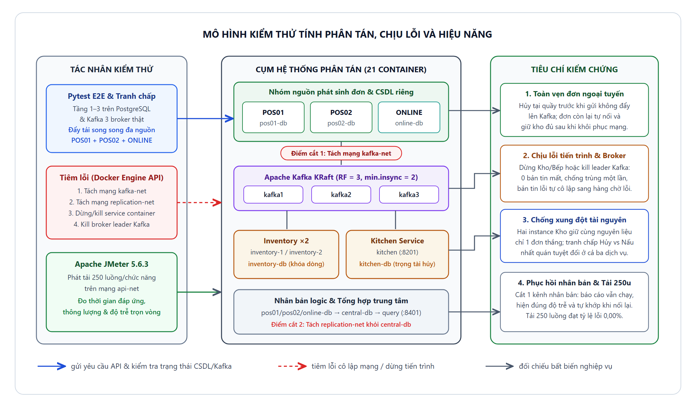

# PHẦN IV. THỬ NGHIỆM VÀ ĐÁNH GIÁ HỆ THỐNG

## I. KỊCH BẢN KIỂM THỬ

Quá trình kiểm thử tập trung xác minh khả năng hợp nhất đơn hàng đa kênh từ các nguồn độc lập (POS01, POS02, Online) về Kho và Bếp trung tâm theo thời gian gần thực, đồng thời chứng minh cơ chế kiểm soát xung đột tài nguyên, chịu lỗi tiến trình, chịu lỗi đường truyền và phục hồi dữ liệu của kiến trúc phân tán. Toàn bộ kịch bản kiểm thử trọng tâm được phân thành hai nhóm chức năng hợp nhất (Bảng 4.1) và tính chất phân tán (Bảng 4.2).

*Bảng 4.1. Kịch bản kiểm thử chức năng hợp nhất đa kênh*

| Mã ca | Kịch bản kiểm thử | Điều kiện & thao tác thực hiện | Kết quả mong đợi | Trạng thái |
|---|---|---|---|---|
| KT-01 | Tạo đơn đồng thời từ quầy POS và kênh Online | Mở đồng thời quầy POS01, POS02 và kênh Online, gửi đơn đặt món tới các dịch vụ nguồn độc lập. | Kho giữ đủ nguyên liệu; Bếp nhận tất cả phiếu vào cùng hàng đợi Chờ nấu kèm nhãn chi nhánh gốc và trả trạng thái về đúng từng kênh. | Đạt |
| KT-02 | Hủy đơn hợp lệ khi Bếp chưa chế biến | Thu ngân hoặc khách bấm hủy đơn đang ở trạng thái Chờ nấu, hoặc Bếp từ chối phiếu với lý do Hỏng thiết bị / Nguyên liệu hỏng. | Kênh và Bếp chuyển đơn sang Đã hủy; Kho hoàn trả toàn bộ lượng Đang giữ về Có thể giữ (hoặc chuyển phần hỏng sang Hao hụt kèm bật cờ kiểm kho). | Đạt |
| KT-03 | Cập nhật và đồng bộ trạng thái phục vụ món ăn | Kiểm kho đếm số lượng thấp khiến món không đủ định lượng, sau đó nhập bổ sung tồn kho tại màn hình Kho. | Kho công bố sự kiện đổi trạng thái món (Còn hàng, Hết hàng, Tạm ẩn) kèm phiên bản tăng đơn điệu; các chi nhánh tự khóa món Hết và mở bán lại khi nhập đủ tồn kho. | Đạt |
| KT-04 | Tổng hợp số liệu và lý do đóng đơn toàn chuỗi | Phát sinh đủ năm trạng thái đơn và các lý do hủy/thất bại trên POS01, POS02, Online rồi mở màn hình Quản lý. | Dịch vụ Tổng hợp báo cáo thống kê khớp số lượng từng trạng thái, lý do đóng đơn của cả ba kênh kèm mốc "Dữ liệu tính đến" riêng cho mỗi nguồn. | Đạt |

*Bảng 4.2. Kịch bản kiểm thử tính phân tán, xung đột tài nguyên và phục hồi*

| Mã ca | Kịch bản kiểm thử | Mô phỏng phân tán & thao tác gây lỗi | Tiêu chí kiểm chứng | Trạng thái |
|---|---|---|---|---|
| KT-05 | Xung đột giữ nguyên liệu trên hai thực thể Kho song song | Gửi cùng lúc hai đơn nằm trên hai phân vùng tin nhắn khác nhau tới hai thực thể Kho chạy song song, cùng yêu cầu nguyên liệu chỉ đủ cho một đơn. | Mỗi thực thể Kho xử lý đúng một phân vùng; nhờ khóa dòng theo thứ tự mã nguyên liệu, đúng một đơn Đã giữ, đơn còn lại Thất bại, tồn khả dụng không âm. | Đạt |
| KT-06 | Tranh chấp giữa lệnh hủy tại điểm bán và thao tác Bắt đầu nấu | Gửi đồng thời lệnh hủy từ điểm bán và thao tác Bắt đầu nấu tại Bếp lặp lại nhiều vòng với độ lệch 0–0,6 giây. | Điểm khóa phân xử duy nhất tại Bếp bảo đảm chỉ một bên thắng trong mỗi vòng; cả ba phía (Kênh, Kho, Bếp) luôn đồng thuận cùng một kết quả cuối. | Đạt |
| KT-07 | Yêu cầu hủy đến Bếp trước thông điệp giữ kho | Tạm dừng cụm Kho, tạo đơn và bấm hủy ngay tại điểm bán, sau đó khởi động lại Kho. | Bếp ghi nhận Hủy chờ đơn và báo chi nhánh "Bếp sẽ không nấu"; khi Kho hoạt động lại và chuyển tiếp đơn, Bếp tự chốt Đã hủy kèm lệnh hoàn kho. | Đạt |
| KT-08 | Mất kết nối mạng truyền tin tại điểm bán | Ngắt kết nối mạng truyền thông của quầy POS01 tới cụm Kafka, tạo hai đơn liên tiếp, bấm hủy một đơn tại quầy rồi nối mạng lại. | Đơn hủy tại chỗ chuyển Đã hủy ngay và không xuất hiện trên Kafka/Kho/Bếp; đơn còn lại lưu ở hàng chờ gửi và tự giữ kho thành công khi mạng nối lại. | Đạt |
| KT-09 | Sự cố tiến trình, dừng đột ngột broker leader Kafka và bản tin hỏng | Dừng đột ngột dịch vụ Bếp, Kho hoặc ngắt tiến trình broker trưởng trong lúc truyền tin; xen kẽ bản tin lỗi cấu trúc và bản tin gửi lặp. | Cụm 3 broker KRaft duy trì ngưỡng đồng thuận 2/3 không mất đơn đã xác nhận; cơ chế chống trùng bảo đảm xử lý đúng một lần; bản tin lỗi sau 5 lần tự tách sang hàng chờ lỗi kèm cảnh báo. | Đạt |
| KT-10 | Ngắt kết nối nhân bản trung tâm rồi khôi phục | Tách kết nối nhân bản dữ liệu của quầy POS01 khỏi bản sao trung tâm, tạo đơn ở cả POS01 và POS02, quan sát báo cáo rồi nối mạng lại. | Trong lúc ngắt, báo cáo vẫn phản hồi với số liệu cập nhật của POS02 và mốc đứng yên của POS01; sau khi nối lại, toàn bộ đơn của POS01 tự khớp về trung tâm. | Đạt |

## II. BÁO CÁO TỔNG HỢP KẾT QUẢ KIỂM THỬ

### 2.1. Mục đích kiểm thử

Hoạt động thử nghiệm nhằm đánh giá đầy đủ hệ thống theo hai trục yêu cầu chính của bài toán đặt hàng phân tán:

1. Kiểm thử chức năng và tính phân tán: xác nhận toàn bộ quy trình tiếp nhận, giữ nguyên liệu, chế biến hợp nhất và báo cáo đều vận hành đúng trên PostgreSQL và Kafka thật; kiểm chứng khả năng chịu lỗi khi mất kết nối mạng, dừng dịch vụ hoặc xung đột đồng thời theo mô hình kiểm thử ở Hình 4.1.
2. Kiểm thử hiệu năng: đo thời gian đáp ứng, tỷ lệ lỗi và thông lượng các nhóm API trọng tâm dưới tải đồng thời, kết hợp đo độ trễ trọn vòng từ khi điểm bán tạo đơn tới lúc nhận trạng thái giữ kho thành công.

### 2.2. Công cụ kiểm thử

Hệ thống áp dụng kiểm thử hộp đen ở mức dịch vụ kết hợp kiểm thử tích hợp thực tế trên Docker Compose (không thay thế cơ sở dữ liệu hay cụm truyền tin bằng thành phần giả lập) với bộ công cụ thống kê tại Bảng 4.3.

*Bảng 4.3. Công cụ sử dụng trong quá trình kiểm thử và đo hiệu năng*

| Hoạt động kiểm thử | Công cụ / Trình duyệt | Nhà cung cấp | Phiên bản |
|---|---|---|---|
| Kiểm thử chức năng & phân tán Backend | Pytest trên nền Python | Cộng đồng mã nguồn mở (pytest-dev / PSF) | Pytest 9.2.0 / Python 3.12.13 |
| Tiêm lỗi mạng & vòng đời tiến trình | Docker Engine API (dừng tiến trình và ngắt mạng container) | Docker Inc. | 29.8.2 |
| Kiểm thử giao diện & hợp đồng API | Vitest, Testing Library, MSW | Cộng đồng mã nguồn mở | Vitest 5.1.0 / MSW 3.0.4 |
| Kiểm thử giao diện trên trình duyệt | Google Chrome / Microsoft Edge | Google / Microsoft | 157.0.8103.79 / 158.0.4370.33 |
| Kiểm thử tải và hiệu năng API | Apache JMeter (trên Eclipse Temurin JRE 21) | Apache Software Foundation | 5.6.3 |

### 2.3. Môi trường kiểm thử

Toàn bộ cụm 21 container (gồm 3 broker Kafka, 7 dịch vụ ứng dụng, 7 thực thể PostgreSQL phục vụ vận hành và kiểm thử, giao diện web và các công cụ hỗ trợ) chạy đồng thời trên cùng một máy chủ cục bộ theo cấu hình mô tả ở Bảng 4.4.

*Bảng 4.4. Thông số môi trường triển khai và kiểm thử hệ thống*

| STT | Thành phần môi trường | Hệ điều hành / Địa chỉ | Cấu hình phần cứng | Phần mềm nền tảng |
|---|---|---|---|---|
| 1 | Cụm hệ thống đặt món phân tán (21 container trên các vùng mạng Docker cô lập) | Microsoft Windows 11 Pro (127.0.0.1, các dịch vụ giao tiếp trên vùng mạng riêng của API, Kafka và nhân bản dữ liệu) | AMD Ryzen 5 6600H (6 nhân / 12 luồng xử lý), RAM 23,2 GB (Docker Engine cấp 12 CPU logic và ~11,3 GiB RAM) | Docker 29.8.2, Docker Compose v5.5.1; Apache Kafka 4.3.2, PostgreSQL 16.14, Python 3.12.13, Node.js 24.22.1 |

### 2.4. Kết quả kiểm thử, đánh giá

#### 2.4.1. Đánh giá chức năng

Toàn bộ bộ kiểm thử tự động phía máy chủ (bao gồm kiểm thử quy tắc nghiệp vụ Tầng 1, kiểm thử tranh chấp đồng thời trên hai kết nối song song Tầng 2 và kiểm thử tích hợp/chịu lỗi container thực tế Tầng 3) cùng bộ kiểm thử giao diện người dùng phía trình duyệt đều được chạy kiểm chứng hoàn toàn sau lần cập nhật cuối cùng. Kết quả tổng hợp được trình bày trong Bảng 4.5.

*Bảng 4.5. Tổng hợp kết quả kiểm thử tự động chức năng và phân tán*

| STT | Hạng mục kiểm thử | Thành công | Lỗi | Không kiểm thử được | Tổng số trường hợp |
|---|---|---|---|---|---|
| 1 | Kiểm thử Backend hợp nhất, tranh chấp & chịu lỗi (Pytest Tầng 1–3) | 273 | 0 | 0 | 273 |
| 2 | Kiểm thử giao diện & xử lý trạng thái Frontend (Vitest trên 6 tệp màn hình) | 85 | 0 | 0 | 85 |
| | **Tổng cộng toàn hệ thống** | **358** | **0** | **0** | **358** |

Kết quả thực nghiệm ghi nhận 100% (358/358) trường hợp kiểm thử đạt yêu cầu mà không có ca nào bị lỗi hoặc bỏ qua (273 ca kiểm thử Backend hoàn tất trong 465,18 giây và 85 ca kiểm thử Frontend hoàn tất trong 16,14 giây). Toàn bộ 21 container của cụm phân tán đều tự phục hồi trạng thái hoạt động ổn định sau chuỗi phép thử cắt mạng và dừng tiến trình ở Tầng 3.

#### 2.4.2. Kết quả kiểm thử hiệu năng

Quá trình đo hiệu năng sử dụng Apache JMeter 5.6.3 chạy trong container kết nối trực tiếp vào vùng mạng API của giao diện, đẩy tải tuần tự qua sáu nhóm chức năng đại diện của thu ngân, nhân viên bếp, nhân viên kho và quản lý (Bảng 4.6). Ở mỗi nhóm chức năng, kịch bản khởi tạo đồng thời 250 luồng người dùng trong 1 giây (1 vòng lặp mỗi luồng, tổng cộng 1.500 yêu cầu HTTP như thể hiện trong Bảng 4.7).

*Bảng 4.6. Danh mục các chức năng được sử dụng trong kiểm thử hiệu năng*

| STT | Tên chức năng kiểm thử | Giao diện API | Dịch vụ đích |
|---|---|---|---|
| 1 | Tạo đơn đặt món mới (món Trà đá, số lượng 1) | `POST /orders` | Dịch vụ Kênh đặt hàng (POS01) |
| 2 | Xem danh mục thực đơn | `GET /dishes` | Dịch vụ Kênh đặt hàng (POS01) |
| 3 | Xem danh sách đơn hàng tại chi nhánh (20 đơn mới nhất) | `GET /orders?limit=20` | Dịch vụ Kênh đặt hàng (POS01) |
| 4 | Xem danh sách phiếu chế biến hợp nhất (20 phiếu mới nhất) | `GET /tickets?limit=20` | Dịch vụ Bếp trung tâm |
| 5 | Tra cứu bảng tồn kho nguyên liệu trung tâm | `GET /stock` | Dịch vụ Kho trung tâm |
| 6 | Xem báo cáo tổng hợp đơn hàng toàn chuỗi | `GET /reports/summary` | Dịch vụ Tổng hợp báo cáo |

*Bảng 4.7. Phân bổ tải các trường hợp kiểm thử đồng thời*

| STT | Tên chức năng kiểm thử | Vai trò thực hiện | Số người dùng đồng thời | Tổng số yêu cầu |
|---|---|---|---|---|
| 1 | Tạo đơn đặt món mới | Thu ngân tại quầy | 250 | 250 |
| 2 | Xem danh mục thực đơn | Thu ngân tại quầy | 250 | 250 |
| 3 | Xem danh sách đơn hàng tại chi nhánh | Thu ngân tại quầy | 250 | 250 |
| 4 | Xem danh sách phiếu chế biến hợp nhất | Nhân viên Bếp | 250 | 250 |
| 5 | Tra cứu bảng tồn kho nguyên liệu | Nhân viên Kho | 250 | 250 |
| 6 | Xem báo cáo tổng hợp toàn chuỗi | Quản lý chuỗi | 250 | 250 |
| | **Tổng thực hiện** | | | **1.500** |

Kết quả tổng hợp các thông số đáp ứng của 1.500 yêu cầu dưới tải đồng thời được thu thập từ báo cáo thống kê của Apache JMeter 5.6.3 và trình bày tại Bảng 4.8.

*Bảng 4.8. Kết quả kiểm thử hiệu năng tổng hợp theo từng chức năng (JMeter 5.6.3)*

| STT | Chức năng (API) | Mẫu | Trung bình (ms) | Trung vị (ms) | 95% (ms) | Thấp nhất (ms) | Cao nhất (ms) | Lỗi % | Thông lượng (yêu cầu/s) |
|---|---|---|---|---|---|---|---|---|---|
| 1 | `POST /orders` (POS01) | 250 | 3.421 | 3.584 | 5.313 | 834 | 5.424 | 0,00% | 42,5 |
| 2 | `GET /dishes` (POS01) | 250 | 838 | 837 | 1.305 | 128 | 1.335 | 0,00% | 99,8 |
| 3 | `GET /orders?limit=20` (POS01) | 250 | 2.171 | 2.204 | 2.603 | 1.342 | 2.650 | 0,00% | 68,8 |
| 4 | `GET /tickets?limit=20` (Kitchen) | 250 | 1.543 | 1.713 | 2.142 | 129 | 2.181 | 0,00% | 79,2 |
| 5 | `GET /stock` (Inventory) | 250 | 335 | 375 | 453 | 20 | 473 | 0,00% | 171,2 |
| 6 | `GET /reports/summary` (Query) | 250 | 1.599 | 1.733 | 2.067 | 423 | 2.112 | 0,00% | 81,1 |
| | **Tổng hợp toàn bộ bài đo** | **1.500** | **1.651** | **1.572** | **4.460** | **20** | **5.424** | **0,00%** | **75,9** |

Song song với bài tải API, nhóm đo độ trễ xử lý bất đồng bộ trọn vòng đối với 30 đơn hàng tạo liên tiếp tại quầy POS01 (chu kỳ kiểm tra lại mỗi 20 ms) qua đầy đủ các chặng: lưu cục bộ và hàng chờ gửi tại nguồn, chuyển phát qua cụm Kafka 3 broker, giữ nguyên liệu tại Kho và đẩy sự kiện phản hồi Đã giữ về lại chi nhánh. Kết quả tại Bảng 4.9 ghi nhận 30/30 đơn hàng hoàn tất giữ kho chính xác với trung vị 218 ms.

*Bảng 4.9. Độ trễ đồng bộ trọn vòng từ lúc tạo đơn tại POS01 tới khi nhận trạng thái Đã giữ*

| Số đơn thử nghiệm | Số đơn đạt trạng thái Đã giữ | Tỷ lệ thành công | Thấp nhất (ms) | Trung bình (ms) | Trung vị (ms) | 95% (ms) | Cao nhất (ms) |
|---|---|---|---|---|---|---|---|
| 30 | 30 | 100% | 192 | 226 | 218 | 256 | 362 |

Tổng hợp cả hai phép đo cho thấy dưới áp lực 250 kết nối đồng thời đổ vào trong 1 giây trên cùng một máy chủ cục bộ, toàn bộ 1.500 yêu cầu đều hoàn thành sạch với tỷ lệ lỗi 0,00%, nhóm truy vấn tồn kho đạt thông lượng 171,2 yêu cầu/giây và thời gian hợp nhất đơn bất đồng bộ từ điểm bán qua Kho trung tâm đạt trung bình 226 ms (ngưỡng 95% là 256 ms), đáp ứng hoàn toàn yêu cầu xử lý đơn hàng theo thời gian gần thực của đề tài.

## III. KẾT LUẬN VÀ HƯỚNG PHÁT TRIỂN

### 3.1. Tổng kết mức độ hoàn thành mục tiêu đề tài

Qua quá trình khảo sát, phân tích thiết kế, xây dựng giải pháp phân tán và kiểm thử thực nghiệm trên hạ tầng container hoàn chỉnh, hệ thống đã giải quyết trọn vẹn cả ba nhóm yêu cầu cốt lõi của Đề tài 4: Hệ thống đặt hàng tại quầy và online hợp nhất như tổng hợp đối chiếu trong Bảng 4.10.

*Bảng 4.10. Đối chiếu kết quả hoàn thành so với các mục tiêu trọng tâm của đề tài*

| Mục tiêu trọng tâm (Phần I) | Cơ chế kiến trúc và cài đặt đã áp dụng (Phần II & III) | Bằng chứng kiểm chứng thực tế (Phần IV) |
|---|---|---|
| Duy trì nhận đơn độc lập tại từng quầy POS và kênh Online, bán được khi gián đoạn mạng | Tách biệt cơ sở dữ liệu theo từng kênh bán hàng kèm hàng chờ gửi cục bộ và cơ chế thăm dò kết nối giữ nguyên thứ tự từng đơn | Vượt qua KT-08 (hủy tại quầy khi mất mạng, nối mạng tự đồng bộ đơn còn lại); 30/30 đơn đo trọn vòng đạt Đã giữ trung vị 218 ms |
| Điều phối Bếp và Kho trung tâm không xung đột tài nguyên, phân xử chuẩn xác lệnh hủy và lỗi mạng | Khóa dòng theo thứ tự mã nguyên liệu tại Kho, phân xử qua một điểm khóa duy nhất tại Bếp (Hủy chờ đơn), chống xử lý trùng lặp theo mã sự kiện | 358/358 ca kiểm thử tự động (273 ca Backend Tầng 1–3 + 85 ca Frontend) đạt 100%; chịu tải Apache JMeter 1.500 yêu cầu với 0,00% lỗi |
| Tổng hợp báo cáo toàn chuỗi gần thời gian thực kèm khả năng giám sát vận hành phân tán | Nhân bản logic hai chiều dữ liệu đơn hàng và nhịp đồng bộ về bản sao trung tâm; đọc nhất quán theo lát cắt thời gian và hiển thị trên màn hình Giám sát | Vượt qua KT-04, KT-09, KT-10: ngắt đường truyền nhân bản nhưng báo cáo vẫn giữ số liệu nhất quán và tự khớp hoàn toàn khi nối lại |

### 3.2. Hướng phát triển mở rộng

Trên nền tảng kiến trúc hướng sự kiện và hợp đồng giao tiếp API đã chuẩn hóa, hệ thống có khả năng tiếp tục mở rộng theo ba hướng thực tiễn trong giai đoạn tiếp theo:

1. Mở rộng đa kho nguyên liệu theo vùng địa lý: nâng cấp dịch vụ Kho theo mô hình phân vùng hoặc nhiều kho trung tâm độc lập kèm nghiệp vụ điều chuyển tồn kho liên kho khi quy mô chuỗi mở rộng vượt phạm vi một khu vực phục vụ.
2. Tích hợp cổng thanh toán trực tuyến và quản lý ca bán hàng: bổ sung phân hệ đối soát thanh toán QR/thẻ cho kênh đặt hàng trực tuyến, kết nối máy in hóa đơn nhiệt tại quầy và tính năng chốt ca doanh thu theo nhân viên thu ngân.
3. Triển khai điều phối cụm trên Kubernetes và quan sát hệ thống: chuyển cấu hình hạ tầng container lên nền tảng điều phối cụm có khả năng tự động co giãn số lượng thực thể Kho và Bếp theo độ trễ tiêu thụ thông điệp, kết hợp thu thập chỉ số tập trung qua Prometheus và Grafana.

# TÀI LIỆU THAM KHẢO

1. KiotViet, *Phần mềm quản lý bán hàng cho nhà hàng, quán ăn*. Truy cập tại: https://www.kiotviet.vn/
2. Sapo, *Tính năng Auto Offline – Vận hành nhà hàng, quán ăn ổn định khi internet gặp sự cố*. Truy cập tại: https://www.sapo.vn/cap-nhat-tinh-nang/tinh-nang-auto-offline
3. MISA CukCuk, *Trang chủ phần mềm quản lý nhà hàng MISA CukCuk*. Truy cập tại: https://www.cukcuk.vn/
4. MISA CukCuk, *Tài liệu hướng dẫn chế độ làm việc ngoại tuyến*. Truy cập tại: https://helpv2.cukcuk.com/en/?p=22858
5. iPOS.vn, *Giới thiệu hệ sinh thái sản phẩm quản lý F&B*. Truy cập tại: https://ipos.vn/en/san-pham/
6. Toast, *Use Toast in Offline Mode*. Truy cập tại: https://support.toasttab.com/en/article/Using-Toast-in-Offline-Mode
7. Toast, *KDS devices in Offline Mode*. Truy cập tại: https://doc.toasttab.com/doc/platformguide/platformOfflineKDSDevices.html
8. Square, *Offline payments time limits*. Truy cập tại: https://squareup.com/help/us/en/article/8106-offline-payments-time-limits
9. Lightspeed, *Offline POS functionality (K-Series)*. Truy cập tại: https://k-series-support.lightspeedhq.com/hc/en-us/articles/53028167251867-Offline-POS-functionality
