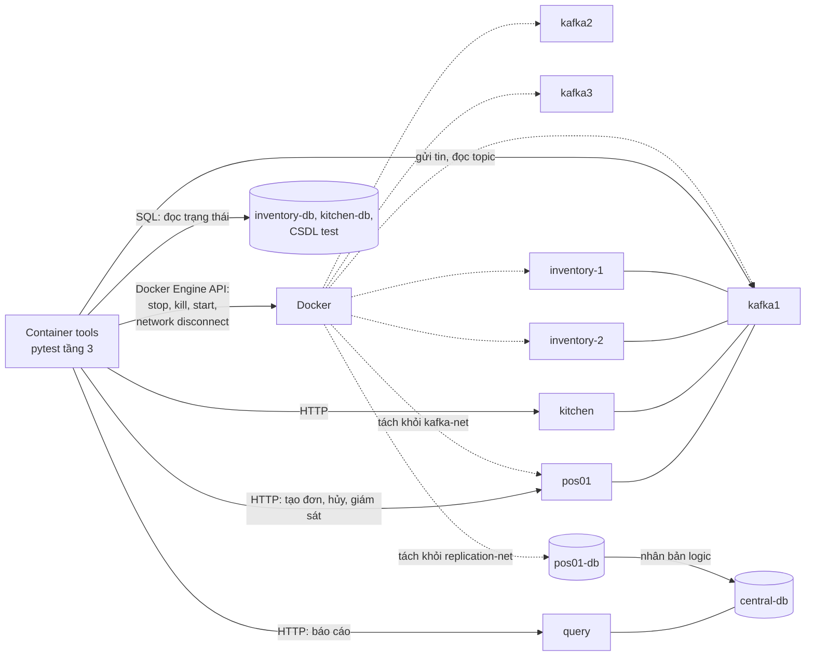

# PHẦN IV. THỬ NGHIỆM VÀ ĐÁNH GIÁ HỆ THỐNG

## I. KIỂM THỬ HỆ THỐNG

### 1. Kịch bản kiểm thử

Đặc tả nghiệp vụ quy định 44 kịch bản bắt buộc. Mỗi kịch bản có ít nhất một test tự động, gắn nhãn `kb(<số kịch bản>)`, chạy ở một trong ba tầng:

| Tầng | Cách chạy |
|---|---|
| Tầng 1 | Gọi trực tiếp handler trên PostgreSQL thật, theo đúng thứ tự tin mà kịch bản mô tả |
| Tầng 2 | Tranh chấp: hai luồng trên hai kết nối cùng lúc, lặp nhiều lần (100 lần mỗi kịch bản) |
| Tầng 3 | Trên cụm Docker Compose đang chạy: Kafka thật, dừng hoặc kill container, cắt mạng, nhân bản |

Không dùng mock thay cho PostgreSQL hay Kafka. Bảng dưới đây sinh từ lần chạy test gần nhất (`backend/scripts/report_tests.py`):

<!-- include: generated/kiem-thu.md -->

### 2. Báo cáo tổng hợp kết quả kiểm thử

#### 2.1. Mục đích kiểm thử

Thực hiện kiểm thử hệ thống đặt món phân tán đáp ứng các nội dung kiểm thử bao gồm:

- Kiểm thử chức năng, trong đó có tính phân tán: mô hình và kịch bản kiểm thử tính phân tán của hệ thống, khả năng chịu lỗi và phục hồi (mục "Mô hình kiểm thử tính phân tán" dưới đây).
- Kiểm thử hiệu năng: mức độ sử dụng tài nguyên và khả năng đáp ứng khi nhiều người dùng đồng thời (mục 2.4.2).

##### Mô hình kiểm thử tính phân tán

Test tầng 3 chạy trong container `tools`, nối vào cùng các mạng Docker với các dịch vụ. Test tự gây lỗi qua Docker Engine API (dừng, kill, bật lại container; tách một container khỏi mạng `kafka-net` hoặc `replication-net`), giống lệnh `bin/chaos` dùng khi demo bằng tay, rồi kiểm tra trạng thái trong CSDL, tin trên Kafka và câu trả lời của API.

| Kịch bản | Lỗi gây ra | Cách gây | Kiểm tra | Kết quả |
|---|---|---|---|---|
| 26 | Tiến trình consumer chết sau khi commit DB, trước khi commit offset | Chạy consumer ở tiến trình riêng, dừng bằng `os._exit` đúng giữa hai bước | Kafka gửi lại tin; `processed_events` chặn bản trùng; kho chỉ trừ một lần | Đạt |
| 29 | Tin có `event_type` lạ hoặc `schema_version` cao hơn mức hỗ trợ | Gửi tin hỏng xen giữa hai đơn hợp lệ trên cùng partition | Tin vào `dlq`, đơn bị đánh dấu `CAN_KIEM_TRA`, hai đơn kia vẫn được giữ nguyên liệu | Đạt |
| 31 | Broker đang làm leader bị kill khi đang gửi tin | `kill` (SIGKILL) container leader của partition trong lúc outbox relay đang gửi | Không mất tin nào Kafka đã xác nhận; gửi vẫn tiếp tục; partition có leader mới | Đạt (3 lần liên tiếp) |
| 4 | Kho ngừng hoạt động khi Bếp từ chối phiếu | Dừng mọi instance Inventory, từ chối phiếu qua API của Bếp, bật lại Kho | Chi nhánh nhận Đã hủy ngay; Kho hoàn kho đúng một lần khi bật lại | Đạt |
| 3, 51, 52 | Hai thao tác tranh nhau trên cùng một phiếu | Hai kết nối, lặp 60–100 lần, có Kho thật nhận lệnh của Bếp | Đúng một thao tác thắng; Kho rời trạng thái Đang giữ đúng một lần theo bên thắng | Đạt |
| 24 | Định tuyến theo chi nhánh | Gửi đơn thật vào `order-events.POS01` | Bếp nhận qua `kitchen-orders`; chỉ POS01 nhận trạng thái | Đạt |
| 25 | Bếp ngừng hoạt động trong khi đơn và yêu cầu hủy vẫn đến | Dừng container `kitchen`, gửi 10 đơn và 5 yêu cầu hủy (có cái trước, có cái sau đơn của nó), bật lại | Mọi đơn đến đúng trạng thái theo bảng 3.2; mỗi đơn bị hủy có đúng một lệnh hoàn kho và một Đã hủy; Kho hoàn kho đủ | Đạt |
| 10 | Chi nhánh mất mạng, thu ngân tạo đơn rồi hủy | Tách container `pos01` khỏi `kafka-net`, tạo hai đơn qua API của `pos01`, hủy một đơn, nối mạng lại | Đơn bị hủy đóng `DA_HUY` ngay (200), không có tin nào của đơn đó trên `order-events.POS01`, Kho và Bếp không có bản ghi; đơn còn lại được gửi và lên Đã giữ | Đạt |
| 36 | Chi nhánh mất mạng sau khi đã gửi đơn; Bếp bắt đầu nấu trước khi yêu cầu hủy tới | Đơn lên Đã giữ, tách `pos01` khỏi `kafka-net`, bấm hủy (202), Bếp bấm Bắt đầu nấu, nối mạng lại, Bếp bấm Hoàn tất | Chi nhánh hiện "Không hủy được: bếp đã bắt đầu nấu", đơn đi tiếp tới Hoàn tất, Kho ghi nguyên liệu đã dùng, không hoàn kho | Đạt |
| 12 | Gửi lỗi nhiều lần sau khi đã thử gửi | Hàng chờ của chi nhánh gửi tới một topic mà broker chưa có (thăm dò vẫn thành công nên mục được đặt cờ), lặp nhiều vòng, rồi tạo topic | Không mục nào bị bỏ; mục hủy không đi trước mục tạo đơn; khi gửi được thì đủ mọi mục, đúng thứ tự theo đơn; đơn khác không bị chặn | Đạt |
| 31 (chi nhánh) | Broker đang làm leader bị kill khi chi nhánh đang gửi đơn | `kill` (SIGKILL) container leader trong lúc đơn mới liên tục được tạo và hàng chờ của chi nhánh đang gửi | Mọi mục Kafka đã xác nhận đều đọc lại được; gửi vẫn tiếp tục với broker còn lại | Đạt |
| 28, 42 | Hai instance cùng xử lý một đơn | Hai kết nối CSDL chạy song song, lặp 100 lần (bước 7 bổ sung bản chạy hai instance thật trên Kafka) | Chỉ một bản ghi, kết quả đúng bảng 3.2 dù tin nào đến trước (28); đúng một đơn được giữ, kho không âm (42) | Đạt |
| 1 | Yêu cầu hủy tới Bếp trước đơn (kịch bản demo) | Dừng mọi instance Inventory, tạo đơn ở `pos01` và hủy qua API; bật lại Kho | Bếp có bản ghi Hủy chờ đơn và chi nhánh hiện "Bếp sẽ không nấu"; khi Kho chạy lại: không có phiếu, đơn `DA_HUY`, mọi dòng giữ `DA_HOAN`, tồn kho trở về đúng như trước | Đạt |
| 3 | Hủy và Bắt đầu nấu cùng lúc (kịch bản demo) | Bấm hủy ở `pos01` và Bắt đầu nấu ở Bếp cùng lúc, nút Bếp lệch 0–0,6 giây, 5 vòng | Mỗi vòng đúng một bên thắng và ba phía cùng kết cục: hủy thắng thì Bếp, chi nhánh `DA_HUY` và Kho hoàn kho; nấu thắng thì chi nhánh hiện "Không hủy được", Kho ghi đã dùng, đơn tới `HOAN_TAT`. Một lần chạy ra cả hai kết cục | Đạt |
| 42 (hai instance thật) | Hai đơn cùng lúc tới hai instance Inventory, cùng cần một nguyên liệu chỉ đủ cho một đơn | Chọn trước hai `order_id` rơi vào hai partition khác nhau của `order-events.POS01` (CRC32 của key), gửi cùng lúc; `inventory-1` và `inventory-2` cùng một nhóm consumer; 5 vòng mỗi lần chạy | Log của mỗi instance cho thấy nó xử lý đúng một đơn, từ partition của mình; đúng một đơn `DANG_GIU`, đơn kia `THAT_BAI` và không có dòng giữ nào; tồn kho không âm; hai bất biến của Kho đúng | Đạt (3 lần liên tiếp) |
| 55 | Cắt nhân bản từ POS01 về Central Order Replica trong khi POS01 và POS02 vẫn nhận đơn | Tách `pos01-db` khỏi mạng `replication-net`, tạo hai đơn ở mỗi chi nhánh, chờ ba nhịp `replication_heartbeat` của POS02, nối mạng lại | Trong lúc cắt: `GET /reports/summary` vẫn trả lời; mốc "dữ liệu tính đến" của POS01 đứng yên, của POS02 vẫn chạy; đơn mới của POS01 chưa có ở `central-db`, đơn của POS02 đã có. Sau khi nối lại: số liệu POS01 trong báo cáo khớp với CSDL của chi nhánh | Đạt (3 lần liên tiếp) |

#### 2.2. Công cụ kiểm thử

Quá trình kiểm thử sử dụng kiểm thử hộp đen ở mức dịch vụ (gửi tin, gọi API, đọc CSDL) với các công cụ sau:

| Hoạt động | Công cụ | Nhà cung cấp | Phiên bản |
|---|---|---|---|
| Kiểm thử chức năng, tính phân tán | pytest | pytest-dev (nguồn mở) | 9.2.0 |
| | Python | Python Software Foundation | 3.12.13 |
| | confluent-kafka (client Kafka trong test) | Confluent (nguồn mở) | 2.16.1 |
| | Docker Engine API (gây lỗi) | Docker | 28.4.0 |
| Kiểm thử giao diện | Vitest, Testing Library, MSW | nguồn mở | theo `frontend/package-lock.json` |
| Kiểm thử hiệu năng | Apache JMeter (trong container, trên Java 21 của Eclipse Temurin) | Apache Software Foundation | 5.6.3 |

#### 2.3. Môi trường kiểm thử

Toàn bộ hệ thống chạy trên một máy, bằng Docker Compose; không có máy chủ riêng.

| STT | Hệ thống | Tên máy chủ | Địa chỉ IP | Cấu hình máy chủ | Phần mềm cài đặt |
|---|---|---|---|---|---|
| 1 | Hệ thống đặt món phân tán (21 container: 3 broker Kafka, 7 container dịch vụ, 7 PostgreSQL, giao diện, công cụ) | Máy phát triển (macOS 13.7) | 127.0.0.1; các container trong mạng Docker riêng | Intel Core i9-9880H, 16 luồng, 16 GB RAM; Docker được cấp 4 CPU và 5,8 GB RAM | Docker Desktop 28.4.0, Docker Compose 2.39.4; image: `apache/kafka:4.3.2`, `postgres:16.14`, `python:3.12.13-slim-bookworm`, `node:24.22.1-bookworm-slim` |

Mức tài nguyên khi hệ thống chạy không tải: khoảng 2,5 GB RAM với cấu hình rút gọn, 3,1 GB với đủ 21 container (mục 6 của `docs/03-implementation-plan.md`).

#### 2.4. Kết quả kiểm thử, đánh giá

##### 2.4.1. Đánh giá chức năng

Bảng tổng hợp ở cuối mục 1 (kịch bản đạt, lỗi, chưa kiểm thử) sinh từ lần chạy test gần nhất.

##### 2.4.2. Kết quả kiểm thử hiệu năng

Apache JMeter 5.6.3 chạy trong container `jmeter` trên mạng `api-net` (mạng mà giao diện dùng), gọi thẳng API của các dịch vụ bằng tên dịch vụ. Kế hoạch tải nằm ở `perf/plan.jmx`; lệnh `bin/perf` chạy toàn bộ: nhập thêm kho cho món dùng trong test, chạy tải, ghi `docker stats` trong lúc chạy, đo thời gian một đơn đi trọn đường, rồi sinh bảng kết quả `report/generated/hieu-nang.md`.

**Các chức năng được kiểm thử.**

| STT | Chức năng | API | Dịch vụ |
|---|---|---|---|
| 1 | Tạo đơn (món Trà đá, 1 phần) | `POST /orders` | POS01 |
| 2 | Xem danh mục món | `GET /dishes` | POS01 |
| 3 | Xem danh sách đơn (200 đơn gần nhất) | `GET /orders` | POS01 |
| 4 | Xem danh sách phiếu bếp | `GET /tickets` | Kitchen |
| 5 | Xem tồn kho | `GET /stock` | Inventory (hai instance) |
| 6 | Xem báo cáo tổng hợp | `GET /reports/summary` | Order Query Service |

**Trường hợp kiểm thử.** Mỗi chức năng chịu 250 người dùng đồng thời (khởi động trong 1 giây, mỗi người gửi một yêu cầu); các chức năng được chạy lần lượt, chức năng sau bắt đầu khi chức năng trước xong, nên mỗi bảng số đo chỉ thuộc về một chức năng. Tổng cộng 1.500 yêu cầu. Vai trò: thu ngân (1–3), nhân viên bếp (4), nhân viên kho (5), quản lý (6).

**Hai lỗi kiểm thử hiệu năng tìm ra.** Lần chạy đầu tiên có 47 % yêu cầu lỗi (HTTP 500) ở cả sáu chức năng. Nguyên nhân: mỗi yêu cầu HTTP tự mở một kết nối PostgreSQL mới, nên 250 yêu cầu cùng lúc vượt giới hạn 100 kết nối của PostgreSQL ("too many clients already"). Cách sửa thứ nhất là dùng pool kết nối giới hạn 10 kết nối cho mỗi tiến trình dịch vụ (`psycopg_pool`). Lần chạy thứ hai còn tệ hơn: phần lớn yêu cầu hết 60 giây chờ. FastAPI chạy phần lấy kết nối trong threadpool 40 luồng; các yêu cầu đang chờ pool chiếm hết 40 luồng, nên 10 yêu cầu đã có kết nối không còn luồng để chạy tiếp, và tất cả kẹt cho tới khi hết thời gian chờ. Cách sửa thứ hai là cho yêu cầu chờ trên một semaphore bất đồng bộ (không chiếm luồng) trước khi lấy kết nối, nên số yêu cầu vào tới threadpool để lấy kết nối không bao giờ vượt kích thước pool. Cả hai tình huống đều có test tự động tái hiện (`backend/common/tests/test_api.py`). Sau hai lần sửa, kết quả như dưới đây.

**Kết quả.** Không có yêu cầu nào lỗi. `GET /tickets` chậm nhất vì lúc đo Bếp có 556 phiếu Chờ nấu (250 phiếu do chính bài tải tạo ra, phần còn lại do các lần kiểm thử trước để lại): mỗi câu trả lời nặng khoảng 214 KB và mất khoảng 0,36 giây khi chạy một mình, rồi 250 yêu cầu chia nhau 10 kết nối của Bếp. Thời gian một đơn đi trọn đường từ lúc tạo tới khi chi nhánh thấy Đã giữ, khoảng 0,2 giây, không đổi so với lúc không tải. Khi chạy tải, toàn cụm dùng khoảng 3,1 GB bộ nhớ, gần như bằng lúc không tải; CPU tăng chủ yếu ở dịch vụ đang bị gọi và CSDL của nó.

Bảng dưới đây sinh từ lần chạy `bin/perf` gần nhất:

<!-- include: generated/hieu-nang.md -->
