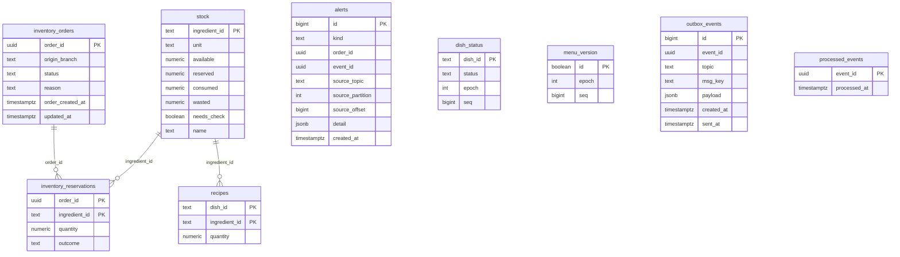
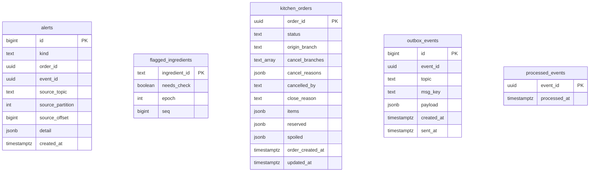
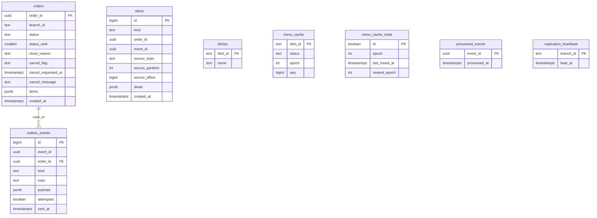
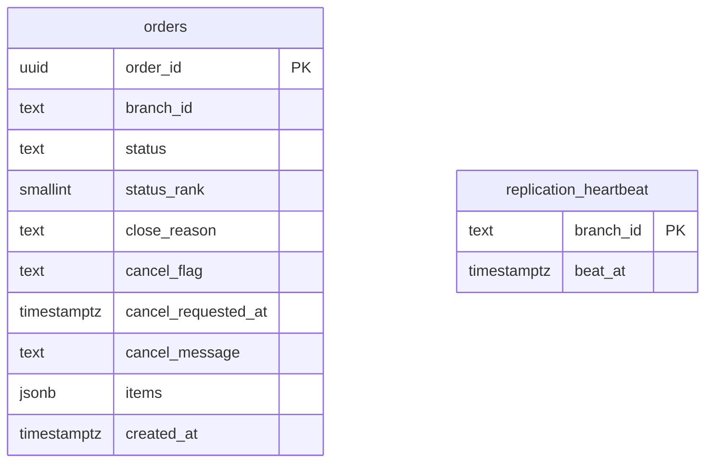

<!-- Sinh tự động bởi backend/scripts/report_schema.py từ các CSDL đang chạy. Không sửa tay: chạy lại script sau mỗi migration. -->

##### Inventory DB

Nguồn: CSDL `inventory-db` đang chạy.

###### Bảng `alerts`

| Field | Type | Null | Key | Default | Extra |
|---|---|---|---|---|---|
| id | BIGINT |  | PRI |  | auto_increment |
| kind | TEXT |  | UNI |  | CHECK ((kind = ANY (ARRAY['CAN_KIEM_TRA'::text, 'LENH_KHONG_KHOP'::text, 'HUY_SAI_CHI_NHANH'::text]))) |
| order_id | UUID | YES |  |  |  |
| event_id | UUID | YES |  |  |  |
| source_topic | TEXT |  | UNI |  |  |
| source_partition | INT |  | UNI |  |  |
| source_offset | BIGINT |  | UNI |  |  |
| detail | JSONB |  |  | '{}'::jsonb |  |
| created_at | TIMESTAMPTZ |  |  | now() |  |

###### Bảng `dish_status`

| Field | Type | Null | Key | Default | Extra |
|---|---|---|---|---|---|
| dish_id | TEXT |  | PRI |  |  |
| status | TEXT |  |  |  | CHECK ((status = ANY (ARRAY['CON'::text, 'HET'::text, 'AN'::text]))) |
| epoch | INT |  |  |  |  |
| seq | BIGINT |  |  |  |  |

###### Bảng `inventory_orders`

| Field | Type | Null | Key | Default | Extra |
|---|---|---|---|---|---|
| order_id | UUID |  | PRI |  |  |
| origin_branch | TEXT |  |  |  |  |
| status | TEXT |  |  |  | CHECK ((status = ANY (ARRAY['DANG_GIU'::text, 'THAT_BAI'::text, 'DA_TRA'::text, 'DA_DUNG'::text]))) |
| reason | TEXT | YES |  |  |  |
| order_created_at | TIMESTAMPTZ | YES |  |  |  |
| updated_at | TIMESTAMPTZ |  |  | now() |  |

###### Bảng `inventory_reservations`

| Field | Type | Null | Key | Default | Extra |
|---|---|---|---|---|---|
| order_id | UUID |  | PRI, FK → inventory_orders.order_id |  |  |
| ingredient_id | TEXT |  | PRI, FK → stock.ingredient_id |  |  |
| quantity | NUMERIC(12,3) |  |  |  | CHECK ((quantity > (0)::numeric)) |
| outcome | TEXT | YES |  |  | CHECK ((outcome = ANY (ARRAY['DA_HOAN'::text, 'DA_DUNG'::text, 'HAO_HUT'::text]))) |

###### Bảng `menu_version`

| Field | Type | Null | Key | Default | Extra |
|---|---|---|---|---|---|
| id | BOOLEAN |  | PRI | true | CHECK (id) |
| epoch | INT |  |  |  |  |
| seq | BIGINT |  |  |  |  |

###### Bảng `outbox_events`

| Field | Type | Null | Key | Default | Extra |
|---|---|---|---|---|---|
| id | BIGINT |  | PRI |  | auto_increment |
| event_id | UUID |  | UNI |  |  |
| topic | TEXT |  |  |  |  |
| msg_key | TEXT |  |  |  |  |
| payload | JSONB |  |  |  |  |
| created_at | TIMESTAMPTZ |  |  | now() |  |
| sent_at | TIMESTAMPTZ | YES |  |  |  |

###### Bảng `processed_events`

| Field | Type | Null | Key | Default | Extra |
|---|---|---|---|---|---|
| event_id | UUID |  | PRI |  |  |
| processed_at | TIMESTAMPTZ |  |  | now() |  |

###### Bảng `recipes`

| Field | Type | Null | Key | Default | Extra |
|---|---|---|---|---|---|
| dish_id | TEXT |  | PRI |  |  |
| ingredient_id | TEXT |  | PRI, FK → stock.ingredient_id |  |  |
| quantity | NUMERIC(12,3) |  |  |  | CHECK ((quantity > (0)::numeric)) |

###### Bảng `stock`

| Field | Type | Null | Key | Default | Extra |
|---|---|---|---|---|---|
| ingredient_id | TEXT |  | PRI |  |  |
| unit | TEXT |  |  |  |  |
| available | NUMERIC(12,3) |  |  |  | CHECK ((available >= (0)::numeric)) |
| reserved | NUMERIC(12,3) |  |  | 0 | CHECK ((reserved >= (0)::numeric)) |
| consumed | NUMERIC(12,3) |  |  | 0 |  |
| wasted | NUMERIC(12,3) |  |  | 0 |  |
| needs_check | BOOLEAN |  |  | false |  |
| name | TEXT |  |  | ''::text |  |

##### Kitchen DB

Nguồn: CSDL `kitchen-db` đang chạy.

###### Bảng `alerts`

| Field | Type | Null | Key | Default | Extra |
|---|---|---|---|---|---|
| id | BIGINT |  | PRI |  | auto_increment |
| kind | TEXT |  | UNI |  | CHECK ((kind = ANY (ARRAY['CAN_KIEM_TRA'::text, 'LENH_KHONG_KHOP'::text, 'HUY_SAI_CHI_NHANH'::text]))) |
| order_id | UUID | YES |  |  |  |
| event_id | UUID | YES |  |  |  |
| source_topic | TEXT |  | UNI |  |  |
| source_partition | INT |  | UNI |  |  |
| source_offset | BIGINT |  | UNI |  |  |
| detail | JSONB |  |  | '{}'::jsonb |  |
| created_at | TIMESTAMPTZ |  |  | now() |  |

###### Bảng `flagged_ingredients`

| Field | Type | Null | Key | Default | Extra |
|---|---|---|---|---|---|
| ingredient_id | TEXT |  | PRI |  |  |
| needs_check | BOOLEAN |  |  |  |  |
| epoch | INT |  |  |  |  |
| seq | BIGINT |  |  |  |  |

###### Bảng `kitchen_orders`

| Field | Type | Null | Key | Default | Extra |
|---|---|---|---|---|---|
| order_id | UUID |  | PRI |  |  |
| status | TEXT |  |  |  | CHECK ((status = ANY (ARRAY['CHUA_CO'::text, 'HUY_CHO_DON'::text, 'CHO_NAU'::text, 'DANG_NAU'::text, 'HOAN_TAT'::text, 'DA_HUY'::text, 'THAT_BAI'::text]))) |
| origin_branch | TEXT | YES |  |  |  |
| cancel_branches | TEXT[] |  |  | '{}'::text[] |  |
| cancel_reasons | JSONB |  |  | '{}'::jsonb |  |
| cancelled_by | TEXT | YES |  |  | CHECK ((cancelled_by = ANY (ARRAY['CUSTOMER'::text, 'KITCHEN'::text]))) |
| close_reason | TEXT | YES |  |  |  |
| items | JSONB | YES |  |  |  |
| reserved | JSONB | YES |  |  |  |
| spoiled | JSONB | YES |  |  |  |
| order_created_at | TIMESTAMPTZ | YES |  |  |  |
| updated_at | TIMESTAMPTZ |  |  | now() |  |

###### Bảng `outbox_events`

| Field | Type | Null | Key | Default | Extra |
|---|---|---|---|---|---|
| id | BIGINT |  | PRI |  | auto_increment |
| event_id | UUID |  | UNI |  |  |
| topic | TEXT |  |  |  |  |
| msg_key | TEXT |  |  |  |  |
| payload | JSONB |  |  |  |  |
| created_at | TIMESTAMPTZ |  |  | now() |  |
| sent_at | TIMESTAMPTZ | YES |  |  |  |

###### Bảng `processed_events`

| Field | Type | Null | Key | Default | Extra |
|---|---|---|---|---|---|
| event_id | UUID |  | PRI |  |  |
| processed_at | TIMESTAMPTZ |  |  | now() |  |

##### Branch DB (POS01, POS02, ONLINE)

Nguồn: CSDL `pos01-db` đang chạy.

###### Bảng `alerts`

| Field | Type | Null | Key | Default | Extra |
|---|---|---|---|---|---|
| id | BIGINT |  | PRI |  | auto_increment |
| kind | TEXT |  | UNI |  | CHECK ((kind = 'CAN_KIEM_TRA'::text)) |
| order_id | UUID | YES |  |  |  |
| event_id | UUID | YES |  |  |  |
| source_topic | TEXT |  | UNI |  |  |
| source_partition | INT |  | UNI |  |  |
| source_offset | BIGINT |  | UNI |  |  |
| detail | JSONB |  |  | '{}'::jsonb |  |
| created_at | TIMESTAMPTZ |  |  | now() |  |

###### Bảng `dishes`

| Field | Type | Null | Key | Default | Extra |
|---|---|---|---|---|---|
| dish_id | TEXT |  | PRI |  |  |
| name | TEXT |  |  |  |  |

###### Bảng `menu_cache`

| Field | Type | Null | Key | Default | Extra |
|---|---|---|---|---|---|
| dish_id | TEXT |  | PRI |  |  |
| status | TEXT |  |  |  | CHECK ((status = ANY (ARRAY['CON'::text, 'HET'::text, 'AN'::text]))) |
| epoch | INT |  |  |  |  |
| seq | BIGINT |  |  |  |  |

###### Bảng `menu_cache_meta`

| Field | Type | Null | Key | Default | Extra |
|---|---|---|---|---|---|
| id | BOOLEAN |  | PRI | true | CHECK (id) |
| epoch | INT |  |  |  |  |
| last_heard_at | TIMESTAMPTZ | YES |  |  |  |
| newest_epoch | INT |  |  | 0 |  |

###### Bảng `orders`

| Field | Type | Null | Key | Default | Extra |
|---|---|---|---|---|---|
| order_id | UUID |  | PRI |  |  |
| branch_id | TEXT |  |  |  |  |
| status | TEXT |  |  |  | CHECK ((status = ANY (ARRAY['CHO_KHO'::text, 'DA_GIU'::text, 'HOAN_TAT'::text, 'DA_HUY'::text, 'THAT_BAI'::text]))) |
| status_rank | SMALLINT |  |  | 0 |  |
| close_reason | TEXT | YES |  |  |  |
| cancel_flag | TEXT |  |  | 'KHONG'::text | CHECK ((cancel_flag = ANY (ARRAY['KHONG'::text, 'DANG_YEU_CAU'::text, 'BEP_KHONG_NAU'::text]))) |
| cancel_requested_at | TIMESTAMPTZ | YES |  |  |  |
| cancel_message | TEXT | YES |  |  |  |
| items | JSONB |  |  |  |  |
| created_at | TIMESTAMPTZ |  |  |  |  |

###### Bảng `outbox_events`

| Field | Type | Null | Key | Default | Extra |
|---|---|---|---|---|---|
| id | BIGINT |  | PRI |  | auto_increment |
| event_id | UUID |  | UNI |  |  |
| order_id | UUID |  | FK → orders.order_id |  |  |
| kind | TEXT |  |  |  | CHECK ((kind = ANY (ARRAY['TAO_DON'::text, 'HUY'::text]))) |
| topic | TEXT |  |  |  |  |
| payload | JSONB |  |  |  |  |
| attempted | BOOLEAN |  |  | false |  |
| sent_at | TIMESTAMPTZ | YES |  |  |  |

###### Bảng `processed_events`

| Field | Type | Null | Key | Default | Extra |
|---|---|---|---|---|---|
| event_id | UUID |  | PRI |  |  |
| processed_at | TIMESTAMPTZ |  |  | now() |  |

###### Bảng `replication_heartbeat`

| Field | Type | Null | Key | Default | Extra |
|---|---|---|---|---|---|
| branch_id | TEXT |  | PRI |  |  |
| beat_at | TIMESTAMPTZ |  |  |  |  |

##### Central Order Replica

Nguồn: CSDL `central-db` đang chạy.

###### Bảng `orders`

| Field | Type | Null | Key | Default | Extra |
|---|---|---|---|---|---|
| order_id | UUID |  | PRI |  |  |
| branch_id | TEXT |  |  |  |  |
| status | TEXT |  |  |  | CHECK ((status = ANY (ARRAY['CHO_KHO'::text, 'DA_GIU'::text, 'HOAN_TAT'::text, 'DA_HUY'::text, 'THAT_BAI'::text]))) |
| status_rank | SMALLINT |  |  | 0 |  |
| close_reason | TEXT | YES |  |  |  |
| cancel_flag | TEXT |  |  | 'KHONG'::text | CHECK ((cancel_flag = ANY (ARRAY['KHONG'::text, 'DANG_YEU_CAU'::text, 'BEP_KHONG_NAU'::text]))) |
| cancel_requested_at | TIMESTAMPTZ | YES |  |  |  |
| cancel_message | TEXT | YES |  |  |  |
| items | JSONB |  |  |  |  |
| created_at | TIMESTAMPTZ |  |  |  |  |

###### Bảng `replication_heartbeat`

| Field | Type | Null | Key | Default | Extra |
|---|---|---|---|---|---|
| branch_id | TEXT |  | PRI |  |  |
| beat_at | TIMESTAMPTZ |  |  |  |  |

